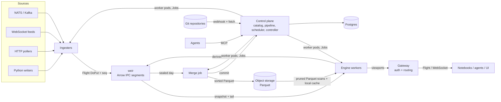
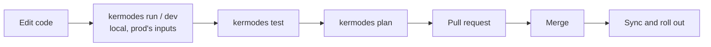
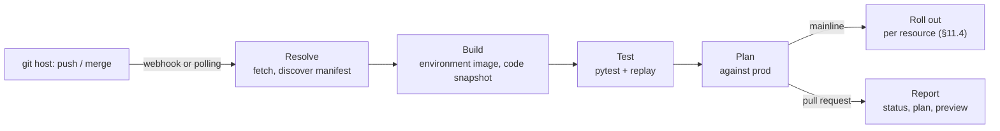

# Kermodes architecture

Status: direction. These are ideals, not hard rules: much of it runs today, the rest is where it
is heading, and the code corrects this document as it teaches us. "Writing a novel is like
driving a car at night. You can see only as far as your headlights, but you can make the whole
trip that way." (E. L. Doctorow)

The engine's first milestone is designed in more detail in [engine.md](engine.md).

Kermodes is a cloud-native data platform where live and historical data share one table model.
A real-time incremental engine, a columnar ingest log, a Parquet lake, a job scheduler, a model
registry, a feature store, and an agent surface all sit on that model. User code lives in git and
reaches the cluster through a deployment pipeline.

The name: the Kermode bear, or spirit bear, is a rare white black bear found only in British
Columbia's Great Bear Rainforest. pandas, then Polars, then Kermodes: `import kermodes as km`.

## 1. Thesis

**A table is a timeline.** Every `namespace.table` has one schema and is reachable as:

- `db.live_table(ns, t)` — intraday, append-only, ticking.
- `db.historical_table(ns, t)` — merged days in the lake, static.
- `db.table(ns, t)` — both, routed by `Date`.

Everything else is a declarative object built on tables: feature views, models, jobs,
ingesters, deployments. The same expression that builds a training set from history runs
incrementally on live data; replaying history through the engine is a backtest.

**Arrow end to end.** Arrow in memory, Arrow Flight on the wire, Arrow IPC for intraday storage,
Parquet for history. One engine evaluates live and historical data with the same operators,
whether the query comes from the table API or SQL. No embedded third-party query engine.

**Git is the source of truth.** Tables, deployments, jobs, feature views, and models are declared
in project repositories on any git host, developed locally against live production data, and
delivered by syncing the mainline: each merged commit is built once and rolled out without
downtime.

## 2. Goals and non-goals

Goals

- Deephaven-style incremental engine with ticking tables and viewport subscriptions.
- kdb+/Deephaven-Enterprise-style data lifecycle: ingest → intraday store → daily merge → lake.
- Scheduled jobs and DAGs with retries, whose state is itself a live table.
- Model registry with models that plug directly into live graphs.
- Feature store with one definition for offline training and online serving.
- Agent-first: every resource is a typed spec with validate → plan → apply.
- Python SDK and Jupyter as the primary human surface.
- Multi-user from the start: OIDC login, namespace RBAC, per-user isolated worker pods.
- Schema changes as first-class, planned operations across live data, history, and dependents.
- Kubernetes-native: Helm install; the controller runs every worker as its own pod.
- Clean local start: `pip install kermodes` (one wheel). No JVM, Docker, or Kubernetes required.
- Continuous integration and delivery for user projects: develop locally, push, and the cluster
  tests, plans, and deploys the commit.
- Small dependency surface: the arrow-rs family for data, plus infrastructure crates.

Non-goals (for now)

- Distributing one update graph across nodes. One deployment = one engine process; scale by
  sharding deployments.
- General incremental SQL (DBSP/differential dataflow). The engine supports a fixed operator set.
- A third-party SQL engine. SQL is a frontend that compiles to the same Kermodes plan as the table
  API (§9.8).
- A custom historical file format. History is Parquet.
- Web UI beyond catalog, table viewer, console, pipelines, jobs, and models until notebooks and
  agents work end to end.

## 3. Prior art mapping

| kdb+ tick | Deephaven Enterprise | Kermodes |
|---|---|---|
| Feedhandler | Logger / Kafka ingester | Ingester (connector) |
| Tickerplant + tplog | Data Import Server (DIS) | **weir** |
| RDB | Worker reading intraday | Engine worker, `db.live_table` |
| RTE / CEP, chained TP | Persistent query | Engine deployment publishing derived live tables back to weir |
| `.u.end` end-of-day writedown | Merge + validate | Daily merge job |
| HDB (splayed, date-partitioned, mmap) | Historical (DH format / Parquet) | Parquet + Kermodes catalog, `db.historical_table` |
| Gateway | Query routing | `db.table` + query router |
| q scripts on disk | Git-integrated persistent query scripts | Project repositories + deployment pipeline (§11) |

Lessons taken from kdb+: keep the ingest hop dumb (append, log, publish — no queries); historical
speed comes from layout (sort by key within date, enumerated keys, parted attribute) more than
from file format.

## 4. Components

| Component | Name | Language | Role |
|---|---|---|---|
| Ingest server | weir | Rust | Accepts ingest protocol, writes Arrow IPC segments, serves snapshot + tail |
| Engine | falls | Rust (library + server) | Incremental and static operators, expressions, Parquet scans, inference, Flight server |
| Merge | — | Rust job | Daily intraday → sorted Parquet → catalog commit |
| Control plane | — | Rust | Catalog, spec API, scheduler, pipeline, Kubernetes controller, registry, audit |
| Scheduler | run | Rust (in control plane) | Cron, DAGs, retries, leases |
| Pipeline | — | Rust (in control plane) | Sync project commits from git; build, test, plan, roll out |
| Model registry | den | Rust (in control plane) | Model versions, aliases, signatures |
| Feature store | forage | Rust + Python SDK | Feature views, point-in-time training sets, online state |
| Agent surface | ranger | Rust | MCP server over the spec API, pipeline, and query surface |
| Gateway | — | Rust | Single authenticated entry point; proxies Flight/WebSocket to worker pods; serves the UI |
| SDK | `kermodes` | Python (+ PyO3 engine module) | Client, local engine, notebook widgets, resource decorators |
| CLI | `kermodes` | Python (`argparse`) over the Rust core | Server roles, local platform, project workflow (`init`, `dev`, `test`, `plan`, `deploy`) |



### 4.1 Dependency policy

Core data path: the arrow-rs family only — `arrow` (array, compute kernels, IPC), `arrow-flight`,
`parquet`, and `object_store` for S3 and local files. One arrow-rs major version across the
workspace.

Infrastructure crates are allowed where writing our own would add risk without value: `tokio`,
`tonic` (via arrow-flight), `postgres` / `tokio-postgres`, `kube`, `ort` (ONNX Runtime), `pyo3` +
`pyo3-arrow`, `openidconnect`, `jsonwebtoken`, `clap`, `serde`, `tracing`/OpenTelemetry.

`sqlparser` is the one parsing dependency: it turns SQL text into an AST and does nothing else (its
only runtime dependency is `log`). Writing and maintaining a SQL grammar ourselves would cost more
than it saves. Its `visitor` feature (a derive macro from the same project) lets the SQL binder
rewrite expressions, dropping table qualifiers, without matching every expression variant.

`ahash` (already compiled in through arrow-array) hashes group keys; using it directly adds no
crate to the build.

`rusqlite` (with SQLite bundled) holds the local catalog: a synchronous, in-process database is
what an embedded store (`km.connect(path)`) and `kermodes dev` need, with no runtime to start. The
cluster's catalog is Postgres, shared by every weir, through the rust-postgres family: weir's
catalog calls are synchronous (made under the store's locks), which its `postgres` client is, and
the async control plane uses `tokio-postgres` from the same family; `sqlx` would be async-only and
bring compile-time query macros nothing here needs. Both catalogs hold the same rows and pass one
test suite. `crc32fast` checks weir's index records, so recovery can tell a committed record from
one a crash cut short.

`mimalloc` is the Python extension's global allocator. The system allocators keep freed memory
resident (macOS keeps large freed blocks cached; glibc keeps freed memory in its heaps), so a
long-lived process's footprint follows its high-water mark, the usual reason data processes get
OOM-killed in containers. mimalloc reuses freed memory while work runs, and the engine has it
return what is free whenever it goes idle (`engine.md` §4), at no measured cost to cycle times.
Polars ships a tuned jemalloc for the same reason.

`axum` (hyper, with tokio-tungstenite for WebSocket) serves HTTP and WebSocket for the gateway:
today the local server behind `Session.serve`, later the cluster gateway. HTTP and WebSocket
protocol handling written ourselves would be risk without value. `serde_json` reads and writes
the web app's JSON messages. The WebSocket connector is a tokio-tungstenite client, the same
crate axum's WebSocket is, and decodes JSON records with `arrow-json` straight into Arrow
columns.

raft-rs (TiKV's port of etcd's raft) is vendored as `crates/kermodes-raft` for weir's replication
(§7.6): a consensus core proven at scale is less risk than one of our own, and it is a pure state
machine, which the simulator drives. Vendored rather than a git dependency because its messages
come from protobuf (rust-protobuf 2, flagged by RUSTSEC-2024-0437, or prost 0.11 with `protoc` at
build time); here they are written out with their wire encoding, and the rest is upstream's as
it is (its README lists every difference). It brings `slog` (core only, no dependencies) for
upstream's log statements, `rustc-hash`, `rand`, and `thiserror`.

No embedded query engines (DataFusion, DuckDB, Polars). A new data-path dependency needs a written
reason in this section.

## 5. Data model

### 5.1 Tables and schemas

- A table is named `namespace.table` and is owned by exactly one project (§11), which declares
  it. Other projects read it. Names have two levels, lowercase `[a-z][a-z0-9_]*`; `sys` is
  reserved.
- The catalog keys a table by **branch** and name (§10.1) and gives it a stable table ID. Names
  are labels, as column names are (§5.4): renaming a table or moving it to another namespace
  changes the catalog, not the data.
- A table's storage location is fixed when it is created, from its branch, name, and ID
  (`{branch}/{namespace}/{table}.{id}`), and recorded in the catalog. weir and the lake use it;
  nothing derives a path from a name.
- Schemas are Arrow schemas with stable column IDs, versioned in the catalog. Live and historical
  share the schema history. Changes are planned operations (§5.4).
- Column partition: `Date` (UTC, string `YYYY-MM-DD`), assigned from **ingest time**, not event
  time. This makes a day's partition closable at a fixed wall-clock moment. Late events land in the
  partition of the day they arrived.
- Internal partition: one per ingest source (`source_id`). Each internal partition has exactly one
  writer.
- Event time is an optional designated column per table (`ts_column`), used by as-of joins,
  windows, and replay.

### 5.2 Table kinds

| Kind | Stored | Semantics |
|---|---|---|
| append | weir → lake | Default. Rows are never modified or removed. |
| keyed | weir → lake | One row per key, like a key-value bucket: writes upsert or delete by the table's key columns, and readers get every key's latest value, then each change. State carries across days (§7.3). |
| blink | no | Only the current cycle's rows are visible; for high-rate transient signals. |
| derived | optional | Engine output. May be published back to weir as a keyed table (`publish(name, table, key=...)`): its rows replace the stored table's when publishing starts, so a restart leaves no stale keys, then each cycle's changes follow as deletes and upserts. One publication per table, holding the `publish` source's lease. Later: publishing to an append table, which needs its own exactly-once design across restarts. |
| input | engine memory | As in Deephaven: append-only, or keyed (one row per key; upserts replace, deletes remove). Written from code or edited by hand in the UI. |

A keyed table's key columns are declared when it is created and fixed for its life. Ingested
mutable data (upserts, CDC, order books from a feed) goes to keyed tables; weir stores each change
as written and never mutates a row, so a keyed table's history is its log of changes.
`changes(name)` is that log for today, ticking: the latest checkpoint, then each change after it.

### 5.3 Access API

```python
db = km.connect()  # $KERMODES_URL, else kermodes dev; or a directory, or ":memory:"

odds = db.live_table("sports.odds")  # unmerged intraday partitions, ticking
hist = db.historical_table("sports.odds")  # merged dates, static
full = db.table("sports.odds")  # historical ∪ live, disjoint by Date
```

`db.live_table` contains every intraday partition not yet merged; callers usually filter
`.where("Date = today()")`. `db.table` partitions dates by catalog state: dates committed to the
lake come from history, the rest from weir. When a merge commits, the date moves from live to
historical at a cycle boundary; the rows are identical, so downstream sees no change.

### 5.4 Schema evolution

Table schemas are declared in the owning project. Changing one is a code change that goes through
the pipeline: the plan classifies it, and rolling out the commit applies the change. A change the
plan does not class as compatible waits for an explicit rollout (§11.4).

```python
odds = km.table(
    "sports.odds",
    columns={
        "game_id": km.string(),
        "book": km.string(),
        "price": km.float64(was="px"),  # renamed: same column ID
        "size": km.int64(),  # widened from int32
        "venue": km.string(),  # added: rows written before read it as null
    },
    keys=["game_id", "book"],
    ts="ts",
)
```

Declaring a table's columns is a sync: `create_table` (and the table declaration it backs) brings
the stored table to the columns given when that is a compatible change, does nothing when it
already has them, and refuses anything else, naming the change and its class.

Column identity

- Every column has a stable ID, kept in the catalog (§8.2), in each weir segment's schema as
  Arrow field metadata, and in each history file as Parquet `field_id`. Names are labels; data is
  matched by ID everywhere. Data written before IDs existed has its columns' positions as theirs.
- A rename is declared on the column, as the names it had (`km.float64(was="px")`, or the spec
  `"float64 was px"` in a project file): it keeps the column's ID rather than reading as a drop
  and an add. Renames are never inferred, and `was` can stay in the declaration for good.

Change classes, determined by `plan`

| Change | Class | Effect |
|---|---|---|
| Add column | compatible | Applies at once. Older segments and files read it as null. |
| Widen type (int32 → int64 or float64, the lossless ones) | compatible | Cast on read. |
| Rename column | compatible | Metadata only. Dependents referencing the old name are reported and must change in the same commit or a dependent project's next commit. |
| Drop column | contract | Refused for now. Later: hidden from reads immediately; stored data kept until an explicit purge job. |
| Incompatible type change, recomputed values | rewrite | Refused for now. Later: backfill DAG with one task per date: rewrite Parquet with a transform expression, commit each date atomically. Resumable. |
| Key or sort columns renamed or retyped; sort keys / layout | rewrite | Refused for now: keys hash and history files sort by them. |

Dependents

- `plan` walks lineage across projects and lists every affected ingester, deployment, feature view,
  and model signature as unaffected, auto-migrated, or must-change.
- A change that would break a feature view or model signature in the same project is rejected
  unless the same commit updates it. Breaking changes to tables other projects read require those
  projects to be compatible first (expand → migrate consumers → contract).
- Consumer contracts: a project declares what it reads from tables other projects own (columns,
  types, and optionally keys and freshness) under `[reads]` in `kermodes.toml`. The owner's
  `plan` checks every contract on its tables and fails a change that breaks one, so the producer
  learns before merging, not when a consumer fails in production.

Live data

- A change takes effect when `create_table` applies it. weir closes each partition's open
  segment, so every segment holds one set of columns.
- Readers and writers keep the columns they opened with. weir brings a writer's rows to the
  current columns by ID (nulls for added columns, casts for widened ones), and a reader gets each
  batch in its own columns: added columns are left out until it reads the table again, and a
  rename follows the ID. A reader holding a column that was widened since cannot follow: its table
  fails, saying to read the table again. Producers and tables upgrade independently.
- Deployments pick up new columns when restarted, as a rollout does; hot re-planning for
  compatible changes comes later.

History

- Existing Parquet files are not touched: reads map them to the current columns by `field_id`.
- Merge writes every date in the current columns, rewriting neighbouring files by column ID (§8.3).
- Later, if catalog snapshots are added (§8.2), they keep old columns; reading an old snapshot
  sees them.

## 6. Ingestion

### 6.1 Ingest protocol

Arrow Flight `DoPut`.

- Flight descriptor: a command naming the table and the source. weir assigns the date from the
  batch's ingest time. In the cluster, writers resolve `ns.table` on their branch to a table ID
  and an endpoint once, through `GetFlightInfo` (§17); with one server (`kermodes dev`) the name
  is enough.
- Every record batch carries `app_metadata = seq` (u64, little-endian). `seq` is strictly
  increasing per `(table, date, source_id)`.
- weir acknowledges each batch on the `PutResult` stream once it is durable (fsynced) or dropped:
  the source's last `seq` and whether this batch was written. A writer's call returns only then.
- weir drops batches with `seq <= last_seq`. Resent batches are harmless.
- One writer per source at a time, server-wide, holding the source's lease (§7.4): a second is
  refused, or with `wait` waits, until the first lets go or its connection drops.
- Once it holds the lease, the writer reads the action `last_seq` and resumes the source from
  there. For log-structured sources (NATS JetStream, Kafka) the source offset is the `seq`, so
  connectors keep no state of their own.
- A writer writes the table's columns as they were when it opened (a remote writer: when its
  `DoPut` began); weir brings its rows to the current columns by column ID (§5.4). A new set of
  columns opens new segments.

Fallback for lightweight producers: WebSocket (and HTTP POST) carrying Arrow IPC or JSON rows,
coerced to the table schema by weir, same `seq` semantics.

### 6.2 Ingesters

An ingester is a managed deployment that reads a source and speaks the ingest protocol. It is
declared in a project like any other resource, and its writer's source is named after it.

```python
ticks = km.ingester(
    "ticks",
    target="md.ticks",
    source=km.websocket("wss://feed.example/ticks"),
    columns={"sym": km.string(), "price": km.float64()},  # created if it does not exist
)
```

A source that needs code (parsing, joining reference data) is a deployment holding a writer:
`@km.deployment() def odds(db): ...` with `db.writer("sports.odds", source="odds", wait=True)`.

- Built-in Rust connectors (`kermodes-ingest`): NATS JetStream, Kafka, WebSocket, HTTP poll,
  file drop. Connectors are Tolerant Readers: fields map to columns by name, unknown fields are
  ignored, missing ones are NULL, and an unreadable record is skipped and counted without losing
  its neighbours. Built so far: WebSocket feeds of JSON (an object or an array of them per
  message), flushed every `flush` or `max_rows`, reconnecting with backoff:
  `session.ingest_websocket(url, "md.ticks")` or `kermodes ingest websocket URL --table md.ticks`.
  A raw WebSocket feed is not replayable, so a restarted connector resumes from the feed's
  present. `kermodes demo ticker` (`km.demo.ticker()`) serves a synthetic feed, the same ticks to
  every client, each numbered by `seq`.
- A connector that loses its store (weir restarting, a broken connection) opens its writer
  again once the store is back and writes the batch it was on again; `stats.reopens` counts
  it. With `seq`, a batch the store did commit is dropped as a duplicate; without, it may be
  written twice. Other errors stop it (`stats.failed`).
- A feed that numbers its records is written exactly once across a rolling handover with
  `seq="seq"` (`km.websocket(url, seq="seq")`, `--seq`): the new run reads the feed while the old
  one still writes, and once it holds the source's lease it writes only records numbered above
  the source's last batch, each batch under its highest number (§7.4). `stats.duplicates` counts
  what it dropped, `stats.missed` the numbers no run received (a crash, a lost reconnect), which
  only a replayable source can fill.
- Python connectors use a session's `writer(table, source=...)`, the SDK equivalent of a
  Deephaven logger.
- Batch imports (CSV, API backfills) are ordinary jobs that write either through weir (live) or
  directly into the lake (historical, via the merge writer).

### 6.3 Managed Postgres and change data capture

Transactional workloads (a sportsbook's bets, wallets, and ledger) need ACID writes and one
source of truth for balances; the engine is neither. Kermodes provides them as a managed
resource, separate from the control plane's own Postgres, and brings their changes into the
catalog as live tables.

- A managed database is declared in a project or created in the web UI. The controller provisions
  it on CloudNativePG (a database in a shared cluster, or a cluster of its own), keeps its
  credentials in a Secret, and injects them into the project's services.
- Branches apply: PR previews and local runs get their own database (cloned from prod or built
  from the project's migrations), never prod's.
- A built-in CDC connector reads Postgres logical replication (`pgoutput`): an initial snapshot,
  then every committed change, into keyed live tables (key: the primary key), so `bets` and
  `wallets` tick next to the odds and merge into history like any other table. The source is
  replayable: the connector's position is the replication slot's confirmed LSN, so a restart
  resumes without gaps or duplicates.
- The web UI sets it up: create the database or point at an existing one, choose the tables to
  capture and the catalog namespace, and watch replication lag and slot size.
- A schema change in the source is a planned schema change of the captured table (§5.4).

## 7. weir

### 7.1 Storage

```
{store}/weir/log/                               the shard log (§7.6)
  00000000000000000001.log   segments of entries, preallocated; 256 MiB each
  applied                    the partition files hold every entry up to this LSN
{store}/weir/{location}/{date}/{source_id}/     location = {branch}/{namespace}/{table}.{id} (§5.1)
  seg-000042.arrows     Arrow IPC stream: the segment's batches, derived from the log
  seg-000042.idx        format header, then per batch: seq, rows, ingest time, end offset,
                        epoch, change kind, LSN, CRC
{store}/weir/{location}/@sources               each source's last seq on dates since dropped
```

- Every write goes through the shard log, the only durable copy until the partition files are
  flushed. One committer proposes every write waiting, from every table and producer, to Raft
  (§7.6) as one group and logs Raft's entries under one `fdatasync`; once a quorum of the
  shard's replicas holds them (a shard of one, on its own), it applies them in log order: to the
  partition files (written without an fsync), keyed checkpoints, and subscribers, and only then
  acknowledges each writer. A group waits up to 100 µs for as many writes as the last one held,
  so writers answered together share the next fsync. Log segments are preallocated, so an fsync
  never has to commit the file's growth.
- A writer need not wait for one write before sending the next: `write(..., wait=False)` (in
  Rust, `send`) returns at once with a handle to wait on, and `flush` waits for all of them and
  raises the first that failed. Writes arriving during an fsync share the next, and so a single
  producer is not held to one write per fsync. Up to 64 MiB may be unanswered per writer;
  sending then waits, so a slow store slows its producer instead of filling its memory. Over
  Flight the writes stream without waiting and are acknowledged in order; one the server
  refuses fails, and so does every write sent after it. A stream that breaks (weir restarted, the
  connection dropped) is opened again with backoff, waiting for the source's lease (the server
  holds the old stream's until it notices it gone); the writes it had not acknowledged are
  answered as written up to the source's last `seq`, and the rest resent, so each is written
  once. Writes sent meanwhile wait in the budget. Every break and reconnect is reported: why,
  how long writes waited, how many were resent.
- What is ordered, as Kafka orders a partition: a writer's writes (one source of one table) are
  logged in the order sent; a write sent after another was acknowledged is logged after it; and
  a checkpoint is logged in its place among every write of its table, since it replaces them
  all. Unacknowledged writes of different writers, even one process's writers of two tables,
  may be logged in either order. A producer that needs one table's write to follow another's
  waits for the first (`Pending.wait`, `flush`) before sending the second.
- Each group's writes of one source of a table, of the same change kind and date and not split
  by another change of that source or a checkpoint of the table, are logged as one batch under
  the last one's `seq`, where the last of them was. A resend is recognised by `seq <= last`, so
  the batch stands for every write in it and resending any of them is still dropped; a resend
  and a checkpoint are never merged. Each write is still answered on its own. So producers
  sending many small writes have them batched by the load, Kafka's batching without a linger or
  a batch size to choose: one write alone when it is quiet, thousands under one log entry when
  it is not, however many producers write the table. Readers see each writer's rows in the same
  order in fewer, larger batches (a keyed batch's later row for a key wins).
- A log entry is Raft's: its index (the LSN), its term, and a batch whole in itself (table,
  columns with their IDs as an Arrow IPC schema message, source, `seq`, epoch, change kind,
  ingest time, and the rows as an Arrow IPC message), so any replica reads it alone. On disk a
  segment holds each set of columns once, and its entries refer to them, rather than every
  entry carrying its columns: on preallocated files the first write to each block is an extent
  change `fdatasync` must journal, so a few hundred bytes more per group cost each fsync
  measurably. A segment starts with where it takes up the log (the index and term before its
  first entry) and Raft's term and vote, which are also written with entries under the same
  fsync; the commit index goes with them but is not written alone, since Raft learns it again.
  A frame is its length, a CRC, a kind, and its body; the log ends at the first that is empty,
  fails its CRC, or is an entry past the next index. An entry at or below the last replaces it
  and every one after: a new leader overwrote entries that were never committed. Writing after a
  restart starts a new segment, so a torn tail is never written over. A log from before Raft
  (format 1) is still read: its writes are replayed once, as committed, and Raft's log takes up
  after them.
- Every second the partition files written since are fsynced, `applied` records how far they
  hold the log, and the log's segments wholly below that go: a shard of one deletes them at once,
  and a replica keeps those a follower still needs, up to 4 GiB of them (§7.6). Opening the store
  drops index records past `applied` (they may be torn) and replays the committed entries from
  there; a resend is recognised by `(source, seq)` as it is applied. Index records written before
  the log (format 1, without an LSN, fsynced one by one) are always kept.
- A resend is recognised whatever its date: a source's seqs rise across its dates, so one at or
  below its last is a resend. Its last outlives the dates it was written on, as Redpanda keeps
  producer state apart from the segments it came from: before a merged date is dropped, each
  source's last seq on it is recorded durably in `@sources`.
- Recovery trusts only what is durable, since a killed process leaves its last writes in the
  page cache, where the next one reads them and a later power loss takes them. The log segments
  it replays from are fsynced before anything is built on them. A directory is durable only once
  its parent is fsynced: a process's first segment in a partition has the flush fsync every
  directory from the store down to it, and opening the log does the same for the log's, whoever
  created them. A segment whose stream or log header a killed process left half-made commits
  nothing and is written over.
- A flush that fails is the process's last: the files it took to sync may not hold what they
  were given, and a later flush would not sync them again, so no later one (not even closing)
  records a position; the next open replays the log from the last one recorded.
- Every file weir writes or reads goes through one interface (`Disk`): the machine's file
  system, or a simulated one (§7.6), with the guarantees POSIX gives and no more. The committer
  and the flusher are steps a thread drives with the system clock, or a simulation drives with
  its own.
- A segment takes batches until its stream reaches 64 MiB. Later: sealing rewrites a full
  segment as an Arrow IPC file with its footer, so it can be memory-mapped and copied to S3.
- One write is one batch under one `seq`, never split, so it is atomic. Over Flight it is at most
  64 MiB encoded (the client refuses a larger one as too large, not as a lost connection, so a
  connector does not retry it); connectors also write once buffered records reach 16 MiB of JSON,
  far below that. One maximal batch fits a live reader's queue (§7.2).
- Row positions within an internal partition are stable (append-only), which maps onto add-only
  tables in the engine.
- Per-batch metadata (`seq`, ingest time, LSN) lives in the index, not in user columns. An
  `IngestTime` column can be materialized per table if requested.
- The change-kind field says what a batch is: 0 rows (an append table's), 1 upserts, 2 deletes
  (the rows' key columns name what goes), 3 a checkpoint: the table's whole state, replacing every
  key before it (§7.3). The epoch field is written from the start, so fencing (§17) needs no
  format change either.
- Commit order is LSN order, the same across every table and source of the store; ingest times,
  stamped by the committer from one clock, rise with it, so dates and commit order agree.
  Batches from before the log come first, in ingest-time order.

### 7.2 Serving

- Subscribers are engine workers, not end users.
- Subscribe = snapshot (every batch committed today, UTC) then tail (each new batch as it
  commits), in one Flight `DoGet` stream per subscriber, each batch with its change kind. Live
  tables are intraday: earlier days stay in weir until merged and are read as history (§8), never
  replayed into every reader, whose memory would otherwise grow with every day kept. A live table
  never drops rows at midnight: a reader that subscribed yesterday keeps yesterday's rows and goes
  on getting today's, while one that subscribes today starts from today.
- A subscription's stream marks where its replay ends and the tail begins (an empty batch
  tagged `caught-up-v1`, sent only to readers that ask). An engine's live table holds what it is
  given until then (it reads as "loading…"), then shows it in one cycle: a reader that starts or
  restarts sees the table whole, not filling batch by batch. Only that reader waits; weir, its
  writers, and other readers do not.
- Replays deliver batches in commit order across sources, empty ones included (an empty
  checkpoint clears a reader's keyed table). A keyed table's replay starts from its latest
  checkpoint and the changes committed after it, so a reader starts near now however busy the
  day. A checkpoint is never delivered to a reader already tailing: it repeats what that reader
  has.
- The replay reads one batch at a time from disk without the table's lock, in rounds, until
  little is left (64 batches and 4 MiB); that it delivers under the lock and joins the writes,
  so no batch comes between or twice and writers wait only for that remainder. Each reader has a
  queue bounded in bytes: while it catches up, the replay waits for the reader past 16 MiB, so a
  day of any size costs about that much of weir's memory per reader; a reader 128 MiB behind live
  writes is dropped (its stream ends, and it subscribes again) rather than held in memory.
- Reads by position, for viewers that show a table without holding it (§15.3): rows
  `[start, start + n)` of a table's day in commit order, the columns asked for only, and the
  day's row count as batches commit. Positions come from the index alone: the day's batches
  merged in commit order with their running row counts, a binary search to a batch, and that
  batch read from its segment. A subscription can ask for some columns only, so a viewer
  sorting one column moves that column.
- A subscription resumes by log position: a reader that asks is given each batch's LSN, and one
  whose stream broke asks for everything after the last it had, whatever its date (a keyed
  table's checkpoints are not repeated). The client does this by itself, retrying with backoff,
  and reports every break and resume: why, how long the table was not current, and how much was
  replayed. A position whose batches may have gone with a merged date is refused; a keyed
  table's reader then reads it again from its start (a checkpoint replaces its state), any
  other fails, saying so. Flight connections ping every 5 s, so one that died silently is found
  within about 15 s rather than looking current.
- Later: sealed segments over `DoGet` with the engine caching them locally.
- Co-located workers may memory-map sealed segments directly; this is an optimization only.

### 7.3 Day roll

Weir dates each batch by its arrival (UTC), so writers roll to `D+1` by themselves and nothing new
is written to `D` once it is over; a write timestamped just before midnight may still be
committing for a moment, which the merge waits out (§8.3). Later: sealing rewrites `D`'s
segments as Arrow IPC files with footers, to memory-map and copy to S3.

A keyed table's state carries across days through a checkpoint: the first thing in each day's
data, in a partition of its own (`{date}/@checkpoint/`, a name no source can take), holding every
key's latest row as the day began. Weir folds the latest earlier day it holds (its latest
checkpoint, then the upserts and deletes committed after it) into the new day's checkpoint on the
day's first write or subscription, and always before a merge drops the earlier day, so a key
never depends on a day weir no longer has. The checkpoint sits in commit order where the earlier
day ends, which is what it holds: it is written after the flush that covers that position, so a
crash can take it, or leave its index without its stream (recovery drops what is missing, as it
never does for a source's batches), and the one folded again on reopening is the same
checkpoint in the same place, before the day's changes. Dropping a merged day is an entry in the
shard log (§7.6), so every replica drops it at the same position. It carries the rows history
holds of the day, and a replica drops the day only if it holds as many: a write stamped just
before midnight can commit after the merge read the day (proposed under a leader that lost the
lead before it committed), and then the day stays, for the merge to take again. Applying the
drop fsyncs the checkpoint, which could no longer be folded once the day is gone; marks the day
as going at the drop's position; waits until a flush covers that position (the log must not
replay part of the day back); records each source's last seq on the day (§7.1), which earlier
would have a replay of the day's writes take them for resends; and fsyncs the day's going. A
process stopped in between finishes on opening if a flush covered the mark, and otherwise
replays the drop. A busy day gets checkpoints as it goes: once the changes since the last
checkpoint pass 64 MiB and that checkpoint's own size, the write that crosses it folds a new
one, so folding costs in proportion to the bytes written. A publisher's first write is a
checkpoint too (§5.2). Weir keeps no state per key in memory.

### 7.4 Source leases

One writer per source is enforced by weir, not by whatever runs the writers: rollouts and node
drains run old and new runs side by side (§11.4, §17.1), and a run on a partitioned node can
outlive what Kubernetes believes.

- A writer holds a lease on `(table, source)`: `session.writer(table, source, wait=True)` waits
  for the current holder to go; without `wait`, a taken source fails at once.
- Taking a lease increments the source's epoch, kept in the catalog, so epochs rise across
  restarts. weir accepts writes only on the holder's stream, and each batch's index record carries
  its epoch, so a replicated weir (§17) can reject a fenced holder's writes as well. With
  replication (§7.6), taking and releasing a lease are entries in the shard's log, so writing
  needs no catalog call at all.
- A lease is released when its writer closes or its connection drops. A holder that vanishes
  without closing (a crashed or partitioned node) is found by HTTP/2 keepalive pings within about
  30 s.
- The new holder reads `last_seq` once it holds the lease, so it resumes after the old holder's
  final batch, including one committed but not yet acknowledged when the old holder died. A
  program whose output seqs derive from its inputs' positions (§17) recomputes the same batches
  with the same seqs, so a handover writes each batch exactly once.

### 7.5 Durability

- Initial: one weir, its log fsynced per group before any writer is acknowledged, on a
  replicated PVC (block storage such as Longhorn). weir is a StatefulSet with one replica;
  draining its node is a brief outage (§17.1), which readers resume across by position.
- With replication (§7.6), its volumes become local and unreplicated (a single-replica storage
  class, or local disks): the storage's replicas under weir's own would add network round-trips
  to every acknowledged write and triple the storage. The switch lands with replication, never
  before, and measured acknowledgement latency on both storage classes decides it.
- Retention: intraday partitions are deleted N days after their merge validates.
- A failed fsync stops weir, and weir will not open again on that boot. After an fsync fails,
  Linux marks the pages it held clean: they may never reach the disk, while every process still
  reads them until the machine restarts, so recovery would trust what a power loss later takes
  away (Postgres lost data this way; Redpanda avoids it by bypassing the page cache). The
  committer refuses writes and the flusher stops. The disk records the boot in
  `{store}/weir/fsync-failed` within the call that saw the fsync fail, so a process killed a
  moment later still leaves it; opening on the same boot fails, saying to restart the machine or
  move the volume to another, after which what weir reads is what the disk holds. A full disk
  (a failed write) does not fence: freeing space is enough. With replication the fenced replica
  is a failed follower, rebuilt from its peers if its log diverged.

### 7.6 Replication

Built: the shard log as Raft's log, which every weir runs (a shard of one leads at once), and
replication over 3 replicas with fixed membership, proven under the simulator and running as
processes over Flight: catch-up from a follower's log or a peer's partition files, trimming
each replica's log, dropping a merged date as an entry, and clients that find the leader. Not
built yet: followers serving reads as a feature (they can), a replica rejoining after its disk
is lost, and the other commands as entries; the direction, decided before it is written. weir
replicates itself so that losing a node loses no acknowledged write, a planned restart (a
rollout, a drain) costs writers a pause of milliseconds and readers nothing, and producing and
consuming depend on nothing outside weir.

The model is the one databases use: one replicated write-ahead log per shard, the only durable
copy, and everything else derived from it.

```
writers ─► leader ── append + fsync ─────────────┐
              └─► followers ── append + fsync ───┤ a majority holds it: committed
                                                 ▼
         acknowledge the writer; deliver to subscribers (from memory)
                                                 │ applied in log order, on every replica
                                                 ▼
         partition files (date, source): derived, written in the background
         keyed checkpoints: each replica's own, folded from the log
         the log is trimmed below the position the files hold
```

- **Shards.** A shard is a replication group of 3 replicas on separate nodes, each with its own
  local disk; it holds the internal partitions the placement map in Postgres gives it (§17).
  There is one shard to begin with. Each shard's log is replicated by Raft: a majority of
  replicas must accept a leader's term before it serves, and an entry is committed once a
  majority hold it durably, so an acknowledged write survives any election and an old leader
  cannot commit after being replaced. Safety comes from these quorums among the replicas, not
  from clocks or from Postgres, which is why weir does not elect its leader through Postgres:
  membership changed only in an external store, without fencing at the replicas, is how
  ZooKeeper-era Kafka lost acknowledged writes.
- **What Postgres holds.** What changes rarely: tables and their columns, shards and their
  members, which shard holds which partitions, and history (§8.2). A Postgres outage stops none
  of producing, consuming, or failing over; it blocks creating tables, changing columns, and
  moving partitions until it is back.
- **Log entries.** A batch: its table, its columns with their IDs, source, `seq`, epoch, change
  kind (§7.1), the ingest time the leader stamps (rising across leaders, since every replica
  keeps the last it applied and a leader stamps above it), and the rows as Arrow IPC (built). A
  leader's first entry of its term is empty. Commands are entries too, so every replica does the
  same thing at the same position: dropping a merged date (§7.3, built), and later taking and
  releasing a source lease (§7.4) and changing a table's columns (§5.4). Until they are, a
  follower takes up a table created, or columns changed, since it opened from the catalog when
  the first write in them reaches it. Entries are versioned; a change to their format is a
  Parallel Change across two releases, so old and new replicas run side by side during a
  rollout.
- **Writes.** The leader assigns each batch the next log position (LSN), appends it, and
  replicates it while it fsyncs; one fsync covers every batch waiting, from every producer, so
  commit is grouped by construction. The writer is acknowledged once the batch is committed:
  one fsync and one round trip to a follower. A resend is recognised when the entry is applied,
  by `(source, seq)` (§6.1), so every replica decides it alike. A leader proposes the next group
  only once it has applied every entry before it, since merging a group's writes (§7.1) tells a
  resend by the seqs its tables hold; pipelining groups needs the seqs in flight tracked too. A
  write a replica refuses (it does not lead) or loses (it stopped leading first) fails as busy:
  its producer resends it, and the resend is recognised if it was written.
- **Positions.** The LSN is the same on every replica: a shard's entries are in one total order,
  across all its producers, identical live, on a follower, and in a replay. A subscriber's
  position is one LSN per shard it reads; reconnecting, to the same replica or another, it asks
  for the entries after it and misses or repeats none. A position whose entries were trimmed and
  dropped is refused, and the reader rebuilds from the start, which is recorded, never silent.
- **Reads.** Every replica serves subscriptions up to the commit position it knows, so readers
  add no load to the leader and a change of leader does not touch them. Live delivery is from
  memory as entries commit; catching up and reads by position (§7.2) read the partition files
  and, past them, the log.
- **Transport.** A replica is a process, `kermodes weir --replica N --peers URL,URL,URL
  --catalog POSTGRES`: its store, its Flight server, and a carrier that sends its Raft messages
  to the others as the `raft` action, one call per peer at a time with whatever waited for it
  (a call that fails loses its messages, which Raft sends again). Raft's clock ticks every
  100 ms on the store's own thread: a heartbeat a tick, an election after 10 to 20 without
  the leader. A replica too far behind closes its store, copies its leader's partition files
  over the same server (`snapshot_files`, `snapshot_read`), and opens again.
- **Clients** are given every replica (`grpc://a:8731,b:8731,c:8731`). A replica that does not
  lead refuses writes and their leases as unavailable, saying so; a write lost to a change of
  leader is refused the same way. The client moves to the next replica at once, and pauses
  200 ms after each round of them, while they elect a leader: a writer reopens its stream
  there and resends what was not acknowledged, recognised if it was written; an action tries
  for up to 10 s. Each reconnect is reported, never silent.
- **Latency and throughput, per table.** A firm's trading signal and its full-depth market feed
  want opposite trade-offs, and both are first-class. A table declares them; defaults are safe
  and fast (majority fsynced, no producer batching, apps cycling on input).
  - Durability: `fsync` (committed once a majority has fsynced it) or `memory` (committed once a
    majority holds it in memory, fsynced moments later; it survives any one node's crash and
    loses the last milliseconds only if a majority lose power together). The leader keeps two
    watermarks, received and fsynced by a majority, and each entry's acknowledgement and
    visibility follow its table's choice. Both preserve the log's order.
  - Producer batching (a linger time, and rows or bytes per batch) and acknowledgement (wait for
    commit, or return a handle at once and wait on it later) are the writer's.
  - Placement isolates: a shard's entries share its leader, its network, and its fsync, so a
    table whose bursts would delay another's (head-of-line, at p99) or whose latency is
    critical gets a shard of its own, on its own nodes and disks if need be. The placement map
    (§17) makes this a declaration, not a mechanism.
  - Readers choose how often their engine cycles (§9.4) and, later, whether to see a provisional
    tier ahead of commit.
  - Hardware sets the floor. With `fsync`, every acknowledgement waits on the slowest disk of a
    majority: drives with power-loss protection fsync in tens of microseconds, consumer drives
    in up to milliseconds with spikes. A target near 1 ms at p99, produce to subscriber, needs
    the former, or `memory` durability on the latter; the latency benchmark (step 1 below)
    measures each disk rather than assuming it.
- **Partition files** keep the layout of §7.1, so dates, merges, reads by position, and dropping
  merged dates are unchanged. Each replica writes them from the log in the background and flushes
  them in bulk; recovery replays the log from the position the files hold. Keyed checkpoints
  (§7.3) are each replica's own, folded from the log, never replicated. Writing every byte twice
  is the price of the clean split, small at our volumes.
- **Catching up.** A follower behind takes the entries it lacks from its leader: the last 64 MiB
  past what the leader applied from memory, older ones read back from the log's segments, which
  keep an offset every MiB. Each replica keeps its segments down to what every follower holds,
  but no more than 4 GiB of those its partition files hold; a follower further behind gets a
  snapshot instead. Raft's snapshot is only a position and the replica to copy from, its leader:
  the follower copies that replica's partition files, keyed checkpoints included, as of the last
  entry it applied (listed under the lock its committer holds while applying an entry, so the
  files are of one position), stages them beside `weir/` with a log that takes up at that
  position, makes them durable, then swaps them in under a marker, so an install cut short
  either finishes on the next open or never began. Each pass at the swap makes every directory
  of `weir/` durable before the marker goes, since one that finishes another's moves may have
  nothing left to move. Its own files go only once the copy is whole and durable. It then
  reopens and takes entries from that position.
- **A lost disk.** A replica that starts with no log in a shard the catalog records as started
  (a leader committed in it) lost its disk, or was given a new one: its log is no measure of
  what it held, and it may have voted in terms it no longer knows, so its vote could elect a
  leader without entries it helped commit. It refuses to open. Watching the leader cannot tell
  it when it is safe to vote again, since a delayed or duplicated message carries a commit
  index from before the loss. It is to rejoin as Redpanda, Kafka's KRaft (KIP-853), and etcd
  rejoin a replaced disk: as a new incarnation of the replica, a learner that takes the log or
  a snapshot and votes only once a membership change, committed after it caught up, makes it
  a voter. That needs changing a shard's members (step 5 below).
- **Planned restarts.** A rollout or drain restarts one replica at a time, under a
  PodDisruptionBudget, each only once the previous one has caught up. Before the leader
  restarts it hands leadership to an up-to-date follower; writers are redirected, and the batch
  in flight is resent with its `seq`, so nothing is lost or written twice. Readers on the
  restarting replica reconnect and resume by position, each reconnect recorded.
- **Unplanned failure.** Losing the leader stalls writes for an election (1 to 2 s without
  hearing from it, then a vote), losing no acknowledged write. Losing a follower changes
  nothing for writers. With two of three replicas gone, writes stop until one returns, and the
  committed log is still served.
- **`kermodes dev`** runs the same code as a shard of one replica.
- **Testing.** Replication is proven by deterministic simulation before it serves anything: every
  replica in one process over a simulated network and disk, faults injected from a seed (lost,
  delayed, and reordered messages, crashes mid-fsync, torn writes, partitions), and invariants
  checked over millions of runs: no committed entry lost, none applied twice, every replica's log
  a prefix of the same log. Then real processes: three replicas on localhost
  (`crates/kermodes-flight/tests/replicas.rs`), each stopped in turn while a writer writes and
  started once the others trimmed their logs past it, so it catches up by copying files; then
  `kill -9` on each of three `kermodes weir` processes under load. Later, node
  drains. Built for one replica: the store runs stepped (§7.1) on a simulated disk that keeps
  what a running process sees apart from what is durable. From a seed the process is killed (the
  page cache staying) or the power goes, between operations or in the middle of one (keeping a
  random prefix of each file's unsynced writes, the last torn); fsyncs fail as Linux's do; and
  weir, stopped by a failure, is restarted as Kubernetes would, the machine only when weir
  refuses to open. Seeded writers send, resend, upsert, delete, and replace across midnight, and
  past dates are merged and dropped; after every crash and restart every acknowledged write must
  be there once, in order, keyed state equal to a model's, and a write whose answer the crash
  took must be there wholly or not at all. The same seed gives the same disk, byte for byte.
  Built for three: each replica stepped on its own simulated disk, Raft's messages carried by the
  simulation, which drops, duplicates, and reorders them and cuts a replica off, while any
  replica's process is killed or its power lost at any point, the leader's included. A write
  refused, lost to a leader change, or cut short by a crash is resolved once the replicas agree
  again (one leader, all applied as far as it): every replica must then hold exactly what was
  acknowledged and the writes resolved as written, each once and in order, and the same past
  dates. Its logs roll every 4 KiB, keeping nothing or 64 KiB past what the files hold, so
  followers catch up from the leader's segments and by snapshots, half of which a crash cuts
  short at any step, the swap's included; past dates are merged and dropped through the log,
  and merged again when a late write grows them. A replica that lost its disk must not open.
- **Raft itself.** raft-rs, vendored (§4.1, `crates/kermodes-raft`): etcd's raft as TiKV runs
  it, a pure state machine (ticks, messages, and a `Ready` of what to persist and send) with no
  I/O, clock, or network of its own, so the simulator drives every replica. Its messages are
  ours, protobuf-encoded by hand. Upstream's tests (200 integration cases) run with it.
- **Order of work**, each step useful alone:
  1. One replica: the shard log, partition files derived from it, grouped commit, subscriptions
     resumed by LSN, and existing segments still read. Its latency, produce to subscriber, is
     measured (p50, p99, p999).
  2. The simulator; then replication over 3 replicas with fixed membership, under it, with
     catch-up from a peer's partition files, and replicas over Flight (built). Next: the Helm
     chart running three.
  3. Leadership transfer for rollouts, reads from followers, leases as log entries.
  4. Local disks, one replica per node.
  5. Later: more shards, and changing a shard's members.

## 8. Lake

Correctness first, then storage and speed; no time travel. Each `(table, date)` is served from
exactly one place: weir until the date is merged, the lake once the catalog says so. Moving a
date is one catalog transaction, and weir deletes its copy only after that commit.

### 8.1 Layout

The lake: Parquet files written by Kermodes to object storage through `object_store`, at
`KERMODES_LAKE` (`s3://kermodes-lake` in the cluster, credentials from the `AWS_*` variables of
a user scoped to that bucket), or in `lake` beside a local store. Table locations begin with
their branch, so one bucket holds every branch's history.

```
{lake}/{location}/{first_date}-{file_id}.parquet      the catalog holds each file's date range
```

- **A date is the logical unit, not the physical one.** Every write replaces whole dates. A file
  holds whole dates only: a big date is split over files of about the target size, in arrival
  order, and consecutive small dates share a pack. No file holds part of one date and part of
  another.
- **Small dates are packed as part of the write.** Writing date `D` decides, by a pure planning
  function over the dates' sizes and the current files, what to write and what to delete: a
  small `D` joins the neighbouring pack if that pack is under half the target file size (256 MiB)
  and the result stays under the target; replacing a packed date rewrites its pack. A write
  rewrites at most one pack, never a nearly full one to add a little, so a sparse table never
  accumulates tiny files and there is no compaction service.
- An append table created with `sort=[...]` (`create_table(name, columns, sort=["sym", "ts"])`)
  has each row group sorted by those columns, the analogue of kdb+'s `p#`: a read filtering on
  them skips most pages by the page index. A row group is sorted, not a whole date, so a merge's
  memory is a row group's however big the date; a symbol then lies in a narrow run of pages in
  each row group, not in one run per date. Row groups never straddle dates (a new one starts at
  every date boundary) and are at most about 128 MiB.
- `Date` is stored in every file (run-length encoded, nearly free); key columns are
  dictionary-encoded (kdb+'s `sym`); column statistics and the page index are written so readers
  skip by date, key, and time. Parquet `field_id` is set from column IDs. Compression: ZSTD.
- A keyed table's history is its log of changes in commit order: after `Date`, an `Op` column
  (`upsert`, `delete`, `checkpoint`), then its columns. Later: retention per keyed table (the whole
  log, or after N days only each day's checkpoint, its latest values) and downsampled logs.

### 8.2 Catalog

The catalog lives in the control-plane database (Postgres in the cluster, SQLite locally). It is
the only record of what history exists.

- Tables: ID, branch, namespace, name, location, owning project, layout config, and its columns:
  each column's name, type, ID, and former names (§5.4). There is no table of versions: a weir
  segment's schema and a Parquet file's `field_id`s say which columns it was written with, and
  reads match them to the table's columns by ID. Columns stored before IDs have their positions,
  counting from 1, as theirs, and so do segments and files written then.
- Data files: path, first and last date, row count, byte size.
- Merged dates: which dates of a table the lake serves (the routing flip).
- A commit is one database transaction: the new files go in, the files they replace go out, and
  the dates written become merged. Replaced files are deleted after a grace period that covers
  reads already in flight; nothing older is kept.

### 8.3 Merge

1. Once a minute the leading controller starts a merge Job for each table's oldest past date weir
   still holds, 5 minutes after that date's midnight. One merge per table runs at a time (they
   would only race each other's commits); a date whose Job failed is retried once that Job
   expires, a day later, while later dates go ahead. The Job is `kermodes merge TABLE DATE` on
   the platform image, under the namespace's restricted pod security, with credentials for the
   lake's bucket alone; it reaches weir by its Service. Locally, `kermodes merge` runs one by
   hand.
2. The Job reads `D` from weir over Flight and writes it per the plan (§8.1), every segment and
   rewritten neighbour brought to the table's current columns by column ID (§5.4). Later:
   sorting by the table's key columns.
3. It commits, replacing `D` (a re-run after a crash is the same commit), after checking that
   the rows written equal the rows weir holds of `D`.
4. Weir then deletes its partitions for `D`, and refuses to unless history holds `D` with as
   many rows.

Batch jobs (end-of-day files, vendor data, backfills, corrections) write history directly, never
through weir: `write_history(table, date, data)` goes through the same planner, writer, and
commit. Weir is only for live, sequenced, exactly-once ingestion.

### 8.4 Reading history

The engine reads history itself, on its static operator path (§9.1).

- `db.historical_table(...)` is static. Date predicates in its `where` are pushed down: the
  catalog returns only files whose date range overlaps them, the reader skips row groups by their
  statistics (a packed small date costs its own row groups, not its pack). The predicate's other
  top-level `and`-ed comparisons of a column with a value (`sym = 'AAPL'`, `px > 10`) skip row
  groups and pages by their statistics and the page index; on a sorted table (§8.1) a symbol is
  a narrow run of pages in each row group. The engine still applies the whole predicate.
  `EXPLAIN` shows files, row groups, and rows considered and read. A date sealed but not yet
  merged is read from weir, so history has no gap.
- `db.live_table(...)` is today's rows at subscription, then every row written after, across
  midnight too: nothing leaves at midnight, and memory grows with the run's uptime. A run that
  restarts starts from today again, so a program needing earlier rows reads them from history
  (`db.table`), not from having stayed up. Later, if wanted: an opt-in daily restart of a
  deployment, or rows leaving in place at midnight.
- `db.table(name).where(predicate)` is a stored table across its history and today. An append
  table's predicate must say which dates (`Date >= '2026-11-01' && ...`): dates before today are
  read once from history (files and row groups by date; unmerged dates from weir), and if the
  dates reach today, today on ticks from weir, each row dated by its arrival (the ingest time
  each batch carries to its readers), across midnight too. Which day is today is fixed when
  `where` runs, so nothing is read twice or missed; a later merge of a day changes nothing a
  running engine sees. A keyed table is its latest state, ticking. `explain(predicate)` says what
  history it reads.
- Later: a date replaced while an engine runs reaches it on restart only; catalog notifications
  could swap it as a remove-then-add delta. Workers may cache fetched files on local NVMe.

### 8.5 External access

Files are standard Parquet with `Date` stored in them, so external tools (DuckDB, Polars, pyarrow,
Spark) can read a table's directory directly with read access to the bucket. The catalog is the
source of truth for which files are current: a file being replaced is visible beside its
replacement until the grace period ends. Locations are fixed at creation, so a renamed table's
files keep their first path; the catalog (`kermodes data locate ns.table`) gives the current one.

## 9. Engine

### 9.1 Model

- Deephaven-style update graph. Execution proceeds in cycles; each cycle propagates deltas
  (added / removed / modified row sets, plus shifts) through operators in topological order.
- Data is held as Arrow arrays in chunks. Append-only sources produce only `added` deltas.
- Two paths per operator:
  - **static**: inputs never change; operators run once over streamed batches with no
    incremental state (scans, filters, hash aggregation, hash join, sort);
  - **incremental**: inputs tick; operators keep the state needed to apply deltas.
  A static query is a graph whose sources are all static. Mixed graphs (live joined to history)
  use the static path for static subtrees.
- One worker pod per deployment, ingester, or session (§16.3). No worker process is shared
  between users.
- The engine is a library first (Rust crate, PyO3 module for `km.connect(":memory:")`) and a server second
  (same crate plus Flight).

### 9.2 Operators (initial set)

`where`, `select` / `update` (expressions), `last_by`, `agg_by` (sum, count, mean, min, max,
first, last, std), `natural_join`, `as_of_join`, `rolling` (row- and time-based), `sort`,
`merge` (union), `head` / `tail`, `predict` (model inference).

Operators are built on arrow-rs compute kernels (filter, take, sort, cast, arithmetic,
comparison, string) plus Kermodes's own hash tables for joins and aggregations.

Anything outside this set runs as Python jobs over Arrow batches.

### 9.3 Plans and expressions

- Every query is a **Kermodes plan**: a serializable logical plan of operators (§9.2) over named
  tables. The Python table API builds plans client-side; SQL compiles to the same plans (§9.8).
  Plans are what workers execute, what `plan`/`EXPLAIN` show, and what clients send over Flight.
- Scalar expressions use SQL expression syntax everywhere, including table API strings:
  `t.where("price > 2.5 AND book IN ('a', 'b')")`, `t.update("edge = model_p - 1 / price")`.
  Supported: literals, column references, arithmetic, comparison, boolean logic, `IN`,
  `IS [NOT] NULL`, `CAST`, `CASE`, `COALESCE`, and a function library (math, string, time, date
  arithmetic).
- Expression strings are parsed with `sqlparser` (`parse_expr`), so the table API and SQL share
  one grammar, one binder, and one type checker. Type errors carry position and fix hints.
- Evaluation compiles the typed expression to a tree of arrow-rs kernel calls per chunk. Constant
  folding and common-subexpression reuse are the only optimizations initially.
- Predicates on scan inputs are translated into Parquet pruning (§8.4).
- Rust-native function registry; Python UDFs run in the Python sidecar per batch (§9.5).
- Plans are language-neutral. Python is the first SDK and SQL the second front end; another
  language (a Rust or TypeScript SDK) is one more plan builder speaking Flight, with no engine
  change. User code in other languages runs as a sidecar speaking the same Arrow-over-socket
  protocol as Python's (§9.5). Code inside the engine process, if ever needed, would be WASM,
  never native plugins: a user's crash must not take the engine down.

### 9.4 Clocks and replay

The engine is driven by an injectable clock.

- Real-time clock: cycles on a fixed period (default 100 ms) or on input, whichever comes first.
- Replay clock: feeds stored rows back in event-time order, and the same graph run on it is a
  backtest; deterministic replay is the basis of pipeline tests (§11.3).

  ```python
  replay = db.replay("2026-11-10", "2026-11-14")  # finished dates; step="100ms"
  board = market(replay)  # the deployment's own function, given the replay as its db
  replay.run()  # or step() a cycle at a time; run(speed=60) paces it
  ```

  `kermodes run NAME --replay 2026-11-10..2026-11-14` does the same for a project's deployment
  or app and reports its tables at the end. A replay's `live_table(name, ts="ts")` reads each
  date through history (merged dates from the lake, the rest from weir), one date in memory per
  table, and feeds it in a session of its own (`kermodes_core::replay`):

  - Time moves on a grid of `step` from the epoch; each cycle feeds every row due by its time,
    and a stretch with no rows is skipped, so a night costs nothing. The same rows and step
    give the same cycles and outputs.
  - An append table's date is ordered by `ts`, ties as written. A keyed table replays its log
    in written order (reordering it would change its state), from its first date's checkpoint;
    a change timed earlier than the one before, or not at all (a delete), happens with it.
  - A row with no time arrives with the row before it or its date's first timed row.
  - A replay reads the store and never writes it: `create_table` checks the table is as
    declared, and `publish` refuses.
  - The event-time column is named per table (`ts` by default) until tables declare theirs in
    the catalog (§5.4).

Late data policy is per operator: windows declare allowed lateness; as-of joins use the current
state at cycle time.

### 9.5 Inference in the graph

`predict(model_ref)` evaluates once per cycle on the batch of changed rows.

- ONNX models run in-process via ONNX Runtime (`ort`). sklearn → ONNX via skl2onnx; torch via
  `torch.onnx.export`.
- Other flavors (arbitrary Python) run in a Python sidecar process fed Arrow IPC over a Unix socket,
  one round-trip per cycle. CPython is not embedded in the engine process.
- Aliases (`model@champion`) are watched; swaps happen atomically at a cycle boundary. Shadow mode
  evaluates two versions and emits both outputs.

### 9.6 Client subscriptions

- Flight `DoExchange` with a delta protocol modeled on Deephaven Barrage: Arrow record batches
  plus flatbuffer metadata describing row-set changes and viewport.
- Clients subscribe to a viewport (row range + columns); the server sends only that window.
- Browser transport: WebSocket carrying the same frames. WebTransport (HTTP/3) can replace it later
  behind the same frame format once browser and proxy support allow.

### 9.7 Memory

- Each worker has an engine memory budget (§10.5) enforced by an accounting allocator over Arrow
  buffers; an operator that would exceed it fails the query with an error instead of the pod
  being OOM-killed.
- Large static aggregations and joins process one `Date` partition at a time where the query
  allows. Spilling to local disk is a later addition.

### 9.8 SQL

SQL is a frontend onto the Kermodes plan, the way Deephaven's SQL compiles to its table operations.
A query ticks when any input it reads ticks, and is static otherwise; the same SQL works over live
data, history, or both.

```python
edges = db.sql("""
    SELECT o.game_id, o.book, o.price, f.pts_avg
    FROM live.sports.odds o
    ASOF JOIN live.sports.form f
      MATCH_CONDITION (o.ts >= f.ts)
      ON o.player_id = f.player_id
""")  # reads today's live data: ticking

monthly = db.sql("""
    SELECT book, avg(price) AS avg_price, count(*) AS n
    FROM sports.odds
    WHERE Date >= '2026-10-01' AND Date <= '2026-10-31'
    GROUP BY book
""")  # merged dates only: static

print(db.explain("SELECT ..."))  # the plan, without reading anything
```

Table resolution

- `ns.table` resolves to `db.table` (history ∪ live). An append table's `WHERE` must say which
  dates; they are pruned against the catalog: if no unmerged date survives, the plan reads only
  Parquet and is static; if only today's date survives, it reads only weir. A keyed table is its
  latest state.
- `live.ns.table` and `hist.ns.table` pin one side explicitly.
- Later, maybe: `FOR SYSTEM_TIME AS OF '<timestamp>'`, reading history at a catalog snapshot.
  Not built: history keeps no replaced files (§8.2), so its correctness rests on each commit, not
  on time travel.
- Tables in Python are passed by keyword and read under that name:
  `db.sql("SELECT ... FROM board", board=board)`. Keywords, not the caller's variables, so a query
  reads only what it is given.

Supported subset, mapped to operators

| SQL | Kermodes operator |
|---|---|
| `WHERE` | `where` |
| `SELECT` expressions, aliases | `select` / `update` |
| `GROUP BY` with aggregates, `HAVING` | `agg_by`, then `update` and `where` |
| `LEFT JOIN` on equality keys | `natural_join` |
| `ASOF JOIN ... MATCH_CONDITION (left.ts >= right.ts) ON ...` | `as_of_join` |
| Window functions over `ROWS` / `RANGE` frames | `rolling` |
| `ORDER BY`, `LIMIT` | `sort`, `head` |
| `UNION ALL` | `merge` |
| CTEs (`WITH`), subqueries in `FROM` | inlined into the plan |

- `WHERE` conditions on the first table read alone go with its read, so a stored table reads only
  the dates, files, and row groups they allow; the rest filter the joined rows.
- A join adds only the right table's columns the query reads: `r.price` is a column of its own,
  so it never collides with the left's `price`, and an unqualified name comes from the right only
  when the left lacks it. `SELECT *` adds every right column, and a name both sides have is an
  error naming it.
- Aggregates are `count`, `sum`, `avg`, `min`, `max`, `first`, `last`, `stddev`, over a column or
  an expression; expressions over aggregates (`sum(px * qty) / sum(qty)`) are computed after
  grouping. An aggregate without `AS` is named after its function, as in Postgres.
- `INNER JOIN` is refused: matching many rows to many needs a join operator the engine does not
  have; `LEFT JOIN` covers a right side with one row per key. `DISTINCT ON (key) ... ORDER BY ts`
  is refused too: `last_by` keeps each key's last row written, which is its latest by `ts` only
  when rows arrive in time order.
- Anything else (full outer joins, non-equi joins, `OFFSET`, correlated subqueries, recursive
  CTEs) is rejected at bind time with an error naming the construct and the closest supported
  form.
- `ORDER BY` / `LIMIT` on ticking inputs are maintained incrementally, as in Deephaven; on static
  inputs they run once. `LIMIT` after a ticking `ORDER BY` is refused, as `head` after a ticking
  `sort` is.
- `db.explain(query)` prints the Kermodes plan with pruning decisions (dates, files, row groups)
  and whether each operator runs on the static or incremental path; `db.sql` refuses `EXPLAIN`
  and points to it.
- SQL works everywhere a plan does: sessions (`db.sql`), deployments (a deployment may be one SQL
  file in the project), feature views, the web console, and ranger.

## 10. Control plane

### 10.1 Resources and sources of truth

Every resource is a typed spec (Rust types, JSON Schema generated from them):
`Project`, `Table`, `Ingester`, `Deployment` (long-running engine graph), `Job`, `Dag`,
`FeatureView`, `Model`, `ModelVersion`, `Alias`, `WorkerClass`, `Environment`, `Repository`,
`Secret` reference.

Tables live on **branches** of the catalog, as code lives on branches of a repository. Code always
names tables `ns.table`; the branch comes from where it runs.

| Branch | Source of truth | How changes arrive |
|---|---|---|
| `prod` | A project repository's mainline at a commit | Synced on merge and rolled out per resource (§11.3–11.4) |
| `pr-<n>` (preview, opt-in) | The pull request's head commit | The pipeline; expires with the PR |
| `local` | A developer's working tree, on their machine | `kermodes run` and `kermodes dev` (§11.2); never reaches the cluster |

- Every branch but `prod` is an overlay on a parent (`prod` unless stated): reading a table the
  branch does not produce reads the parent's, live and historical. A branch writes only the
  tables it produces, so nothing outside `prod` can change `prod`'s data; the catalog enforces
  it.
- A shadowing branch (previews, and `local` unless the developer runs an ingester) runs no
  ingesters: it reads ingested tables from its parent, so a source is never consumed twice.
- `ns.table@branch` names a table on another branch, and is only needed across branches:
  `kermodes diff`, comparisons in a notebook, reads a grant allows.
- One install hosts every branch. Worker classes, quotas, and optionally node pools keep
  non-prod work off prod's resources. A separate install is for upgrading the platform itself
  (promoted through its own staging install) or for isolation a regulator demands.

Postgres holds the catalog, what is deployed where and from which commit, run history, and audit.
It never holds the only copy of a managed resource's definition.

### 10.2 validate → plan → apply

- `validate`: type-check specs; infer output schemas using the engine's planner.
- `plan`: diff desired state (a commit, or a working tree) against what is deployed on prod;
  inferred schemas, schema change classes (§5.4), sample rows (bounded), cost and cardinality
  estimates, environment status, affected downstream resources across projects.
- `apply`: execute the plan. For managed namespaces only the pipeline applies, rolling out a
  commit's build artifact (§11.3–11.4).

Humans (CLI, SDK, UI) and agents use the same calls.

### 10.3 Scheduler

- Triggers: cron, upstream completion (DAG edges), table events (e.g. "date `D` merged"), manual.
- Retries with backoff, timeouts, concurrency limits, catch-up policy.
- State in Postgres; workers claim tasks with leases (`SELECT ... FOR UPDATE SKIP LOCKED`).
- Executors: Kubernetes Job per task (arbitrary image) or a warm Python worker pool (low latency).
- Each run records the deployed artifact (commit SHA) it ran.
- Run state is published to weir as live tables: `sys.job_runs`, `sys.task_runs`, `sys.task_logs`.
  Observability is `db.live_table("sys", "job_runs")`.

```python
@km.job(schedule="0 6 * * *", retries=3, backoff="exp", timeout="30m")
def retrain(ctx): ...
```

### 10.4 System tables

`sys.job_runs`, `sys.task_runs`, `sys.task_logs`, `sys.deployments`, `sys.pipeline_runs`,
`sys.ingest_stats`, `sys.audit`, `sys.lineage`, `sys.model_events`. All are ordinary live tables
and merge to the lake daily.

`sys.delivery`, a view over `sys.deployments` and `sys.pipeline_runs`, gives each project the
delivery measures from *Accelerate* (Forsgren, Humble, Kim): lead time from commit to prod,
deploy frequency, change failure rate (deploys followed by a rollback or a forward fix), and time
to restore. The web UI shows them per project, so "rapid and safe" is a number, not a claim.

### 10.5 Worker configuration

Every deployment, ingester, job, and session declares the worker it runs on.

```python
@km.deployment(
    worker=km.worker(
        worker_class="medium",  # admin-defined preset
        memory="16Gi",  # pod total
        engine_memory="12Gi",  # engine budget, kept below the container limit (§9.7)
        python_memory="4Gi",  # python sidecar container
        cpu=4,
        gpu=0,
        cache_disk="50Gi",
    )
)
def edges(db): ...
```

```python
s = km.connect().session(env="strategy@main", worker_class="medium", memory="8Gi")
```

- **Worker classes** are admin-defined presets (memory, CPU, GPU, node selector, priority, maximum
  overrides). Users pick a class and override within its limits and their quota.
- `plan` shows the environment status (cached or build required) and resources requested against
  quota.

### 10.6 Environments

An environment is an immutable, prebuilt Python environment: a project's locked dependencies in a
venv over the platform's own Python and Kermodes. Nothing is installed when a pod starts.

- Source: the project's `pyproject.toml` + `uv.lock` at the commit; a project without a lockfile
  runs on the platform's Python alone. Kermodes is the platform's: a lock that pins it is not
  installed over it.
- Identity: a hash of `uv.lock` and `pyproject.toml` (the commit's *lock*), and of that with the
  platform image (the environment's *key*), so a new Python or Kermodes builds its own. Code
  changes that don't touch the lock reuse the existing environment.
- Build, once per key: an unprivileged Job on the `kermodes:<version>` image (which carries uv)
  runs `kermodes build-env`: `uv export --frozen` of the lock, `python -m venv --copies /env`,
  `uv pip install` into it, and a `.pth` naming the platform's site-packages, so Kermodes resolves
  under the project's packages; the build fails if Kermodes no longer imports over them. A tar
  of `/env` goes to a presigned URL in the artifacts store; the build's environment is the
  `builds.secretName` Secret's (private index tokens).
- A commit with a lock is discovered once its environment is built (discovery imports the code);
  one whose environment fails to build is not deployable, saying why. Nothing rolls onto a commit
  before its environment under the running platform is built; after an upgrade, the old pods run
  until it is.
- Pods: an init container fetches `/environments/<key>` from the controller, which answers with a
  redirect to a URL signed then, so a pod restarting days later gets one that works and the bytes
  never pass through the controller; the run is `/env/bin/python -m kermodes run`.
- `kermodes dev` builds the same from the working tree, under the project's `.kermodes/`, and runs
  discovery and resources on it; a changed lock rebuilds and rolls.
- Environments no project's five newest commits use under the running platform are deleted, as
  are app builds older than the one an app serves. The Deployments tab's `artifacts` row shows the
  store's size, each object with what uses it (the app it serves, the commits that run on it),
  and *Delete unused*, which keeps only what serves or runs now (`POST /api/artifacts/prune`).

## 11. Projects and delivery

Kermodes follows continuous integration and continuous deployment practice (Fowler; Humble &
Farley): everything in version control, a self-testing build, every merge to mainline goes through
the pipeline, build once and deploy that artifact, everyone can see the pipeline, and deployment
and rollback are automated, cheap, and without downtime. Iteration happens on the developer's
machine against live production data; the cluster runs what is merged.

### 11.1 Project

A project is a directory in a git repository on any host (one repository may hold several).

```
strategy/
  kermodes.toml          project name, owned namespaces, mainline, test config
  pyproject.toml      Python dependencies (kermodes + project deps)
  uv.lock             → environment (§10.6)
  package.json        the JavaScript the project's apps use, one bun.lock (only with apps)
  src/strategy/       the project's package: shared code, imported by resources and apps
    resources.py      resource declarations: tables, ingesters, deployments, jobs, features, models
    ...
  apps/market/        an app (§15.2), served at /apps/<project>/market/
    app.py            @km.app() def market(db): its Python, which returns the tables its page shows
    App.tsx           its page: the default export, any React and TypeScript
  tests/              pytest: unit tests on km.connect(":memory:"), replay tests on pinned history
```

```toml
[project]
name = "strategy"
entry = "strategy.resources"          # module whose decorators declare resources
namespaces = ["strat"]               # namespaces this project owns
mainline = "main"                    # merged commits deploy to prod (§11.3)

[sources]                            # code from other repositories, mounted on PYTHONPATH (§11.7)
quant = { git = "https://github.com/acme/quant-lib", rev = "main", path = "src" }

[reads."md.ticks"]                   # a consumer contract, checked by md's plan (§5.4)
columns = { sym = "utf8", price = "float64", ts = "timestamp" }

[tests]
replay = [{ tables = ["sports.odds", "sports.games"], dates = "2026-10-01..2026-10-07" }]

[preview]                            # opt-in: shadow deployments of pull requests (§11.5)
ttl = "3d"
```

Resources are declared in Python (`km.table`, `km.ingester(...)`, `@km.deployment()`, `@km.app()`, `@km.job`,
`@km.feature_view`, `km.model`). Discovery imports `entry` in the project's environment, fresh
each time, and emits a **manifest**: the resolved specs as JSON (`kermodes manifest`). The
manifest, not the Python source, is what `plan` and `apply` consume. Discovery refuses what the
platform could not run: duplicate names, unknown policies, and an ingester writing outside the
project's namespaces.

`kermodes init` scaffolds a project with an example deployment, a test, and `kermodes.toml`.

### 11.2 Local loop



- `kermodes run <resource>` runs one deployment, ingester, or job from the working tree in a local
  process. `kermodes dev --project <dir>` (or in a directory with `kermodes.toml`) also runs the
  whole project on the local platform (§16.6): each resource in its own process, restarted when
  it dies, and rolled onto every saved change to its Python as the cluster rolls a commit
  (§11.4): the new run starts, becomes ready, then the old one stops and hands over its sources.
  Discovery and runs compile the project from source each time, never from cached bytecode.
  Each app gets `bun install` and its Vite dev server, behind the UI's server at the address it
  has in the cluster, so edits reload in the page at once.
- Inputs, in increasing realism:
  - synthetic sources declared in the project (`@km.source` generators) for tests and demos;
  - `kermodes data pull sports.odds --dates 2026-11-01..2026-11-07` copies Parquet partitions from the
    cluster lake (subject to read grants);
  - `--live <cluster>` reads prod's live and historical tables through the gateway with the
    developer's grants.
- Outputs always stay on the machine: tables a local run produces are written to its local store,
  on the `local` branch (§10.1), and shadow prod's for that run only. Nothing a local run does can
  write to the cluster.
- `kermodes test` runs the same tests the pipeline runs: pytest on `km.connect(":memory:")`, plus replay tests over
  the dates in `kermodes.toml` with the replay clock (§9.4).
- `kermodes plan` diffs the working tree against what is deployed on prod: resources added, changed,
  and removed, schema change classes, downstream impact, and how each change will roll out (§11.4).

### 11.3 Sync and pipeline

Kermodes runs the pipeline itself, in the cluster, because every stage needs the production
environment images, data access, and worker resources. The git host stores code and reviews;
generic CI (lint, formatting, the project's own tests) runs wherever the repository's CI does. A
project configured with `checks: true` deploys only commits whose checks passed: a new head waits
while its checks run (read with the project's git credentials: on GitHub the commit's check runs,
where Actions reports; on Gitea and Forgejo its combined status), and one whose checks failed is
recorded as not deployable, naming them, as a commit whose discovery failed is.



1. **Resolve**: fetch the commit over SSH or HTTPS, run discovery in the project's environment (a
   Job, never inside the control plane), and store the manifest.
2. **Build**: environment image (cached by hash, §10.6) and code snapshot (content-addressed by
   SHA and path). Manifest + image digest + snapshot = the **artifact**, built once per commit.
3. **Test**: pytest and replay tests as a Kermodes job using the artifact's image and worker class,
   against production history read-only. A failed test stops the pipeline for that commit.
4. **Plan**: against what is deployed on prod; schema change classes and cross-project impact.
5. **Roll out**: for mainline commits, each changed resource by its update policy (§11.4), always
   deploying the artifact, never rebuilding. Pull requests stop at the plan, plus a preview if the
   project enables them (§11.5).

- Triggers: polling (every 30 s by default), and a push webhook, `POST /hooks/sync`, signed with
  a shared secret as GitHub, Gitea, and Forgejo sign theirs (`X-Hub-Signature-256`, an
  HMAC-SHA256 of the body), so the secret never travels. A host adapter (§11.7) adds hosts that
  sign differently, such as GitLab. A lost webhook only delays a sync.
- A commit that leaves the project's directory as it was (the same git tree) is not a new version
  of the project: nothing is discovered or rolled out, so commits elsewhere in a shared
  repository restart nothing.
- With a host adapter (§11.7), results go back to the host as commit statuses (`kermodes/test`,
  `kermodes/plan`) and a PR comment with the plan.
- Every stage is a row in `sys.pipeline_runs`. The UI shows commit → build → test → plan → roll out,
  live, and each resource's running commit next to the newest synced one.
- Build stays fast by caching: environments by lock hash, snapshots by SHA, test data by catalog
  snapshot on the worker cache.
- A commit that fails a stage is not rolled out; what runs keeps running.

### 11.4 Rollout

Every deployment and ingester has an update policy (when a synced commit reaches it) and a rollout
strategy (how its run is replaced).

```python
@km.deployment(update="auto", rollout="rolling")  # the defaults
def edges(db): ...


@km.deployment(rollout="recreate")  # too large to run twice
def book(db): ...
```

| Update policy | A new artifact for the resource is deployed |
|---|---|
| `auto` (default) | As soon as its commit passes the pipeline |
| `manual` | When someone rolls it out (UI, CLI, or API); until then the UI shows the update, with its plan |
| `on_start` | At the resource's next scheduled start (`schedule=`), as Deephaven's persistent queries pick up changes on their daily restart. Refused at discovery until schedules exist. |

| Strategy | Replacement |
|---|---|
| `rolling` (default) | The new run starts beside the old one, rebuilds its state, and becomes ready: its tables built and caught up to its inputs. Then the old run stops and the new one takes over its source leases (§7.4). No downtime; resources double during the overlap. |
| `recreate` | The old run stops, then the new one starts; downtime is the rebuild. For engines too large to run twice, or that hold a single-attach disk. |

- A run that is not ready within the rollout deadline fails the rollout: the new run stops, the old
  one keeps serving, and the UI shows why.
- Writers are handed over by weir, not by timing: the new run computes while it waits for the
  source lease and writes only once the old run has released it (§7.4). Output seqs derived from
  input positions make the handover exactly-once.
- Changes the plan does not class as compatible (§5.4) are never rolled out automatically; they
  wait for an explicit rollout, whatever the update policy.
- A platform upgrade is a new artifact too, until environment images pin the platform per
  project (§10.6): `auto` resources roll onto the new image as the controller starts, and
  `manual` ones take it at their next rollout.
- Jobs run the newest artifact at their next trigger; a running attempt finishes on the artifact it
  started with.
- Node drains move runs the same way (§17.1).
- The platform itself (the Helm chart) is promoted by the cluster's own delivery (Argo CD,
  Kargo, or `helm upgrade`); Kermodes deploys user projects.

### 11.5 Preview and shadow deployments

Opt-in per project (`[preview]` in `kermodes.toml`).

- A pull request's artifact runs on branch `pr-<n>`: it reads prod's inputs and writes its own
  outputs (§10.1). Production consumers never see them.
- `kermodes diff sports.edges --branch pr-123 --window 1h` compares the branch's table with
  prod's over the same inputs: row counts, keys on one side only, and per-column differences
  (count, maximum absolute and relative error), with sample rows for each.
- Diffs over replayed history, where both sides see identical inputs under the replay clock
  (§9.4), show differences that are the code's. Diffs of live shadow output are a sanity check
  only: timing alone makes them differ.
- Model changes can additionally run as a challenger alias in production (§12.1) to hide work in
  progress behind a flag.
- Previews expire with the PR or after `ttl`.

### 11.6 Rollback

Rollback is a revert on the mainline: the reverted-to artifact is cached, so it rolls out like any
commit, a restart rather than a rebuild. When a revert is too slow, the UI or CLI rolls one
resource back to a previous artifact directly; the resource is then pinned and shown as diverged
from the mainline until a newer commit supersedes it. Schema changes are the exception: rollback
across a contract or rewrite change requires a forward fix, and `plan` says so.

A bad release can also write bad data, which a restart does not undo. `sys.lineage` records which
derived partitions each deployment wrote, by artifact and input positions, so
`kermodes repair <deployment> --since <time>` lists the affected tables and dates and recomputes
them with the fixed artifact on the replay clock, committing each date atomically as a rewrite
(§5.4). Ingested data is never rewritten this way; a bad ingester is fixed forward.

### 11.7 Repositories and credentials

- A project names its repository by URL, on any host, fetched over HTTPS. Credentials are
  Secrets in the controller's namespace, as Argo CD's: labelled `kermodes.io/secret-type:
  repository` for the repository at exactly its `url`, or `repo-creds` for every repository whose
  URL starts with its `url` (`https://github.com/acme`), each with `username` and `password` (a
  token). A repository takes its own Secret, else the longest prefix that covers it; a public one
  needs none. The controller reads them at every sync, so a new or rotated Secret applies at
  once, and uses them for git and for the host's checks API. Credentials stay in the control
  plane; worker pods never hold them.
- Host adapters are optional: the GitHub, GitLab, and Gitea adapters post commit statuses and plan
  comments. Without one, results are in the UI.
- Code snapshots reach workers through an init container with a short-lived token and are mounted
  read-only. The project's package is placed on `PYTHONPATH`, so a code-only change is a snapshot
  download, not an environment build.
- Source dependencies (`[sources]` in `kermodes.toml`) are snapshotted the same way: pinned to a
  commit at build time, recorded in the artifact, and mounted beside the project's package.
  Editing shared code is then a snapshot download, not an environment build, as long as it adds
  no third-party packages; those belong in the lock.
- Every deployment, job run, and session records the commit it ran (`sys.deployments`,
  `sys.task_runs`, `sys.audit`).
- The pipeline acts as the project's service identity with grants on the project's namespaces;
  manual rollouts and rollbacks require a role on the namespace.

## 12. ML

### 12.1 Model registry (den)

A model version is:

- artifact URI (object storage);
- flavor: `onnx`, `sklearn`, `torch`, `python`;
- input/output Arrow schemas (signature);
- feature-view references and versions;
- the commit and job run that trained it;
- link to an MLflow run (MLflow stays as experiment tracking).

Models are registered by jobs (training runs from a project commit) or from notebooks. Aliases
(`champion`, `challenger`) are pointers to versions; alias changes on `prod` go through the
pipeline or an approval and are events in `sys.model_events`.

### 12.2 Feature store (forage)

A feature view is a keyed, timestamped table expression.

```python
@km.feature_view(entity="player_id", ts="ts")
def form(games):
    return games.rolling(by="player_id", rows=10).agg(
        pts_avg=km.mean("pts"), mins_avg=km.mean("mins")
    )
```

- Offline: `km.training_set(labels, features=[...], ts=...)` evaluates the view over
  `db.historical_table` on the engine's static path and performs a point-in-time-correct as-of
  join, one `Date` partition at a time.
- Online: the same view runs incrementally on `db.live_table`; online state is
  `last_by(entity)` in engine memory. No separate online store.
- Served-feature logging: deployments publish the exact features and predictions they served back
  to weir as live tables. These merge into history and become training data that matches serving.

## 13. Agent surface (ranger)

MCP server over the control plane, pipeline, and query surface.

- Catalog: search namespaces/tables, describe schema, sample rows, lineage.
- Query: bounded static queries and bounded live snapshots, in SQL or the table API.
- Local: agents iterate as developers do, with `kermodes run` and `kermodes test` on prod's inputs,
  read-only.
- Managed namespaces: agents work on a git branch, run `test` and `plan`, push, and open a pull
  request; with previews enabled, its preview branch shows their outputs in shadow; humans merge.
- Pipeline: read runs, logs, test failures, plans; re-run stages.
- Sessions: agent sessions run in their own engine processes with memory, CPU, and time quotas.
- Agents act with a delegated, optionally narrowed token from their user (§14); they never exceed
  the user's grants.
- Every agent action is recorded in `sys.audit`.
- Errors are structured (code, location, fix hint) so agents can repair specs without guessing.

## 14. Identity and access

Multi-user within one organization first; separate tenants later.

Identity

- Any OIDC provider; Dex in the reference deployment.
- Browser and hosted notebooks: authorization code + PKCE. CLI and SDK: device authorization flow
  (`kermodes login`), token cached in the OS keychain.
- The control plane exchanges the OIDC ID token for a short-lived Kermodes access token (JWT,
  refreshable) carrying subject, groups, and scopes. weir, the gateway, and workers verify it
  against the control plane's JWKS; nothing calls the OIDC provider on the request path.

Workload identity

- Every worker and job pod runs under its own Kubernetes ServiceAccount. The pod's projected
  ServiceAccount token (audience `kermodes`) is exchanged at the control plane for a Kermodes token
  scoped to the resource's project and grants. No long-lived credentials in pods.

Authorization

- RBAC per namespace. Roles: `viewer` (read tables), `writer` (ingest, publish derived tables),
  `editor` (manual rollouts, rollbacks, PR previews), `admin` (grants, purges).
- Bindings map users or OIDC groups to roles.
- Managed resources run with their project's grants; local runs and sessions with their user's.
- `sys.*` rows are filtered to namespaces the caller can view.

Enforcement points: control plane (spec operations, pipeline), gateway (which workers a caller may
reach), weir (per-table writes; reads by workers only), workers (table opens checked against the
worker's token).

Isolation and quotas

- Each session is its own pod; per-user quotas on memory, CPU, concurrent sessions, and idle time.
- `sys.audit` records subject and actor separately (user vs agent acting for the user).

Later: row filters, column masking, multiple tenants (tenant-scoped namespaces and Kubernetes
namespaces).

## 15. Clients

### 15.1 Python SDK and notebooks

- `km.connect(target)`: a server's URL (the cluster's weir, or a running `kermodes dev`), a store
  directory opened in this process, or `":memory:"` for no store; the engine runs in this process
  either way, from the same Rust crate. `db.sql(...)` and the table API build the same plans
  (§9.3, §9.8).
- Tables convert to pyarrow, pandas, and polars without copying where possible (Arrow PyCapsule
  interface).
- Tables render in Jupyter through the table viewer (§15.3), an anywidget subscribed to a
  viewport.
- Resource decorators: `km.table`, `@km.ingester`, `@km.deployment`, `@km.job`,
  `@km.feature_view`, `@km.source`; registry: `km.models.register(...)`; ingest: a session's
  `writer(table, source=..., wait=...)`.
- Notebooks are for exploration; deployable code lives in project modules. Notebooks may live in
  the project repository but are not part of the manifest.

### 15.2 Web UI

- React + TypeScript, Vite, Bun (package manager, scripts, tests), shadcn/ui on Tailwind CSS,
  lucide icons, React Router.
- Visual design: [theme.md](theme.md). `@kermodes/theme` (`web/theme`) holds the design tokens
  that the UI, the notebook grid, and apps built on Kermodes all draw from.
- `@kermodes/client`: TypeScript package speaking the delta protocol over WebSocket and decoding Arrow
  IPC with `apache-arrow`, and the protocol's types. Used by the UI, the grid, and apps.
- Apps built on Kermodes: an app is a deployment with a UI, and a directory of the project:
  `apps/<name>/app.py` declares it, one `@km.app()` function with a deployment's update
  policy, rollout, and resources, and `apps/<name>/App.tsx` is its page. Discovery imports each
  `app.py` beside the entry module, with the project's package importable, so an app's Python
  shares the project's code. The platform owns everything else a page needs: the HTML, the
  entry that mounts `App.tsx` in Kermodes' provider and theme, and Vite's config, a kit in the
  `kermodes` package that `kermodes dev` and the build Job write into the project's
  `.kermodes/apps/<name>/` (`kermodes app-kit`) and run Vite with, from the project, whose
  `package.json` holds the JavaScript every app uses. The app runs as its own process: the
  function computes tables and returns those its page shows (`{"board": table}`, or nothing),
  and the process serves its built page, those tables, and the platform's (`kermodes-gateway`'s
  `serve_at`), all under the app's path, `/apps/<project>/<name>/`, which is also Vite's base.
  So an app's views cost its own process, not the shared UI, and it has
  what a deployment has: a row of the Deployments tab with its pods' usage, logs, events,
  Restart and Stop, and a rollout at each commit. `@kermodes/react` gives `KermodesProvider`
  (one connection, by default its page's own server: an app's under its path, any other page's
  at `/ws`) and `useTable(name, { sort, filters, offset, limit } | { last })`: the asked rows as
  plain objects, kept current, with the total, columns, and a status (loading, live, static,
  reconnecting, failed). Only those rows travel; `last` follows an append table's end by
  position, so the server holds nothing to sort. An app's tests give `KermodesProvider` a
  `fakeKermodes({ table: rows })` connection: the rows reach `useTable` through the same Arrow
  decoding, in the order given, and `set` ticks them. For a table shown as a table,
  `@kermodes/react/table`'s `<Table name>` is the platform's own viewer (§15.3) on the
  provider's connection, in the page's theme; with `reverse` it shows the last rows first (a
  tape's newest on top) and with `follow` it starts at the end and stays there as rows arrive,
  neither of which needs a sort. It is its own entry, so an app that does not show one
  does not carry the grid. A dashboard says where its panels start with `Dashboard`, `Split`,
  and `Panel`, which dock as the Tables page's do (dockview: resized, dragged into tabs or beside
  each other, kept per browser), and `Stats`, so a page of panels looks like the platform's by
  default (docs/theme.md, Layout); `@kermodes/react/chart`'s `<Chart>` draws any table live
  (§15.4). Apps style the rest with `@kermodes/theme`'s Tailwind preset.
  Every candidate publishes `@kermodes/client`, `grid`, `react`, and `theme` to npm under the
  `dev` tag and every release under `latest` (§16.1, `web/pack.ts`), and an app pins the version
  it was built against like any dependency; a project's `.npmrc` names any private registry and
  the environment variable holding its token. Under `kermodes dev`, each app's process runs as
  the project's other resources do, rolled on every change to its Python, and its page comes
  from Vite with hot reload; run from a Kermodes checkout, the kit serves `@kermodes/*` from
  the checkout's `web/` sources, so a change to the theme, the table, or the layout reloads the
  app at once. The UI's server passes the app's path to both (its tables' WebSocket to the
  process, the rest to Vite), lists the apps at `/api/apps`, and links them from its top bar.
  In the cluster, the controller builds each app's page at every deployable commit of its
  project in a Job (`builds.image`, Bun): the platform image writes the kit, then the commit's
  code, `bun install --frozen-lockfile` in the project, and Vite's build under the app's path,
  uploaded as a tar to a presigned URL in the artifacts store, a bucket of its own whose keys
  only the controller holds. The build's environment is the `builds.secretName` Secret's:
  read-only registry tokens, since builds run project code. Postgres records only how each
  build went. An app rolls out to a commit once that commit's build is done; a failed build
  leaves the run before it, and its row says why. Its pod fetches the build into the container
  at start, from the controller's `/builds/<project>/<app>/<commit>` (a redirect to the store).
  Kubernetes routes the app: a Service, and a Gateway API `HTTPRoute` for its path on the
  Gateway and hostnames of the UI's route (`ui.httpRoute`), using only the API's Core features
  (a path prefix to a Service, no rewrite), so any conformant implementation serves it. The UI's
  server is not on an app's path. The `ticker` example
  ([reecetec/kermodes-examples](https://github.com/reecetec/kermodes-examples), a project's own
  repository as a team would keep it, with its own CI) declares one, `market`: a dashboard its
  function computes from `md.ticks`, with a tape and live charts.
- Ticking and large tables: the table viewer (§15.3). Lists of things (deployments, the
  catalog) are plain tables with fixed column widths, so values changing or a panel opening
  never moves a column, and details open in a panel docked beside or below the list.
- Auth: OIDC authorization code + PKCE (`oidc-client-ts`). Local mode skips login.
- The production build ships inside the `kermodes` wheel and is served by the gateway, so local mode
  and the cluster serve the same UI with no separate web server.
- First slice, before the cluster gateway: `server = session.serve()` serves the app for one
  local session, and `server.publish(name, table)` lists a table there (held until unpublished
  or the server stops). It listens on 127.0.0.1 and has no authentication; the WebSocket
  protocol is in `kermodes-gateway`'s module doc. `kermodes dev` and `kermodes ui` start the same
  server.
  A session with a store also lists every stored table, from the catalog without reading its
  rows. A view of an append table reads its window from the store by position and holds
  nothing else (§15.3); a table is opened live only while a view sorts or filters it, or for a
  keyed table, and let go a minute after the last such view closes. The server's memory
  follows what is being sorted or filtered, not what is stored. Tables open as panels
  (dockview): dragged into another's tabs, or beside, above, or below it, or dragged in from
  the sidebar to where they are dropped; the layout is kept per browser. A panel not on screen
  pauses its view: the server sends it nothing until it is shown again, with its sort and
  filters kept.
  `kermodes ui` waits for weir to start, then serves throughout: while weir is away (a restart,
  an upgrade) pages keep loading, and a view of a stored table ends with an error the app
  retries, backing off, until weir is back and the table opens afresh. A `kermodes run` started
  while weir is away waits for it too, so a program that lost weir restarts once rather than
  crash-looping.
- Deployments, the home page wherever a controller runs (the Kermodes brand opens it), as
  Deephaven's query monitor lists persistent queries: `kermodes ui` serves `sys.deployments`'
  newest row per deployment as the view `deployments`, which the app opens for this tab and does
  not list among Tables. One dense table: name, project, kind, status as a filled cell coloured
  by how it reads (running, changing, failing, stopped), revision (and any update), CPU and
  memory as shares of their size with their recent history, disk, restarts, uptime, node, and
  newest Warning event. Counts by status and Roll out, Restart, Stop, and Start for the
  selected row sit above it, then a search (`/` focuses it; every word must appear in some
  field), choices of project, status, kind, and node, and Hide stopped. A row opens its summary,
  logs, events, and settings in a panel docked to the right, as wide as it was last dragged or
  folded away; the table's columns keep their places. A commit that failed discovery shows
  above the table.
- A deployment's revision links, in a new tab, to where its project declares it at the commit it
  runs, on the project's git host (GitHub's, GitLab's, or Gitea's page form): discovery records
  each resource's file and line (`defined_at` in the manifest) and the controller builds the
  link (`/api/projects`). Commits from before `defined_at` link to the project's directory.
- The platform's own parts lead the table as the project `system`: weir, Postgres, the
  controller, the web UI, and the lake. Their rows sum
  their pods (a Postgres row shows its primary's disks) and open each pod in the panel. The Helm
  release runs them, so their actions are disabled. The controller reads them
  (`/api/components`) rather than a `sys.*` table, so the page can say weir is down while it is.
  A part's status says, most pressing first, why a pod cannot run (CrashLoopBackOff, an image
  pull), then whether its Deployment or StatefulSet is rolling out, or its pods run two versions,
  so an upgrade reads as Rolling out rather than Degraded, then how many of its pods are ready.
  The lake has no pods: the controller lists one object of its store (at most every 30 s, within
  2 s) and reads its merge Jobs, so it reads Unreachable, Merge failed, Merge overdue (due an
  hour with no Job), Merging, or Running like every part that is fine, with why; its size and
  newest merged date come from `/api/catalog`.
  Each pod's disks come from the component itself, not the node (no kubelet access): weir's
  volume from its `stats` action; each Postgres instance's databases and WAL from its CNPG
  metrics, its data volume's size from its claim. One that cannot be read in two seconds shows
  no disk rather than holding up the page.
  With `kermodes ui --control URL` (the chart sets it with the controller), the server passes
  the controller's project, component, event, log, rollout, and restart routes through, by name
  only. Without a controller the tab is absent. Catalog appears wherever the server has a store.
- Catalog: every stored table under its namespace, each namespace a row of its tables' totals
  that folds them away. Per table: kind and key, rows today, bytes in weir over every date it
  holds, history rows and bytes, the dates held (a date counts once while it is in both weir
  and history, between a merge and weir dropping it), and its columns. weir's volume, used of
  its size, sits above the list. A row opens its columns and every date with what weir and
  history hold of it in a panel docked to the right; Open live views it in Tables. The server
  reads it all from weir's `stats` action (`/api/catalog`) without opening a table.
- Later: a batch job's progress live on its row (a tqdm-style hook in the job's code), and its
  DAG drawn when the row is opened, as Argo Workflows shows a workflow. Times shown in each
  user's time zone, a user setting, instead of UTC.
- v1 surfaces: catalog (schemas, versions, lineage), live and historical table viewer, console
  (SQL and table-API editor on CodeMirror 6, `EXPLAIN` view), pipelines (commit → build → test →
  plan → roll out), deployments (running commit, available update, rollout state, Restart and Roll
  back, logs), job runs and logs (live from `sys.*`), models and aliases, agent chat backed by
  ranger.

### 15.3 Table viewer

One canvas-rendered grid, `@kermodes/grid` (`web/grid` in the Bun workspace), shows every table in
notebooks and the web UI, in the spirit of Deephaven's. It is our own component, adapted from
`@deephaven/grid` (Apache-2.0; the attribution is kept in `NOTICE` and in each adapted file):
its virtualised metrics, canvas renderer, and mouse and keyboard handling are the hard,
proven parts.

- Data stays where it is. The grid subscribes to a viewport (row range + columns) and
  receives those rows as Arrow IPC; after each cycle that changes them, the changed rows. The
  grid draws only visible cells on a canvas, so a billion-row ticking table costs what a
  hundred-row one does, and the payload per update is the visible cells.
- The web UI's server is a viewer, not where tables are computed: it keeps no copy of a stored
  append table. A plain view reads the window and a margin from weir by position (§7.2) and
  ticks as weir's row count passes into it, so its memory is the window's whatever the table's
  size. A sort or quick filter subscribes to the columns it uses only, with each row's
  position; the engine sorts or filters those, and the visible rows are read by position.
  Past a memory budget (512 MiB) the grid says the table is too large to sort or filter there,
  rather than risk the server. Keyed tables (each key's latest row, which a position does not
  name) and published tables (which live in the session) are viewed as before. Whole tables are
  for programs and notebooks: `km.connect().live_table()` and `db.table()` give every row.
- Transport: in notebooks, the widget's comm (a small JSON header plus Arrow IPC buffers); in
  the web UI, the same frames over WebSocket, later Barrage-style deltas over Flight (§9.6).
  What answers the grid (windows, quick filters, sorting, fetches) is the engine's
  (`kermodes_core::viewer`); each transport only carries its messages.
- Hosts: Jupyter, JupyterLab, and VS Code through anywidget, installed with the
  `kermodes[notebook]` extra (`anywidget`, `ipywidgets`, `jupyterlab-widgets`,
  `widgetsnbextension`, `psygnal`; IPython and the kernel are already there). Without the extra,
  or in kernels without IPython's widget comms (Tern's), a table shows as its text (`repr`),
  which the viewer's output carries too, for agents. The web UI hosts the same component in
  React.
- The bundle (`web/widget`, one ES module with React, the grid, and `apache-arrow`, 141 KB
  gzipped) is built by `bun run build` into `python/kermodes/static/`, which the wheel ships; it
  is not checked in.
- From day one: virtual scrolling over rows and columns; column resize and reorder; sort by
  clicking a header (shift-click adds a key); per-column quick filters; selection by whole rows
  (a click selects its row, shift-click or a drag a run of rows, Cmd/Ctrl-click adds one); copy
  the selected rows (Cmd/Ctrl-C, as tab-separated text) and one cell (Option/Alt-click, with a
  copy cursor while the key is down); a right-click menu
  on headers and cells (sort, filter by the clicked value, show the value, copy); a cell whose
  value is cut off or holds JSON shows an expand button at its right edge while hovered, which
  opens the whole value under it, JSON pretty-printed, with Copy; ticking rows briefly
  highlighted when they change; row count and update status; dark and light themes on the
  design tokens (docs/theme.md), numbers coloured by sign and dates by type as Deephaven does.
- Sort and filter run in the engine, on tables the viewer derives and releases with the view
  (`where` for filters; `sort` for static tables and an incremental sort for ticking ones).
  Fetching rows by position needs a rank index for keyed tables.
- A table's newest rows need no sort: the grid shows an append table reversed (row 0 its last
  position) by mapping each row it shows to a position, and asks for the positions behind the
  rows on screen, so a tape newest-first is a window read by position, as cheap as following
  the end. A sort from the header shows its own order instead.
- A sort or filter of a big table takes seconds. The grid numbers each one it sends and the
  engine reports the highest it has applied; until that catches up, the grid dims its rows and
  says "updating…", so nobody reads the old rows as the answer.
- Targets: 60 fps scrolling over a billion rows; a change reaches the screen within one cycle
  and one frame; no work while nothing changes.

### 15.4 Charts

A chart draws any table the server lists, stored or computed (an app's `agg_by` of its ticks as
much as `md.ticks`), live: `@kermodes/react`'s `useSeries` gives its points and `<Chart>` (its own
entry, `@kermodes/react/chart`, so a page without one does not carry Plotly) draws them with
Plotly's finance bundle in the page's tokens.

- The points are the engine's (`kermodes_core::series`): each `y` against `x`, of the rows a
  `where` keeps, in x order, every value the table's own. While the rows fit the chart's budget
  (2000 points by default) every row is sent. Past it, x is cut into buckets and each keeps its
  rows of lowest and highest x and of each y's lowest and highest value: the line's shape,
  spikes included, in at most the budget. A bucket's width is the least power of two in x's
  units that fits the budget, and buckets are aligned to its multiples from zero, so a ticking
  line stays still behind its end: a new row changes only the last bucket's points, and when the
  range outgrows the width it doubles, merging neighbours into a subset of the points already
  drawn. A text x (a bar per category) is sent whole, up to 100,000 rows.
- Zooming in asks for the visible x range (`range`, answered at once on the open view, kept
  across a reconnect), and only rows in it are charted, so detail appears as the budget covers
  less; a double-click asks for all of x again. The points shown stay until the new ones arrive.
- A series reads its table's current rows each time it is sent (a snapshot, which views an
  append table's chunks without copying), so it follows appends, upserts, and deletes alike. It
  is sent again after a cycle that changes its rows, at most twice a second: a day of ticks
  (8.5 million rows) costs tens of milliseconds a frame, and one symbol's of them about one.
- It travels as a view on the table viewer's socket (`series`, closed, paused, and resumed as a
  view), its frames the viewer's with the points as the rows and no keys; a stored table is held
  live while charted, as a sorted view's is.
- Times are drawn in UTC, as the grid shows them; zoom and pan stay where a person put them as
  points arrive.

## 16. Runtime and deployment

Kermodes ships as one Python package: a Rust core (`kermodes._native`) and a thin Python layer. The
`kermodes` command is a Python `argparse` CLI; every server role (control plane, gateway, weir,
worker) and every developer command is a subcommand of it. Server roles call into `_native`, which
detaches from the interpreter and runs the Tokio runtime until shutdown; the CLI turns SIGTERM into
the same shutdown as Ctrl-C. A role that loses something it depends on (an engine its store)
exits with an error rather than serving stale data, and its supervisor restarts it. Two runtimes
host it: Kubernetes (§16.1–16.5) and local (§16.6).

### 16.1 Packaging

- Helm chart `kermodes` in this repo (`deploy/helm/kermodes`), published to
  `oci://ghcr.io/reecetec/charts/kermodes`, plus one image, `ghcr.io/reecetec/kermodes` (Python
  slim + the `kermodes` wheel, web app included; the root `Dockerfile`), which runs every role and
  is the base for environment images. The chart's image tag defaults to its `appVersion`, so a
  chart version runs the image built with it.
- Every green push to `master` is a release candidate, built once (`.github/workflows/ci.yml`):
  wheels for Linux (x86_64, aarch64) and macOS (arm64), the image from the x86_64 wheel, the
  chart, and the npm packages apps build on (`web/pack.ts`). Its version comes from git alone
  (`ci/version`): a pre-release of the version after the last release tag, counting commits since
  it and naming the commit, `0.5.1-dev.12.g8bd8306` (`0.5.1.dev12+g8bd8306` for Python). The image
  and chart go to GHCR and the npm packages to npm under the `dev` tag; the wheels stay with the
  CI run. A cluster that runs mainline follows the chart's pre-releases; one that runs releases
  follows the plain versions.
- A release is a tag `vX.Y.Z` on a commit whose candidate passed (`.github/workflows/release.yml`).
  Nothing is rebuilt: the candidate's image gains the tags `X.Y.Z` and `latest`, and its wheels,
  npm packages, and chart are relabelled `X.Y.Z` (`ci/relabel.py`, which fails if anything but
  version metadata would change) and published to PyPI, npm under `latest`, and GHCR. The tag
  chooses the number; a candidate's label only orders it.
- The chart installs weir (a StatefulSet on a PVC, reachable only from its namespace until Flight
  has authentication), `kermodes ui` (a Deployment, with an optional Gateway API route), and,
  with `control.enabled`, `kermodes control` with its ServiceAccount and namespaced Role. It
  grows to `kermodes-gateway` and config. It does not contain workers, ingesters, or jobs; the
  controller creates those at runtime.
- External dependencies are values: Postgres (a Secret with its connection URI, such as a
  CloudNativePG cluster's `<cluster>-app` Secret), an S3-compatible endpoint and bucket, OCI
  registry for environment images, git hosts, OIDC issuer.

### 16.2 Controller

- `kermodes control` runs API, catalog, scheduler, pipeline, reconciler, and ranger. It runs two
  replicas on separate nodes. Every replica serves the API; one, the leader, runs the loops. The
  leader holds a Postgres advisory lock on a connection of its own, so Postgres frees it the
  moment that connection ends (a stopped replica hands over within a second), and a vanished
  node's lock within about 25 s by session TCP keepalives. The leader checks its connection every
  2 s and stops acting when a check fails, long before its lock could pass on. Postgres rather
  than a Kubernetes `Lease`: the controller already depends on it, and the same connection
  carries sync requests from the webhook on either replica (`NOTIFY`). Built so far: the
  projects listed in the chart's values are synced, each synced commit's snapshot and manifest
  kept in the catalog's Postgres, each commit discovered in a Job, each resource's Deployment
  reconciled by its update policy, and served on port 8732: snapshots, the sync webhook,
  projects (`GET /api/projects`), and each deployment's events, log, rollout, and restart
  (`/api/deployments/{project}/{resource}/{events,logs,rollout,restart,stop,start}`). A
  stopped deployment keeps following commits by its update policy with no run (zero replicas,
  the same template), so Start runs the right commit without another rollout; the stop is
  recorded in Postgres and applied by the leader.
- Desired state is git (resource definitions, by commit) and Postgres (what is deployed where,
  runs, audit). Kubernetes holds only native objects the controller derives from it, labelled
  `kermodes.io/project`, `kermodes.io/resource`, and `kermodes.io/commit`; there is no custom
  resource. `kubectl get deploy -l kermodes.io/project=strategy` shows what runs.
- Status flows back as tables: the controller writes `sys.deployments`, `sys.task_runs`, and
  `sys.pipeline_runs`. Built: every 5 s the leader appends one row per deployment to
  `sys.deployments` (its source `control`): project, name, kind, status, update policy, the
  commit it runs and any newer deployable one, node, start time, restarts, CPU and memory used
  (metrics-server) against its size and as a percentage, and its newest Warning event. Status
  says the most pressing thing: crash looping, image pull failing, unschedulable, rollout
  failed, rolling out, starting, running, or not running. `last_by("project", "name")` is the
  current state; the rows are its history.
- Owner references garbage-collect what each resource's Deployment or Job created.

| Kubernetes object | Created for | Notes |
|---|---|---|
| `apps/v1` Deployment | deployment, ingester | One replica, two for a hot standby. `RollingUpdate` (`maxSurge: 1`, `maxUnavailable: 0`) or `Recreate` (§11.4); the controller changes the template only to roll out an artifact. An init container fetches the commit's snapshot from the controller. Requests and limits both from the resource's `cpu` and `memory` (`@km.deployment(cpu=1, memory="2Gi")`; 0.5 CPU and 512Mi when it does not say). A PodDisruptionBudget per resource; the controller moves runs off cordoned nodes (§17.1). |
| Pod | session | `restartPolicy: Never`, reaped after the idle timeout |
| `batch/v1` Job | scheduled task attempt, pipeline stage, discovery, environment build | Created by the scheduler or pipeline; history in Postgres |

### 16.3 Worker pods

- One worker = one pod, using the environment image (`kermodes-env:<hash>`, §10.6), which already
  contains the matching `kermodes` version. Containers: `engine` (`kermodes worker`, Flight server) and an
  optional `python` sidecar (same image) for Python model flavors, UDFs, and user code, connected
  by a Unix socket on a shared `emptyDir`. User code runs in the sidecar process, never in the
  engine process. Each container gets its own memory limit from the worker spec (§10.5).
- An init container fetches the code snapshot (§11.7) into a read-only volume.
- Deployments and ingesters: a Kubernetes Deployment (§16.2). Kubernetes does not keep a single
  copy: rollouts and drains run old and new pods together, and a pod on a partitioned node can
  outlive its replacement, so weir's source leases enforce one writer (§7.4). Readiness is the
  engine's: its tables built and caught up to their inputs. A PVC for the segment/Parquet cache is
  optional and implies `recreate`. Restarts rebuild state from weir and history.
- Sessions: bare Pod, `restartPolicy: Never`, reaped after the idle timeout; resources from the
  session request within the user's quota.
- Jobs: one `batch/v1` Job per task attempt with `backoffLimit: 0`; the Kermodes scheduler owns
  retries so every attempt is a row in `sys.task_runs`.
- User Python always comes from a prebuilt environment image; nothing is installed at pod start.
- Scheduling: requests/limits from the spec; node selectors and tolerations pass through. Priority
  classes: deployments > ingesters > pipeline > jobs > sessions.

### 16.4 Gateway

- Clients never address worker pods directly. `kermodes-gateway` terminates TLS, verifies tokens,
  checks the caller may reach the target worker, and proxies Flight (gRPC) and WebSocket to it,
  routed by `x-kermodes-worker` metadata or URL path.
- One Gateway API `HTTPRoute` exposes the whole platform, including the UI and git webhooks.

### 16.5 Reference deployment

| Workload | Kind | Storage / dependency |
|---|---|---|
| weir | StatefulSet (chart) | Longhorn PVC |
| kermodes-control | Deployment, 2+ replicas (chart) | Postgres (CNPG) |
| kermodes-gateway | Deployment (chart) | — |
| Workers | Deployment per resource (controller) | Optional PVC cache |
| Merge, jobs, pipeline stages, environment builds | `batch/v1` Job | object storage, OCI registry |
| Lake | Parquet in an object storage bucket | catalog in Postgres |

Telemetry: OpenTelemetry traces to Tempo, logs to Loki, metrics to Prometheus (§16.7); platform
state stays in `sys.*` tables.

### 16.6 Local mode

No JVM, Docker, or Kubernetes.

| Entry point | What runs | Use |
|---|---|---|
| `km.connect(":memory:")` | Engine inside the Python process (PyO3), in memory | Notebooks, tests, experiments |
| `km.connect("./.kermodes")` | The same, plus weir, the lake, and the catalog in-process on that directory: tables survive restarts | One notebook or script working with its own data, like `duckdb.connect("x.duckdb")` |
| `kermodes dev` | One supervisor process: control plane, gateway + UI, weir, workers as child processes; hot reload of the current project | Development |
| Kubernetes | Same package, one role per pod | Cluster |

- Install: `pip install kermodes` (or `uv tool install kermodes`): one wheel with the SDK, the engine,
  every server role, and the `kermodes` command (§19.1).
- `kermodes dev` keeps state in `./.kermodes/` (or `--data-dir`): weir segments on local disk; the lake as
  local Parquet; catalog and control-plane state in SQLite; a single implicit user, OIDC optional.
  It is the same directory layout `km.connect(path)` opens, and the bucket's layout in the cluster.
- One process owns a directory at a time (a lock file): a second process opening it would write
  the same files behind the first one's back. To share data between processes, run `kermodes dev`
  and connect with `km.connect()`; weir is then the one writer and every process is its client.
- Workers are `kermodes worker` child processes; Python sidecars are child processes using the
  environment built by uv into `.kermodes/envs/<hash>` (same hash as §10.6, built once, then reused).
  Same protocols as pods, so behaviour matches the cluster.
- The controller has a runtime trait (`Local`: child processes; `Kubernetes`: Deployments, Pods,
  and Jobs) and a storage trait (SQLite, Postgres) with one conformance suite run against both.
  Locally too, a rolling rollout starts the new process before stopping the old one.
- `kermodes dev` serves the web UI on port 8730 and the store over Flight on 8731 (`--port`,
  `--flight-port`), and shows every stored table in the UI as it appears. `km.connect()` uses
  `$KERMODES_URL`, else that local server; `Session.serve_store()` serves a store the same way
  from any process that opened it. `kermodes dev` is the two cluster roles in one process:
  `kermodes weir` (the store over Flight) and `kermodes ui` (an engine that follows every table of
  a store and serves the web UI).
- Startup targets: `km.connect(":memory:")` under 100 ms; `kermodes dev` ready under 1 s.

### 16.7 Monitoring

An operator sees what the platform uses and why, in the platform: table space, CPU and memory per
worker, ingest rates, and cycle times, without leaving the web UI. The design is open (§21); what
is fixed:

- Every Kermodes process emits OpenTelemetry metrics, traces, and logs over OTLP to a collector.
  The backends are open source and values of the chart (the reference deployment's Prometheus,
  Tempo, and Loki); Kermodes runs none of its own.
- Kermodes' own facts are also live tables, so they can be queried, joined, and alerted on like
  any data: table space and rows per table and date in weir and the lake, live-table memory per
  worker (§9.7), ingest rates and lag per source, cycle times per worker.
- Container CPU and memory come from Kubernetes metrics (cAdvisor through Prometheus); the UI shows
  them next to the worker's tables, so a worker near its memory limit shows which tables hold it.

## 17. Scaling and high availability

Not built initially: one weir, restart-based recovery. These invariants are built from M1 so that
sharding and HA are additive later instead of a redesign. weir's replication is designed in §7.6.

| Invariant | Enables |
|---|---|
| Clients resolve endpoints per internal partition via Flight `GetFlightInfo`; no client hardcodes a weir address | Moving partitions between weir shards without client changes |
| Placement unit is the internal partition `(table, date, source_id)`; weir never coordinates across partitions | Spreading partitions over any number of shards |
| Each shard's log is replicated by Raft (§7.6): a leader serves only with a majority's acceptance of its term, and an entry commits only on a majority | Failover without split-brain, losing no acknowledged write |
| Writers hold a lease per `(table, source)`; taking it bumps the source's epoch and fences the previous holder (§7.4) | Rolling replacement, drains, and standbys without two writers |
| Log entries are versioned and self-describing (partition, source, seq, change kind, ingest time) | Old and new replicas side by side during a rollout |
| Subscriptions resume by log position (one LSN per shard read), the same on every replica | Readers reconnecting to any replica mid-stream, missing and repeating nothing |
| Derived publications record the input positions they cover | Restarted workers resuming output without duplicates |
| Control plane and gateway hold no local state | Horizontal replicas behind leader election |

Ingesters declare whether their source is replayable (NATS JetStream, Kafka, files) or not (raw
WebSocket feeds). Replayable sources recover losslessly from weir's `last_seq` after any weir
failure; `plan` warns when a non-replayable source has no replicated ack.

| Component | Initial behaviour on failure | Later |
|---|---|---|
| weir | Single StatefulSet on a Longhorn-replicated volume; pod reschedules and volume reattaches (minutes); writers buffer and resume from `last_seq` | A shard of 3 replicas on local disks (§7.6): losing a node loses no acknowledged write, a leader's loss stalls writes for about a second; more shards via the placement map in Postgres |
| Ingesters | Restart; replayable sources lose nothing; non-replayable sources lose the outage window | Replicated ack; standby ingester |
| Engine deployments | Rollouts and drains replace runs without downtime (§11.4, §17.1); a crash restarts and rebuilds from weir and history, so recovery time = rebuild time | State checkpoints; hot standby (`replicas=2`) with input-driven (deterministic) cycles |
| Sessions | Lost with the pod | — |
| Control plane, gateway | 2+ replicas | — |
| Postgres, lake | CNPG replicas; the object store's replication | — |

### 17.1 Planned disruption

Node drains (Talos or Kubernetes upgrades, `kubectl drain`) evict pods, and an eviction is not a
rollout: `maxSurge` applies only to template changes, so an evicted single-replica Deployment is
down until its replacement has rebuilt. Kermodes moves runs before they are evicted:

- Each deployment and ingester has a PodDisruptionBudget (`maxUnavailable: 0`) that blocks
  eviction of its runs while they are ready; a run that is not ready can always be evicted, so a
  broken run never holds a node.
- The controller checks for cordoned nodes every 5 s and restarts the Deployment of each settled
  resource running on one (§11.4): the new run is scheduled elsewhere, catches up, and takes the
  source leases; the old run then stops through the rollout, and the drain proceeds. While the
  controller is down, or no other node has room for the new run, the drain waits rather than
  evicting a healthy run.
- A hot standby (`replicas=2`) needs no move: eviction takes one run and the other takes the lease.
  It also covers unplanned node loss, at twice the resources all the time.

| Component | Draining its node |
|---|---|
| Deployments, ingesters | No downtime |
| Gateway, `kermodes ui` | No downtime: stateless, 2+ replicas and a PodDisruptionBudget |
| Control plane | No downtime for the API; the loops hand over to the other replica within a second (a PodDisruptionBudget keeps one up) |
| Postgres (CNPG) | No downtime: CNPG switches the primary over before eviction |
| weir | A brief outage until it is replicated: the pod reschedules and its volume reattaches. Writers and readers reconnect by themselves, writers resending what was not acknowledged and readers resuming by log position, each reconnect reported. Replicated (§7.6): no downtime: one replica at a time, the leader handing over first |

## 18. Technology choices

| Concern | Choice |
|---|---|
| Engine, weir, control plane, gateway | Rust, exposed as the `kermodes._native` extension module |
| CLI | Python `argparse` (standard library) |
| Columnar memory and kernels | `arrow` (one major version across the workspace) |
| RPC | `arrow-flight` (tonic, HTTP/2) |
| Historical files | `parquet` |
| Object storage | `object_store` (S3-compatible, local filesystem) |
| Query frontends | Python table API and SQL (`sqlparser` for parsing), both compiled to the Kermodes plan (§9.3, §9.8) |
| Catalog and control-plane DB | Postgres via `postgres` / `tokio-postgres` (cluster); SQLite via `rusqlite` (local) |
| Inference | ONNX Runtime via `ort`; Python sidecar for other flavors |
| Kubernetes | `kube` |
| Python bindings | PyO3 (abi3), `pyo3-arrow` (Arrow PyCapsule interface), maturin, uv |
| Python environments | uv lockfiles → OCI environment images |
| Notebook widget | anywidget |
| Auth | OIDC (`openidconnect`), JWT (`jsonwebtoken`) |
| Packaging | Helm chart, OCI registry (Gitea's in the reference deployment) |
| Git | Any remote over SSH or HTTPS; host adapters (GitHub, GitLab, Gitea) for webhooks, commit statuses, PR comments |
| Web UI | React, TypeScript, Vite, Bun, shadcn/ui, Tailwind CSS, React Router |
| Browser data | `apache-arrow` (JS), TanStack Virtual, TanStack Table, CodeMirror 6 |

## 19. Repository layout

```
Cargo.toml        Cargo workspace; shared versions in [workspace.dependencies]
pyproject.toml    `kermodes` Python package (maturin, builds crates/kermodes-py)
uv.lock
crates/           target split; crates start merged and split when they earn it
  kermodes-core      Arrow tables, row sets, update graph, clocks, memory accounting
  kermodes-ops       static and incremental operators
  kermodes-plan      Kermodes plan, SQL and expression binder (via sqlparser), type checker, kernel compiler
  kermodes-flight    Flight server, delta protocol
  kermodes-weir      ingest server and segment store
  kermodes-lake      Parquet reader/writer, pruning, catalog, merge
  kermodes-control   spec API, scheduler, pipeline, registry, controller, MCP
  kermodes-gateway   authenticated Flight/WebSocket proxy, UI serving
  kermodes-py        PyO3 extension module `kermodes._native`: engine API and server entry points
python/kermodes      SDK, widgets, decorators, `cli.py` (pure Python over `kermodes._native`)
web/app           React UI (Bun workspace)
web/client        @kermodes/client TypeScript package
deploy/helm/kermodes Helm chart: CRDs, control plane, gateway, weir
examples/         notebooks (example projects are their own repository, reecetec/kermodes-examples)
docs/
```

### 19.1 Python packaging

Verified against maturin 1.16, PyO3 0.30, and uv.

- One wheel, `kermodes`: the Python package plus `kermodes._native`, which links every Rust crate.
  `[project.scripts] kermodes = "kermodes.cli:main"` provides the command, as maturin recommends over
  shipping a library and a separate binary. Containers and local workers run the same wheel.
- Root `pyproject.toml`: `[tool.maturin]` with `manifest-path = "crates/kermodes-py/Cargo.toml"`,
  `module-name = "kermodes._native"`, `python-source = "python"`.
- `tool.uv.cache-keys` covers the workspace `Cargo.toml`, `Cargo.lock`, and every crate's `*.rs`
  and `Cargo.toml`, so `uv sync` / `uv run` rebuild after any Rust change. Without this, uv only
  rebuilds when `pyproject.toml` changes.
- Rust integration tests start servers through the Rust APIs directly, not through the CLI.
- PyO3 without the `extension-module` feature (maturin sets `PYO3_BUILD_EXTENSION_MODULE`), so
  `cargo test` links normally; `crate-type = ["cdylib", "rlib"]`; declarative
  `#[pymodule] mod _native`.
- ABI: `abi3-py312`, one wheel per platform for GIL-enabled CPython. Free-threaded 3.14t needs a
  version-specific wheel; `abi3t` (PEP 803) covers both builds from CPython 3.15.
- Arrow crosses the boundary through `pyo3-arrow` (Arrow PyCapsule interface): zero-copy to
  pyarrow, polars, arro3, nanoarrow, with no hard pyarrow dependency. The workspace arrow major is
  the newest one `pyo3-arrow` supports (currently arrow 60 with `pyo3-arrow` 0.21 / PyO3 0.30).
- Editable builds use a `dev-py` Cargo profile (release optimisation, no LTO, incremental) through
  maturin's `editable-profile`; published wheels use `release`.
- Type stubs for `_native` are hand-written until maturin's `--generate-stubs` (PyO3
  `experimental-inspect`) is stable.

## 20. Roadmap

| Milestone | Deliverable | Toy example |
|---|---|---|
| M0 | Engine library: row sets, update graph, static + incremental operators, expressions; PyO3 module; notebook widget; oracle tests; benchmarks ([engine.md](engine.md)) | Random-walk ticker → rolling mean/vol, live in Jupyter |
| M1 | weir (DoPut, segments, seq dedup, epochs, snapshot + tail); `db.live_table`; WebSocket connector; `kermodes dev`; Helm chart (weir + engine) | Synthetic ticker over WebSocket → weir → engine, on a laptop and in the cluster |
| M2 | Parquet writer and pruned reader, catalog, merge job, `db.historical_table`, `db.table`, replay clock; SQL frontend with `EXPLAIN`; column IDs and compatible schema changes | Same SQL query over last month (static) and today (ticking); ticker merged nightly, replayed as a backtest |
| M3 | Projects and the pipeline: `kermodes init` / `run` / `dev` / `test` / `plan`, manifest discovery, environments, git sync from any host, rollouts (`auto` / `manual` / `on_start`; `rolling` / `recreate`) on weir source leases, a drain-aware controller on Kubernetes Deployments, scheduler and `sys.*` tables | Toy ticker project: merging to `main` rolls it out with no gap in its output, and draining its node moves it with none either |
| M4 | Multi-user: OIDC, RBAC, gateway, worker classes, `--live` local runs on prod's inputs, PR previews in shadow; ranger MCP; web UI v1 with monitoring v1 (§16.7) | Two users with their own sessions; a developer runs a deployment locally on prod's live inputs; an agent opens a PR that previews in shadow; the UI shows each worker's CPU, memory, and table space |
| M5 | den: register sklearn LinearRegression → ONNX → `predict`; torch MLP; aliases, shadow mode | Live prediction; swap champion without restart |
| M6 | forage: feature views, training sets, online `last_by`, served-feature logging | Toy sportsbook: simulated games + odds → form features → live win probability vs implied odds |
| M7 | Managed Postgres and CDC (§6.3), set up from the web UI | Toy sportsbook's bets and wallets in Postgres, ticking in Kermodes next to the odds |
| M8 | A real project end to end: live feeds, history, models, and apps | Real data |

## 21. Open questions

1. Latency target per event (assumed 100 ms–1 s cycles).
2. Peak rows/sec and live state size for a production project — validates single-process deployments.
3. Derived-state checkpointing: replay from start of day vs periodic engine snapshots.
4. weir placement policy once sharded: hashing vs explicit assignment (deferred; §17 keeps it
   additive).
5. Monitoring (§16.7): which facts are `sys.*` tables and which only metrics, how the UI reads
   Prometheus, retention, and alerting.

## 22. Risks

- **Engine scope.** The engine now also covers static queries (scans, hash joins, aggregations,
  sort) that an embedded query engine would have provided. Hold the operator set fixed until M6
  and keep the static path simple: streaming per partition, no cost-based optimizer.
- **No spilling.** Large static joins and aggregations are bounded by worker memory until spilling
  exists; per-`Date` processing and the memory budget (§9.7) keep failures explicit.
- **External readers see files, not snapshots.** Tools reading the lake directly can observe a
  merge mid-flight or expired files; catalog export (§8.5) fixes this when needed.
- **Event vs processing time.** Replay correctness depends on the injectable clock and explicit
  lateness rules from M0.
- **Python in the hot path.** Batch-per-cycle is mandatory for Python inference and UDFs.
- **Arrow version lag.** `pyo3-arrow` trails arrow-rs releases; the workspace stays on the newest
  major it supports.
- **Single weir.** Node loss stalls ingest until the volume reattaches; non-replayable sources lose
  that window. Accepted initially; §17 invariants keep sharding and replication additive.
- **Two control-plane stores.** SQLite (local) and Postgres (cluster) can diverge; one conformance
  suite runs against both, and the storage trait stays narrow.
- **SQL expectations.** Users will try SQL the engine doesn't support. The subset is documented,
  rejected constructs fail at bind time with the nearest supported form, and the subset grows only
  when an incremental implementation exists.
- **Pipeline scope.** Kermodes runs its own build/test/deploy pipeline rather than delegating to an
  external CI; keep it to the five stages in §11.3 and leave generic CI to the git host.
- **Rewrite cost.** Incompatible schema changes on long histories are expensive; `plan` must show
  partitions and bytes to rewrite, and the backfill must be resumable per date.
- **Two state layers.** Desired state (commits, Postgres) and Kubernetes runtime objects can drift;
  the reconciler treats desired state as truth and recreates or deletes runtime objects to match.
