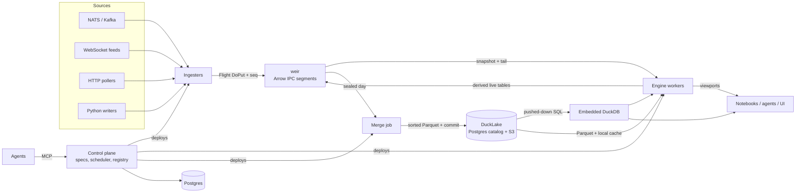

# Ursid architecture

Status: draft. This document is the design contract; nothing here is implemented yet.

Ursid is a cloud-native data platform where live and historical data share one table model.
A real-time incremental engine, a columnar ingest log, a Parquet lake, a job scheduler, a model
registry, a feature store, and an agent surface all sit on that model.

The name: the Ursids are a meteor shower radiating from Ursa Minor — a stream of events coming
from a bear.

## 1. Thesis

**A table is a timeline.** Every `namespace.table` has one schema and is reachable as:

- `db.live_table(ns, t)` — intraday, append-only, ticking.
- `db.historical_table(ns, t)` — merged days in the lake, static.
- `db.table(ns, t)` — both, routed by `Date`.

Everything else is a declarative object built on tables: feature views, models, jobs,
ingesters, deployments. The same expression that builds a training set from history runs
incrementally on live data; replaying history through the engine is a backtest.

## 2. Goals and non-goals

Goals

- Deephaven-style incremental engine with ticking tables and viewport subscriptions.
- kdb+/Deephaven-Enterprise-style data lifecycle: ingest → intraday store → daily merge → lake.
- Scheduled jobs and DAGs with retries, whose state is itself a live table.
- Model registry with models that plug directly into live graphs.
- Feature store with one definition for offline training and online serving.
- Agent-first: every resource is a typed spec with validate → plan → apply.
- Python SDK and Jupyter as the primary human surface.

Non-goals (for now)

- Distributing one update graph across nodes. One deployment = one engine process; scale by
  sharding deployments.
- General incremental SQL (DBSP/differential dataflow). The engine supports a fixed operator set.
- A custom historical file format. History is Parquet.
- Browser UI before notebooks and agents work end to end.

## 3. Prior art mapping

| kdb+ tick | Deephaven Enterprise | Ursid |
|---|---|---|
| Feedhandler | Logger / Kafka ingester | Ingester (connector) |
| Tickerplant + tplog | Data Import Server (DIS) | **weir** |
| RDB | Worker reading intraday | Engine worker, `db.live_table` |
| RTE / CEP, chained TP | Persistent query | Engine deployment publishing derived live tables back to weir |
| `.u.end` end-of-day writedown | Merge + validate | Daily merge job |
| HDB (splayed, date-partitioned, mmap) | Historical (DH format / Parquet) | Parquet in DuckLake, `db.historical_table` |
| Gateway | Query routing | `db.table` + query router |

Lessons taken from kdb+: keep the ingest hop dumb (append, log, publish — no queries); historical
speed comes from layout (sort by key within date, enumerated keys, parted attribute) more than
from file format.

## 4. Components

| Component | Name | Language | Role |
|---|---|---|---|
| Ingest server | weir | Rust | Accepts ingest protocol, writes Arrow IPC segments, serves snapshot + tail |
| Engine | falls | Rust (library + server) | Incremental update graph, expressions, inference, Flight server |
| Merge | — | Rust job | Daily intraday → sorted Parquet → DuckLake commit |
| Control plane | — | Rust | Spec API, scheduler, deployment controller, registry, audit |
| Scheduler | run | Rust (in control plane) | Cron, DAGs, retries, leases |
| Model registry | den | Rust (in control plane) | Model versions, aliases, signatures |
| Feature store | forage | Rust + Python SDK | Feature views, point-in-time training sets, online state |
| Agent surface | ranger | Rust | MCP server over the spec API and query surface |
| SDK | `ursid` | Python (+ PyO3 engine wheel) | Client, local engine, notebook widgets |



## 5. Data model

### 5.1 Tables and schemas

- A table is identified by `namespace.table`.
- Schemas are Arrow schemas, versioned in the catalog. Live and historical share the schema
  history.
- Column partition: `Date` (UTC, string `YYYY-MM-DD`), assigned from **ingest time**, not event
  time. This makes a day's partition closable at a fixed wall-clock moment. Late events land in the
  partition of the day they arrived.
- Internal partition: one per ingest source (`source_id`). Each internal partition has exactly one
  writer.
- Event time is an optional designated column per table (`ts_column`), used by as-of joins,
  windows, and replay.

### 5.2 Table kinds

| Kind | Stored | Semantics |
|---|---|---|
| append | weir → lake | Default. Rows are never modified or removed. |
| blink | no | Only the current cycle's rows are visible; for high-rate transient signals. |
| derived | optional | Engine output. May be published back to weir as an append table. |

Mutable data (upserts, CDC, order books) is stored as an append log of changes. Current state is a
view: `live_table(...).last_by("key")`. Storage never mutates rows.

### 5.3 Access API

```python
db = us.connect().db

odds = db.live_table("sports", "odds")                    # unmerged intraday partitions, ticking
hist = db.historical_table("sports", "odds")              # merged dates, static
full = db.table("sports", "odds")                         # historical ∪ live, disjoint by Date
```

`db.live_table` contains every intraday partition not yet merged; callers usually filter
`.where("Date = today()")`. `db.table` partitions dates by catalog state: dates committed to the
lake come from history, the rest from weir. When a merge commits, the date moves from live to
historical at a cycle boundary; the rows are identical, so downstream sees no change.

## 6. Ingestion

### 6.1 Ingest protocol

Arrow Flight `DoPut`.

- Flight descriptor: `{namespace, table, date, source_id, schema_version}`.
- Every record batch carries `app_metadata = {seq: u64}`. `seq` is strictly increasing per
  `(table, date, source_id)`.
- weir acknowledges on the `PutResult` stream with the highest `seq` that is durable (fsynced).
- weir drops batches with `seq <= last_acked`. Resent batches are harmless.
- On (re)connect the writer calls `GetFlightInfo` / an action `last_seq` and resumes the source from
  there. For log-structured sources (NATS JetStream, Kafka) the source offset is the `seq`, so
  connectors keep no state of their own.
- Batches must match the descriptor's schema version. A schema change opens a new segment.

Fallback for lightweight producers: WebSocket (and HTTP POST) carrying Arrow IPC or JSON rows,
coerced to the table schema by weir, same `seq` semantics.

### 6.2 Ingesters

An ingester is a managed deployment that reads a source and speaks the ingest protocol.

```yaml
kind: Ingester
name: odds-nats
source: {type: nats, subject: "odds.>", durable: ursid-odds}
target: {namespace: sports, table: odds}
transform: python:juicebear.ingest:parse_odds   # optional; or a declarative column map
```

- Built-in Rust connectors: NATS JetStream, Kafka, WebSocket, HTTP poll, file drop.
- Python connectors use `us.ingest.writer(ns, table, source=...)`, the SDK equivalent of a
  Deephaven logger.
- Batch imports (CSV, API backfills) are ordinary jobs that write either through weir (live) or
  directly into the lake (historical, via the merge writer).

## 7. weir

### 7.1 Storage

```
/data/weir/{namespace}/{table}/{date}/{source_id}/
  seg-000042.arrow      sealed: Arrow IPC file (footer present), immutable
  seg-000042.idx        batch offsets, seq range, ingest-time range, row range
  seg-000043.arrows     open: Arrow IPC stream, append + fsync
  state.json            last_seq, schema_version, sealed flag for the day
```

- Open segments are Arrow IPC streams. Appends are fsynced before ack.
- A segment seals after N rows or N seconds: the file is rewritten/finalized with its footer and
  index so it can be memory-mapped.
- Crash recovery: read the open stream to the last complete batch, truncate the rest, restore
  `last_seq`.
- Row positions within an internal partition are stable (append-only), which maps onto add-only
  tables in the engine.
- Per-batch metadata (`seq`, ingest time) lives in the index, not in user columns. An
  `IngestTime` column can be materialized per table if requested.

### 7.2 Serving

- Subscribers are engine workers, not end users.
- Subscribe = snapshot (all sealed segments + open segment up to now) then tail (new batches as
  they are acked).
- Transport: Flight `DoGet` for sealed segments (engine caches them locally), Flight
  `DoExchange` for the tail.
- Co-located workers may memory-map sealed segments directly; this is an optimization only.

### 7.3 Day roll

At UTC midnight + a short grace window weir seals all open segments for `D` and rejects new
writes to `D`. Writers have already rolled to `D+1` because `date` comes from ingest time.

### 7.4 Durability

- Initial: single writer per internal partition on a Longhorn PVC (replicated block storage).
  weir is a StatefulSet.
- Later: copy sealed segments to S3 (rustfs) so node loss costs at most the open segment.
- Retention: intraday partitions are deleted N days after their merge validates.

## 8. Historical store

### 8.1 Layout

Parquet files written by Ursid, cataloged in DuckLake (Postgres catalog on CNPG, data on rustfs).

```
s3://lake/{namespace}/{table}/Date={date}/part-0000.parquet
```

Per-table layout config, applied by the merge writer:

- Sort by `(key columns..., ts_column)` within the date — the analogue of kdb+'s `p#`.
- Dictionary-encode key columns — the analogue of kdb+'s `sym` enumeration.
- Row groups sized to align with key ranges; write the page index so readers skip by key and time.
- Compression: ZSTD.

### 8.2 Merge job

Daily, scheduled through the Ursid scheduler.

1. Wait until all internal partitions for `D` are sealed.
2. Read sealed segments, sort per layout config, write Parquet.
3. Commit to DuckLake in one transaction, **replacing** partition `D` (idempotent re-runs).
   Registering pre-written files uses DuckLake's add-data-files path; confirm semantics against the
   deployed DuckLake version.
4. Validate: row counts per source match weir indexes.
5. Mark `D` merged in the catalog (flips `db.table` routing) and schedule intraday deletion.

### 8.3 Reading history

- Static queries (no live input) on `db.historical_table` compile to SQL and run in embedded
  DuckDB attached to DuckLake; results return as Arrow. Agent and human SQL over history goes
  straight to DuckDB.
- The engine reads Parquet itself (file list from the catalog, arrow-rs reader, local NVMe cache)
  only when it must: as-of joins between live and historical, replay, and warming state at
  startup.

## 9. Engine

### 9.1 Model

- Deephaven-style update graph. Execution proceeds in cycles; each cycle propagates deltas
  (added / removed / modified row sets, plus shifts) through operators in topological order.
- Data is held as Arrow chunks. Append-only sources produce only `added` deltas.
- One engine process per deployment. Sessions (notebook, agent) are separate processes with
  quotas.
- The engine is a library first (Rust crate, PyO3 wheel for `us.local()`) and a server second
  (same crate plus Flight).

### 9.2 Operators (initial set)

`where`, `select` / `update` (expressions), `last_by`, `agg_by` (sum, count, mean, min, max,
first, last, std), `natural_join`, `as_of_join`, `rolling` (row- and time-based), `sort`
(snapshot-oriented), `merge` (union), `predict` (model inference).

Anything outside this set runs as static queries or as Python jobs.

### 9.3 Expressions

The Ursid expression language is the contract. It compiles to:

- DataFusion physical expressions for in-engine evaluation per chunk;
- DuckDB SQL for pushed-down historical queries.

A shared conformance corpus runs every expression through both and compares results. Raw SQL is a
separate surface that only targets DuckDB.

### 9.4 Clocks and replay

The engine is driven by an injectable clock.

- Real-time clock: cycles on a fixed period (default 100 ms) or on input, whichever comes first.
- Replay clock: feeds historical rows in `ts_column` order at a chosen speed (or as fast as
  possible). The same graph run under replay is a backtest.

Late data policy is per operator: windows declare allowed lateness; as-of joins use the current
state at cycle time.

### 9.5 Inference in the graph

`predict(model_ref)` evaluates once per cycle on the batch of changed rows.

- ONNX models run in-process via ONNX Runtime (`ort`). sklearn → ONNX via skl2onnx; torch via
  `torch.onnx.export`.
- Other flavors (arbitrary Python) run in a Python sidecar process fed Arrow IPC over a Unix socket,
  one round-trip per cycle. CPython is not embedded in the engine process.
- Aliases (`model@champion`) are watched; swaps happen atomically at a cycle boundary. Shadow mode
  evaluates two versions and emits both outputs.

### 9.6 Client subscriptions

- Flight `DoExchange` with a delta protocol modeled on Deephaven Barrage: Arrow record batches
  plus flatbuffer metadata describing row-set changes and viewport.
- Clients subscribe to a viewport (row range + columns); the server sends only that window.
- Browser transport: WebSocket carrying the same frames. WebTransport (HTTP/3) can replace it later
  behind the same frame format once browser and proxy support allow.

## 10. Control plane

### 10.1 Resources

Every resource is a typed spec (Rust types, JSON Schema generated from them):
`Table`, `Ingester`, `Deployment` (long-running engine graph), `Job`, `Dag`, `FeatureView`,
`Model`, `ModelVersion`, `Alias`, `Secret` reference.

Specs are stored in Postgres. GitOps export (into the Argo CD repo) is a later addition; Postgres is
the source of truth.

### 10.2 validate → plan → apply

- `validate`: type-check the spec; infer output schemas using the engine's planner.
- `plan`: diff against current state; inferred schemas, sample rows (bounded), cost and
  cardinality estimates, affected downstream resources.
- `apply`: execute the plan; optional approval gate per caller role.

Humans (CLI, SDK) and agents use the same three calls.

### 10.3 Scheduler

- Triggers: cron, upstream completion (DAG edges), table events (e.g. "date `D` merged"), manual.
- Retries with backoff, timeouts, concurrency limits, catch-up policy.
- State in Postgres; workers claim tasks with leases (`SELECT ... FOR UPDATE SKIP LOCKED`).
- Executors: Kubernetes Job per task (arbitrary image) or a warm Python worker pool (low latency).
- Run state is published to weir as live tables: `sys.job_runs`, `sys.task_runs`, `sys.task_logs`.
  Observability is `db.live_table("sys", "job_runs")`.

```python
@us.job(schedule="0 6 * * *", retries=3, backoff="exp", timeout="30m")
def retrain(ctx): ...
```

### 10.4 System tables

`sys.job_runs`, `sys.task_runs`, `sys.task_logs`, `sys.deployments`, `sys.ingest_stats`,
`sys.audit`, `sys.lineage`, `sys.model_events`. All are ordinary live tables and merge to the lake
daily.

## 11. ML

### 11.1 Model registry (den)

A model version is:

- artifact URI (S3/rustfs);
- flavor: `onnx`, `sklearn`, `torch`, `python`;
- input/output Arrow schemas (signature);
- feature-view references and versions;
- link to an MLflow run (MLflow stays as experiment tracking).

Aliases (`champion`, `challenger`) are pointers to versions. Alias changes are events in
`sys.model_events`.

### 11.2 Feature store (forage)

A feature view is a keyed, timestamped table expression.

```python
@us.feature_view(entity="player_id", ts="ts")
def form(games):
    return (games.rolling(by="player_id", rows=10)
                 .agg(pts_avg=us.mean("pts"), mins_avg=us.mean("mins")))
```

- Offline: `us.training_set(labels, features=[...], ts=...)` evaluates the view over
  `db.historical_table` and performs a point-in-time-correct as-of join. Large training sets push
  down to DuckDB.
- Online: the same view runs incrementally on `db.live_table`; online state is
  `last_by(entity)` in engine memory. No separate online store.
- Served-feature logging: deployments publish the exact features and predictions they served back
  to weir as live tables. These merge into history and become training data that matches serving.

## 12. Agent surface (ranger)

MCP server over the control plane and query surface.

- Catalog: search namespaces/tables, describe schema, sample rows, lineage.
- Query: bounded static queries (DuckDB) and bounded live snapshots.
- Resources: validate / plan / apply for every resource kind; job logs; retry; model comparison.
- Sandboxes: agent sessions run in their own engine processes with memory, CPU, and time quotas;
  writes go to scratch namespaces unless the role allows otherwise.
- Every agent action is recorded in `sys.audit`.
- Errors are structured (code, location, fix hint) so agents can repair specs without guessing.

## 13. Python SDK and notebooks

- `us.connect()` — remote cluster; `us.local()` — in-process engine from the same Rust crate.
- Tables convert to pyarrow, pandas, and polars without copying where possible.
- Ticking tables render in Jupyter via an anywidget-based widget subscribed to a viewport.
- Decorators: `@us.job`, `@us.feature_view`; registry: `us.models.register(...)`; ingest:
  `us.ingest.writer(...)`.

## 14. Deployment

Target: the existing Talos cluster managed from the Argo CD repo (`components/ursid`, promoted by
Kargo).

| Workload | Kind | Storage / dependency |
|---|---|---|
| weir | StatefulSet | Longhorn PVC |
| Engine deployments | Deployment per Ursid deployment, created by control plane | local cache volume |
| Engine sessions | Pod per session, created on demand | ephemeral |
| Control plane + ranger | Deployment | Postgres (CNPG) |
| Merge, jobs | Kubernetes Jobs created by the scheduler | rustfs, DuckLake catalog |
| Lake | existing DuckLake component | CNPG catalog + rustfs |

Auth: OIDC via Dex. Telemetry: OpenTelemetry traces to Tempo, logs to Loki, metrics to Prometheus;
platform state stays in `sys.*` tables.

## 15. Technology choices

| Concern | Choice |
|---|---|
| Engine, weir, control plane | Rust |
| Columnar memory | arrow-rs |
| Expressions / planning | DataFusion |
| RPC | arrow-flight (tonic, HTTP/2) |
| Lake catalog and batch SQL | DuckDB + DuckLake |
| Parquet | `parquet` crate (writer and engine reads) |
| Inference | ONNX Runtime via `ort`; Python sidecar for other flavors |
| Kubernetes | kube-rs |
| Control-plane DB | Postgres via sqlx |
| Python bindings | PyO3 + maturin |
| Notebook widget | anywidget |

## 16. Planned repository layout

```
crates/
  ursid-core      Arrow tables, row sets, update graph, clocks
  ursid-ops       operators
  ursid-expr      expression language → DataFusion / DuckDB SQL
  ursid-flight    Flight server, delta protocol
  ursid-weir      ingest server and segment store
  ursid-lake      DuckLake catalog, Parquet writer, merge
  ursid-control   spec API, scheduler, registry, MCP
  ursid-py        PyO3 bindings
python/ursid      SDK, widgets, decorators
deploy/           kustomize bases consumed by the Argo CD repo
docs/
```

## 17. Roadmap

| Milestone | Deliverable | Toy example |
|---|---|---|
| M0 | Engine crate: chunks, update graph, initial operators, expressions; PyO3 wheel; notebook widget | Random-walk ticker → rolling mean/vol, live in Jupyter |
| M1 | weir (DoPut, segments, seq dedup, snapshot + tail); `db.live_table`; WebSocket connector | Synthetic ticker over WebSocket → weir → engine |
| M2 | Merge job, DuckLake commit, `db.historical_table`, `db.table`, DuckDB pushdown, replay clock | Ticker merged nightly, replayed as a backtest |
| M3 | Control plane: specs, validate/plan/apply, scheduler, `sys.*` tables, ranger MCP | Agent creates a DAG; retries visible live |
| M4 | den: register sklearn LinearRegression → ONNX → `predict`; torch MLP; aliases, shadow mode | Live prediction; swap champion without restart |
| M5 | forage: feature views, training sets, online `last_by`, served-feature logging | Toy sportsbook: simulated games + odds → form features → live win probability vs implied odds |
| M6 | Port juicebear sportsflow features and models | Real data |

## 18. Open questions

1. Latency target per event (assumed 100 ms–1 s cycles).
2. Peak rows/sec and live state size for juicebear — validates single-process deployments.
3. Tenancy: single-tenant homelab vs multi-tenant product (auth, isolation, quotas).
4. Derived-state checkpointing: replay from start of day vs periodic engine snapshots.
5. Schema evolution rules mid-day (additive only?) and how merge reconciles multiple schema
   versions within a date.

## 19. Risks

- **Engine scope.** A general Deephaven-class engine is years of work; hold the operator set fixed
  until M5.
- **Event vs processing time.** Replay correctness depends on the injectable clock and explicit
  lateness rules from M0.
- **Python in the hot path.** Batch-per-cycle is mandatory for Python inference and UDFs.
- **Two SQL dialects.** Mitigated by the expression language and conformance corpus (§9.3).
- **Single weir writer.** Node loss stalls ingest for that partition until the PVC reattaches;
  acceptable initially, revisit with S3 segment replication.
