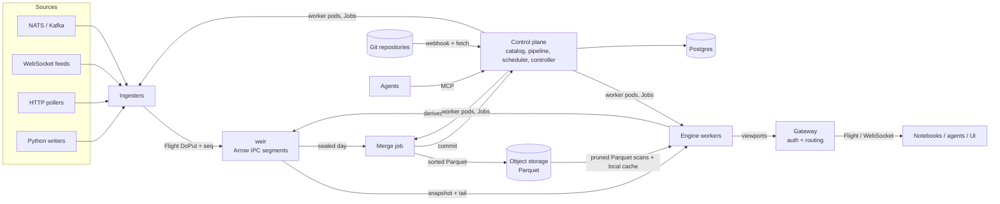
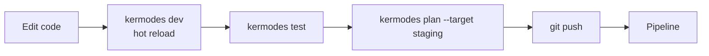
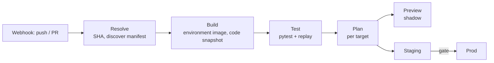

# Kermodes architecture

Status: direction. These are ideals, not hard rules; nothing here is implemented yet, and the code
corrects this document as it teaches us. "Writing a novel is like driving a car at night. You can
see only as far as your headlights, but you can make the whole trip that way." (E. L. Doctorow)

The engine's first milestone is designed in more detail in [engine.md](engine.md).

Kermodes is a cloud-native data platform where live and historical data share one table model.
A real-time incremental engine, a columnar ingest log, a Parquet lake, a job scheduler, a model
registry, a feature store, and an agent surface all sit on that model. User code lives in git and
reaches the cluster through a deployment pipeline.

The name: the Kermode bear, or spirit bear, is a rare white black bear found only in British
Columbia's Great Bear Rainforest. pandas, then Polars, then Kermodes: `import kermodes as km`.

## 1. Thesis

**A table is a timeline.** Every `namespace.table` has one schema and is reachable as:

- `db.live_table(ns, t)` — intraday, append-only, ticking.
- `db.historical_table(ns, t)` — merged days in the lake, static.
- `db.table(ns, t)` — both, routed by `Date`.

Everything else is a declarative object built on tables: feature views, models, jobs,
ingesters, deployments. The same expression that builds a training set from history runs
incrementally on live data; replaying history through the engine is a backtest.

**Arrow end to end.** Arrow in memory, Arrow Flight on the wire, Arrow IPC for intraday storage,
Parquet for history. One engine evaluates live and historical data with the same operators,
whether the query comes from the table API or SQL. No embedded third-party query engine.

**Git is the source of truth.** Tables, deployments, jobs, feature views, and models are declared
in project repositories, developed and tested locally, and delivered to the cluster by a pipeline
that builds once and promotes the same artifact through targets.

## 2. Goals and non-goals

Goals

- Deephaven-style incremental engine with ticking tables and viewport subscriptions.
- kdb+/Deephaven-Enterprise-style data lifecycle: ingest → intraday store → daily merge → lake.
- Scheduled jobs and DAGs with retries, whose state is itself a live table.
- Model registry with models that plug directly into live graphs.
- Feature store with one definition for offline training and online serving.
- Agent-first: every resource is a typed spec with validate → plan → apply.
- Python SDK and Jupyter as the primary human surface.
- Multi-user from the start: OIDC login, namespace RBAC, per-user isolated worker pods.
- Schema changes as first-class, planned operations across live data, history, and dependents.
- Kubernetes-native: Helm install; the controller runs every worker as its own pod.
- Clean local start: `pip install kermodes` (one wheel). No JVM, Docker, or Kubernetes required.
- Continuous integration and delivery for user projects: develop locally, push, and the cluster
  tests, plans, and deploys the commit.
- Small dependency surface: the arrow-rs family for data, plus infrastructure crates.

Non-goals (for now)

- Distributing one update graph across nodes. One deployment = one engine process; scale by
  sharding deployments.
- General incremental SQL (DBSP/differential dataflow). The engine supports a fixed operator set.
- A third-party SQL engine. SQL is a frontend that compiles to the same Kermodes plan as the table
  API (§9.8).
- A custom historical file format. History is Parquet.
- Web UI beyond catalog, table viewer, console, pipelines, jobs, and models until notebooks and
  agents work end to end.

## 3. Prior art mapping

| kdb+ tick | Deephaven Enterprise | Kermodes |
|---|---|---|
| Feedhandler | Logger / Kafka ingester | Ingester (connector) |
| Tickerplant + tplog | Data Import Server (DIS) | **weir** |
| RDB | Worker reading intraday | Engine worker, `db.live_table` |
| RTE / CEP, chained TP | Persistent query | Engine deployment publishing derived live tables back to weir |
| `.u.end` end-of-day writedown | Merge + validate | Daily merge job |
| HDB (splayed, date-partitioned, mmap) | Historical (DH format / Parquet) | Parquet + Kermodes catalog, `db.historical_table` |
| Gateway | Query routing | `db.table` + query router |
| q scripts on disk | Git-integrated persistent query scripts | Project repositories + deployment pipeline (§11) |

Lessons taken from kdb+: keep the ingest hop dumb (append, log, publish — no queries); historical
speed comes from layout (sort by key within date, enumerated keys, parted attribute) more than
from file format.

## 4. Components

| Component | Name | Language | Role |
|---|---|---|---|
| Ingest server | weir | Rust | Accepts ingest protocol, writes Arrow IPC segments, serves snapshot + tail |
| Engine | falls | Rust (library + server) | Incremental and static operators, expressions, Parquet scans, inference, Flight server |
| Merge | — | Rust job | Daily intraday → sorted Parquet → catalog commit |
| Control plane | — | Rust | Catalog, spec API, scheduler, pipeline, Kubernetes controller, registry, audit |
| Scheduler | run | Rust (in control plane) | Cron, DAGs, retries, leases |
| Pipeline | — | Rust (in control plane) | Build, test, plan, deploy, promote project commits |
| Model registry | den | Rust (in control plane) | Model versions, aliases, signatures |
| Feature store | forage | Rust + Python SDK | Feature views, point-in-time training sets, online state |
| Agent surface | ranger | Rust | MCP server over the spec API, pipeline, and query surface |
| Gateway | — | Rust | Single authenticated entry point; proxies Flight/WebSocket to worker pods; serves the UI |
| SDK | `kermodes` | Python (+ PyO3 engine module) | Client, local engine, notebook widgets, resource decorators |
| CLI | `kermodes` | Python (`argparse`) over the Rust core | Server roles, local platform, project workflow (`init`, `dev`, `test`, `plan`, `deploy`) |



### 4.1 Dependency policy

Core data path: the arrow-rs family only — `arrow` (array, compute kernels, IPC), `arrow-flight`,
`parquet`, and `object_store` for S3 and local files. One arrow-rs major version across the
workspace.

Infrastructure crates are allowed where writing our own would add risk without value: `tokio`,
`tonic` (via arrow-flight), `sqlx` (Postgres), `kube`, `ort` (ONNX Runtime), `pyo3` +
`pyo3-arrow`, `openidconnect`, `jsonwebtoken`, `clap`, `serde`, `tracing`/OpenTelemetry.

`sqlparser` is the one parsing dependency: it turns SQL text into an AST and does nothing else (its
only runtime dependency is `log`). Writing and maintaining a SQL grammar ourselves would cost more
than it saves.

`ahash` (already compiled in through arrow-array) hashes group keys; using it directly adds no
crate to the build.

`rusqlite` (with SQLite bundled) holds the local catalog: a synchronous, in-process database is
what an embedded store (`km.local(path)`) and `kermodes dev` need, with no runtime to start; the
cluster's catalog is Postgres through `sqlx`, behind the same storage interface. `crc32fast`
checks weir's index records, so recovery can tell a committed record from one a crash cut short.

`mimalloc` is the Python extension's global allocator. The system allocators keep freed memory
resident (macOS keeps large freed blocks cached; glibc keeps freed memory in its heaps), so a
long-lived process's footprint follows its high-water mark, the usual reason data processes get
OOM-killed in containers. mimalloc reuses freed memory while work runs, and the engine has it
return what is free whenever it goes idle (`engine.md` §4), at no measured cost to cycle times.
Polars ships a tuned jemalloc for the same reason.

`axum` (hyper, with tokio-tungstenite for WebSocket) serves HTTP and WebSocket for the gateway:
today the local server behind `Session.serve`, later the cluster gateway. HTTP and WebSocket
protocol handling written ourselves would be risk without value. `serde_json` reads and writes
the web app's JSON messages. The WebSocket connector is a tokio-tungstenite client, the same
crate axum's WebSocket is, and decodes JSON records with `arrow-json` straight into Arrow
columns.

No embedded query engines (DataFusion, DuckDB, Polars). A new data-path dependency needs a written
reason in this section.

## 5. Data model

### 5.1 Tables and schemas

- A table is named `namespace.table` and is owned by exactly one project (§11), which declares
  it. Other projects read it. Names have two levels, lowercase `[a-z][a-z0-9_]*`; `sys` is
  reserved.
- The catalog keys a table by **branch** and name (§10.1) and gives it a stable table ID. Names
  are labels, as column names are (§5.4): renaming a table or moving it to another namespace
  changes the catalog, not the data.
- A table's storage location is fixed when it is created, from its branch, name, and ID
  (`{branch}/{namespace}/{table}.{id}`), and recorded in the catalog. weir and the lake use it;
  nothing derives a path from a name.
- Schemas are Arrow schemas with stable column IDs, versioned in the catalog. Live and historical
  share the schema history. Changes are planned operations (§5.4).
- Column partition: `Date` (UTC, string `YYYY-MM-DD`), assigned from **ingest time**, not event
  time. This makes a day's partition closable at a fixed wall-clock moment. Late events land in the
  partition of the day they arrived.
- Internal partition: one per ingest source (`source_id`). Each internal partition has exactly one
  writer.
- Event time is an optional designated column per table (`ts_column`), used by as-of joins,
  windows, and replay.

### 5.2 Table kinds

| Kind | Stored | Semantics |
|---|---|---|
| append | weir → lake | Default. Rows are never modified or removed. |
| blink | no | Only the current cycle's rows are visible; for high-rate transient signals. |
| derived | optional | Engine output. May be published back to weir as an append table. |
| input | engine memory | As in Deephaven: append-only, or keyed (one row per key; upserts replace, deletes remove). Written from code or edited by hand in the UI. |

Ingested mutable data (upserts, CDC, order books from a feed) is stored as an append log of changes.
Current state is a view: `live_table(...).last_by("key")`. Storage never mutates ingested rows;
keyed input tables are the mutable tables people and programs edit directly.

### 5.3 Access API

```python
db = km.connect().db

odds = db.live_table("sports", "odds")  # unmerged intraday partitions, ticking
hist = db.historical_table("sports", "odds")  # merged dates, static
full = db.table("sports", "odds")  # historical ∪ live, disjoint by Date
```

`db.live_table` contains every intraday partition not yet merged; callers usually filter
`.where("Date = today()")`. `db.table` partitions dates by catalog state: dates committed to the
lake come from history, the rest from weir. When a merge commits, the date moves from live to
historical at a cycle boundary; the rows are identical, so downstream sees no change.

### 5.4 Schema evolution

Table schemas are declared in the owning project. Changing one is a code change that goes through
the pipeline: the plan classifies it, and applying the commit applies the change. Sandbox
branches (§10.1) also accept direct changes from the SDK, CLI, or an agent.

```python
odds = km.table(
    "sports.odds",
    columns={
        "game_id": km.string(),
        "book": km.string(),
        "price": km.float64(),  # renamed from "px": same column ID
        "size": km.int64(),  # widened from int32
        "venue": km.string(default=None),  # added
    },
    keys=["game_id", "book"],
    ts="ts",
)
```

Column identity

- Every column has a stable ID, carried as Arrow field metadata and Parquet `field_id`, and stored
  in the catalog. Names are labels; data is matched by ID everywhere.
- Renames are metadata-only; the SDK records a rename explicitly (`km.renamed_from("px")`) so the
  plan does not read it as drop + add.

Change classes, determined by `plan`

| Change | Class | Effect |
|---|---|---|
| Add column (nullable or with default) | compatible | Applies mid-day. Older segments and files read as null/default. |
| Widen type (int32→int64, float32→float64, new enum value) | compatible | Cast on read. |
| Rename column | compatible | Metadata only. Dependents referencing the old name are reported and must change in the same commit or a dependent project's next commit. |
| Drop column | contract | Hidden from reads immediately; stored data kept until an explicit purge job. |
| Incompatible type change, recomputed values | rewrite | Backfill DAG with one task per date: rewrite Parquet with a transform expression, commit each date atomically. Resumable. |
| Sort keys / layout | rewrite (optional) | Applies to future merges; backfill optional. |

Dependents

- `plan` walks lineage across projects and lists every affected ingester, deployment, feature view,
  and model signature as unaffected, auto-migrated, or must-change.
- A change that would break a feature view or model signature in the same project is rejected
  unless the same commit updates it. Breaking changes to tables other projects read require those
  projects to be compatible first (expand → migrate consumers → contract).
- Consumer contracts: a project declares what it reads from tables other projects own (columns,
  types, and optionally keys and freshness) under `[reads]` in `kermodes.toml`. The owner's
  `plan` checks every contract on its tables and fails a change that breaks one, so the producer
  learns before merging, not when a consumer fails in production.

Live data

- A new schema version on a live table takes effect at a cycle boundary and opens new weir
  segments.
- weir accepts writes at any version compatible with the current one and projects them up by
  column ID (defaults, casts, dropped columns discarded). Producers and tables upgrade
  independently.
- Initial implementation restarts dependent deployments, which rebuild state from weir and
  history. Hot re-planning for compatible changes comes later.

History

- The catalog records the new schema version in the same transaction as the table definition
  change. Existing Parquet files are not touched; reads map them by column ID.
- Catalog snapshots (§8.2) keep old schema versions; reading an old snapshot sees the old schema.
- Merge projects every version present in a date onto the table's current version (§8.3).

## 6. Ingestion

### 6.1 Ingest protocol

Arrow Flight `DoPut`.

- Flight descriptor: a command naming the table and the source. weir assigns the date from the
  batch's ingest time. In the cluster, writers resolve `ns.table` on their branch to a table ID
  and an endpoint once, through `GetFlightInfo` (§17); with one server (`kermodes dev`) the name
  is enough.
- Every record batch carries `app_metadata = seq` (u64, little-endian). `seq` is strictly
  increasing per `(table, date, source_id)`.
- weir acknowledges each batch on the `PutResult` stream once it is durable (fsynced) or dropped:
  the source's last `seq` and whether this batch was written. A writer's call returns only then.
- weir drops batches with `seq <= last_seq`. Resent batches are harmless.
- One writer per source at a time, server-wide: a second is refused until the first disconnects.
- On (re)connect the writer reads the action `last_seq` and resumes the source from
  there. For log-structured sources (NATS JetStream, Kafka) the source offset is the `seq`, so
  connectors keep no state of their own.
- The descriptor's `schema_version` may be any version compatible with the table's current one;
  weir projects batches up by column ID (§5.4). Incompatible versions are rejected. A new version
  opens a new segment.

Fallback for lightweight producers: WebSocket (and HTTP POST) carrying Arrow IPC or JSON rows,
coerced to the table schema by weir, same `seq` semantics.

### 6.2 Ingesters

An ingester is a managed deployment that reads a source and speaks the ingest protocol. It is
declared in a project like any other resource.

```python
@km.ingester(
    target="sports.odds", source=km.nats(subject="odds.>", durable="kermodes-odds")
)
def parse_odds(msgs: km.Batch) -> km.Batch: ...
```

- Built-in Rust connectors (`kermodes-ingest`): NATS JetStream, Kafka, WebSocket, HTTP poll,
  file drop. Connectors are Tolerant Readers: fields map to columns by name, unknown fields are
  ignored, missing ones are NULL, and an unreadable record is skipped and counted without losing
  its neighbours. Built so far: WebSocket feeds of JSON (an object or an array of them per
  message), flushed every `flush` or `max_rows`, reconnecting with backoff:
  `session.ingest_websocket(url, "md.ticks")` or `kermodes ingest websocket URL --table md.ticks`.
  A raw WebSocket feed is not replayable, so a restarted connector resumes from the feed's
  present. `kermodes demo ticker` (`km.demo.ticker()`) serves a synthetic feed.
- Python connectors use a session's `writer(table, source=...)`, the SDK equivalent of a
  Deephaven logger.
- Batch imports (CSV, API backfills) are ordinary jobs that write either through weir (live) or
  directly into the lake (historical, via the merge writer).

## 7. weir

### 7.1 Storage

```
{store}/weir/{location}/{date}/{source_id}/     location = {branch}/{namespace}/{table}.{id} (§5.1)
  seg-000042.arrows     Arrow IPC stream: the segment's batches, appended and fsynced
  seg-000042.idx        format header, then per batch: seq, rows, ingest time, end offset,
                        epoch, change kind, CRC
```

- A batch is committed when its index record is: the batch is appended and fsynced to the
  stream, then its record is appended and fsynced, then the writer is acknowledged and
  subscribers get the batch. The index is the commit record; there is no separate state file.
- Crash recovery reads each index up to the first record that fails its CRC (or does not follow
  the one before) and reads its stream only that far. `last_seq` is the last good record's.
  Writing after a restart starts a new segment, so what a crash left beyond the last commit is
  never read; a segment with no committed batch is deleted.
- A segment takes batches until its stream reaches 64 MiB. Later: sealing rewrites a full
  segment as an Arrow IPC file with its footer, so it can be memory-mapped and copied to S3.
- Row positions within an internal partition are stable (append-only), which maps onto add-only
  tables in the engine.
- Per-batch metadata (`seq`, ingest time) lives in the index, not in user columns. An
  `IngestTime` column can be materialized per table if requested.
- The epoch and change-kind fields are written from the start (0, and "rows"), so fencing (§17)
  and keyed tables' upserts and deletes need no format change.

### 7.2 Serving

- Subscribers are engine workers, not end users.
- Subscribe = snapshot (every committed batch) then tail (each new batch as it commits), in one
  Flight `DoGet` stream per subscriber. A slow subscriber's batches queue on the server rather
  than holding up writers.
- Later: sealed segments over `DoGet` with the engine caching them locally, the tail over
  `DoExchange` resumed by row position (§17).
- Co-located workers may memory-map sealed segments directly; this is an optimization only.

### 7.3 Day roll

At UTC midnight + a short grace window weir seals all open segments for `D` and rejects new
writes to `D`. Writers have already rolled to `D+1` because `date` comes from ingest time.

### 7.4 Durability

- Initial: single writer per internal partition on a Longhorn PVC (replicated block storage).
  weir is a StatefulSet.
- Later: copy sealed segments to S3 (rustfs) so node loss costs at most the open segment (§17).
- Retention: intraday partitions are deleted N days after their merge validates.

## 8. Historical store

### 8.1 Layout

Parquet files written by Kermodes to object storage (rustfs in the cluster, a local directory in
local mode) through `object_store`.

```
{lake}/{location}/Date={date}/part-{n}.parquet
```

Per-table layout config, applied by the merge writer:

- Sort by `(key columns..., ts_column)` within the date — the analogue of kdb+'s `p#`.
- Dictionary-encode key columns — the analogue of kdb+'s `sym` enumeration.
- Row groups sized to align with key ranges; write column statistics and the page index so readers
  skip by key and time.
- Parquet `field_id` set from column IDs.
- Compression: ZSTD.

### 8.2 Catalog

The catalog lives in the control-plane database (Postgres in the cluster, SQLite locally). It is
the only record of what history exists.

- Tables: ID, branch, namespace, name, location, owning project, current schema version, layout
  config.
- Schema versions: columns by ID with name, type, default, and the version that introduced them.
- Data files: path, `Date`, row count, byte size, schema version, per-column min/max for key and
  `ts` columns, merge run ID.
- Snapshots: every commit (merge, rewrite, purge) creates a snapshot ID; a read pins a snapshot
  and sees a consistent file set. Snapshots older than the retention window are expired and their
  unreferenced files deleted.
- Commits are single database transactions; a merge or rewrite is atomic per date.

### 8.3 Merge job

Daily, scheduled through the Kermodes scheduler.

1. Wait until all internal partitions for `D` are sealed.
2. Read sealed segments, project every schema version present in `D` onto the table's current
   version by column ID (§5.4), sort per layout config, write Parquet.
3. Commit the files to the catalog in one transaction, **replacing** partition `D` (idempotent
   re-runs).
4. Validate: row counts per source match weir indexes.
5. Mark `D` merged (flips `db.table` routing) and schedule intraday deletion.

### 8.4 Reading history

The engine reads history itself.

- Partition pruning by `Date` from the catalog; file pruning by catalog min/max statistics.
- Row-group and page pruning from Parquet statistics and the page index; projection to the
  requested columns; filter predicates evaluated during decode where the `parquet` reader supports
  it (row filters, row selections).
- Static queries run on the engine's static operator path (§9.1), streaming record batches per
  file; results return as Arrow over Flight.
- Workers keep a local NVMe cache of fetched Parquet files and sealed weir segments.

### 8.5 External access

Files use a plain Hive-style layout with standard Parquet, so external tools (DuckDB, Polars,
pyarrow, Spark) can read them directly with read access to the bucket. The catalog is the source
of truth for which files are current; an export of catalog snapshots to an open table format
(DuckLake or Iceberg metadata) is a later addition if external tools need snapshot consistency.
Locations are fixed at creation, so a renamed table's files keep their first path; the catalog
(`kermodes data locate ns.table`) gives the current one.

## 9. Engine

### 9.1 Model

- Deephaven-style update graph. Execution proceeds in cycles; each cycle propagates deltas
  (added / removed / modified row sets, plus shifts) through operators in topological order.
- Data is held as Arrow arrays in chunks. Append-only sources produce only `added` deltas.
- Two paths per operator:
  - **static**: inputs never change; operators run once over streamed batches with no
    incremental state (scans, filters, hash aggregation, hash join, sort);
  - **incremental**: inputs tick; operators keep the state needed to apply deltas.
  A static query is a graph whose sources are all static. Mixed graphs (live joined to history)
  use the static path for static subtrees.
- One worker pod per deployment, ingester, or session (§16.3). No worker process is shared
  between users.
- The engine is a library first (Rust crate, PyO3 module for `km.local()`) and a server second
  (same crate plus Flight).

### 9.2 Operators (initial set)

`where`, `select` / `update` (expressions), `last_by`, `agg_by` (sum, count, mean, min, max,
first, last, std), `natural_join`, `as_of_join`, `rolling` (row- and time-based), `sort`,
`merge` (union), `head` / `tail`, `predict` (model inference).

Operators are built on arrow-rs compute kernels (filter, take, sort, cast, arithmetic,
comparison, string) plus Kermodes's own hash tables for joins and aggregations.

Anything outside this set runs as Python jobs over Arrow batches.

### 9.3 Plans and expressions

- Every query is a **Kermodes plan**: a serializable logical plan of operators (§9.2) over named
  tables. The Python table API builds plans client-side; SQL compiles to the same plans (§9.8).
  Plans are what workers execute, what `plan`/`EXPLAIN` show, and what clients send over Flight.
- Scalar expressions use SQL expression syntax everywhere, including table API strings:
  `t.where("price > 2.5 AND book IN ('a', 'b')")`, `t.update("edge = model_p - 1 / price")`.
  Supported: literals, column references, arithmetic, comparison, boolean logic, `IN`,
  `IS [NOT] NULL`, `CAST`, `CASE`, `COALESCE`, and a function library (math, string, time, date
  arithmetic).
- Expression strings are parsed with `sqlparser` (`parse_expr`), so the table API and SQL share
  one grammar, one binder, and one type checker. Type errors carry position and fix hints.
- Evaluation compiles the typed expression to a tree of arrow-rs kernel calls per chunk. Constant
  folding and common-subexpression reuse are the only optimizations initially.
- Predicates on scan inputs are translated into Parquet pruning (§8.4).
- Rust-native function registry; Python UDFs run in the Python sidecar per batch (§9.5).
- Plans are language-neutral. Python is the first SDK and SQL the second front end; another
  language (a Rust or TypeScript SDK) is one more plan builder speaking Flight, with no engine
  change. User code in other languages runs as a sidecar speaking the same Arrow-over-socket
  protocol as Python's (§9.5). Code inside the engine process, if ever needed, would be WASM,
  never native plugins: a user's crash must not take the engine down.

### 9.4 Clocks and replay

The engine is driven by an injectable clock.

- Real-time clock: cycles on a fixed period (default 100 ms) or on input, whichever comes first.
- Replay clock: feeds historical rows in `ts_column` order at a chosen speed (or as fast as
  possible). The same graph run under replay is a backtest, and deterministic replay is the basis
  of pipeline tests (§11.3).

Late data policy is per operator: windows declare allowed lateness; as-of joins use the current
state at cycle time.

### 9.5 Inference in the graph

`predict(model_ref)` evaluates once per cycle on the batch of changed rows.

- ONNX models run in-process via ONNX Runtime (`ort`). sklearn → ONNX via skl2onnx; torch via
  `torch.onnx.export`.
- Other flavors (arbitrary Python) run in a Python sidecar process fed Arrow IPC over a Unix socket,
  one round-trip per cycle. CPython is not embedded in the engine process.
- Aliases (`model@champion`) are watched; swaps happen atomically at a cycle boundary. Shadow mode
  evaluates two versions and emits both outputs.

### 9.6 Client subscriptions

- Flight `DoExchange` with a delta protocol modeled on Deephaven Barrage: Arrow record batches
  plus flatbuffer metadata describing row-set changes and viewport.
- Clients subscribe to a viewport (row range + columns); the server sends only that window.
- Browser transport: WebSocket carrying the same frames. WebTransport (HTTP/3) can replace it later
  behind the same frame format once browser and proxy support allow.

### 9.7 Memory

- Each worker has an engine memory budget (§10.5) enforced by an accounting allocator over Arrow
  buffers; an operator that would exceed it fails the query with an error instead of the pod
  being OOM-killed.
- Large static aggregations and joins process one `Date` partition at a time where the query
  allows. Spilling to local disk is a later addition.

### 9.8 SQL

SQL is a frontend onto the Kermodes plan, the way Deephaven's SQL compiles to its table operations.
A query ticks when any input it reads ticks, and is static otherwise; the same SQL works over live
data, history, or both.

```python
edges = db.sql("""
    SELECT o.game_id, o.book, o.price, f.pts_avg
    FROM sports.odds o
    ASOF JOIN sports.form f
      MATCH_CONDITION (o.ts >= f.ts)
      ON o.player_id = f.player_id
    WHERE o.Date = today()
""")  # reads today's live data: ticking

monthly = db.sql("""
    SELECT book, avg(price) AS avg_price, count(*) AS n
    FROM sports.odds
    WHERE Date BETWEEN '2026-10-01' AND '2026-10-31'
    GROUP BY book
""")  # merged dates only: static
```

Table resolution

- `ns.table` resolves to `db.table` (history ∪ live). The binder prunes `Date` against the
  catalog: if no unmerged date survives the filter, the plan reads only Parquet and is static; if
  only today's date survives, it reads only weir.
- `live.ns.table` and `hist.ns.table` pin one side explicitly.
- `FOR SYSTEM_TIME AS OF '<timestamp>'` reads history at a catalog snapshot (§8.2).
- In sessions, Python variables holding tables are visible to SQL by name, as in Deephaven.

Supported subset, mapped to operators

| SQL | Kermodes operator |
|---|---|
| `WHERE` | `where` |
| `SELECT` expressions, aliases | `select` / `update` |
| `GROUP BY` with aggregates | `agg_by` |
| `INNER JOIN` / `LEFT JOIN` on equality keys | hash join / `natural_join` |
| `ASOF JOIN ... MATCH_CONDITION (...) ON ...` | `as_of_join` |
| `SELECT DISTINCT ON (key) ... ORDER BY ts DESC` | `last_by` |
| Window functions over `ROWS` / `RANGE` frames | `rolling` |
| `ORDER BY`, `LIMIT` | `sort`, `head` |
| `UNION ALL` | `merge` |
| CTEs (`WITH`), subqueries in `FROM` | inlined into the plan |

- Anything else (full outer joins, non-equi joins, correlated subqueries, recursive CTEs) is
  rejected at bind time with an error naming the construct and the closest supported form.
- `ORDER BY` / `LIMIT` on ticking inputs are maintained incrementally, as in Deephaven; on static
  inputs they run once.
- `EXPLAIN` prints the Kermodes plan with pruning decisions (dates, files, row groups) and whether
  each subtree runs on the static or incremental path.
- SQL works everywhere a plan does: sessions (`db.sql`), deployments (a deployment may be one SQL
  file in the project), feature views, the web console, and ranger.

## 10. Control plane

### 10.1 Resources and sources of truth

Every resource is a typed spec (Rust types, JSON Schema generated from them):
`Project`, `Table`, `Ingester`, `Deployment` (long-running engine graph), `Job`, `Dag`,
`FeatureView`, `Model`, `ModelVersion`, `Alias`, `WorkerClass`, `Environment`, `Repository`,
`Target`, `Secret` reference.

Tables live on **branches** of the catalog, as code lives on branches of a repository. Code always
names tables `ns.table`; the branch comes from where it runs.

| Branch | Source of truth | How changes arrive |
|---|---|---|
| `prod` | A project repository at a commit | Only through the pipeline (§11) |
| `staging` | The mainline commit being promoted | The pipeline |
| `pr-<n>` (preview) | The pull request's head commit | The pipeline; expires with the PR |
| `sandbox-<user>` | The control plane | Direct apply from the SDK, CLI, or agents; `kermodes deploy --target sandbox` |

- Every branch but `prod` is an overlay on a parent (`prod` unless stated): reading a table the
  branch does not produce reads the parent's, live and historical. A branch writes only the
  tables it produces, so nothing outside `prod` can change `prod`'s data; the catalog enforces
  it.
- A shadowing branch (previews, and staging by default) runs no ingesters: it reads ingested
  tables from its parent, so a source is never consumed twice.
- `ns.table@branch` names a table on another branch, and is only needed across branches:
  `kermodes diff`, comparisons in a notebook, reads a grant allows.
- One install hosts every branch. Worker classes, quotas, and optionally node pools keep
  non-prod work off prod's resources. A separate install is for upgrading the platform itself
  (Kargo promotes it through its own staging) or for isolation a regulator demands.

Postgres holds the catalog, what is deployed where and from which commit, run history, and audit.
It never holds the only copy of a managed resource's definition.

### 10.2 validate → plan → apply

- `validate`: type-check specs; infer output schemas using the engine's planner.
- `plan`: diff desired state (a commit, or a sandbox spec) against what is deployed on a target;
  inferred schemas, schema change classes (§5.4), sample rows (bounded), cost and cardinality
  estimates, environment status, affected downstream resources across projects.
- `apply`: execute the plan. For managed namespaces only the pipeline applies, using a commit's
  build artifact (§11.3).

Humans (CLI, SDK, UI) and agents use the same calls.

### 10.3 Scheduler

- Triggers: cron, upstream completion (DAG edges), table events (e.g. "date `D` merged"), manual.
- Retries with backoff, timeouts, concurrency limits, catch-up policy.
- State in Postgres; workers claim tasks with leases (`SELECT ... FOR UPDATE SKIP LOCKED`).
- Executors: Kubernetes Job per task (arbitrary image) or a warm Python worker pool (low latency).
- Each run records the deployed artifact (commit SHA) it ran.
- Run state is published to weir as live tables: `sys.job_runs`, `sys.task_runs`, `sys.task_logs`.
  Observability is `db.live_table("sys", "job_runs")`.

```python
@km.job(schedule="0 6 * * *", retries=3, backoff="exp", timeout="30m")
def retrain(ctx): ...
```

### 10.4 System tables

`sys.job_runs`, `sys.task_runs`, `sys.task_logs`, `sys.deployments`, `sys.pipeline_runs`,
`sys.ingest_stats`, `sys.audit`, `sys.lineage`, `sys.model_events`. All are ordinary live tables
and merge to the lake daily.

`sys.delivery`, a view over `sys.deployments` and `sys.pipeline_runs`, gives each project the
delivery measures from *Accelerate* (Forsgren, Humble, Kim): lead time from commit to prod,
deploy frequency, change failure rate (deploys followed by a rollback or a forward fix), and time
to restore. The web UI shows them per project, so "rapid and safe" is a number, not a claim.

### 10.5 Worker configuration

Every deployment, ingester, job, and session declares the worker it runs on.

```python
@km.deployment(
    worker=km.worker(
        worker_class="medium",  # admin-defined preset
        memory="16Gi",  # pod total
        engine_memory="12Gi",  # engine budget, kept below the container limit (§9.7)
        python_memory="4Gi",  # python sidecar container
        cpu=4,
        gpu=0,
        cache_disk="50Gi",
    )
)
def edges(db): ...
```

```python
s = km.connect().session(env="sportsflow@main", worker_class="medium", memory="8Gi")
```

- **Worker classes** are admin-defined presets (memory, CPU, GPU, node selector, priority, maximum
  overrides). Users pick a class and override within its limits and their quota.
- `plan` shows the environment status (cached or build required) and resources requested against
  quota.

### 10.6 Environments

An environment is an immutable, prebuilt Python environment. Nothing is installed when a worker
starts.

- Source: the project's `pyproject.toml` + `uv.lock` at the commit. Sandbox sessions may instead
  use an inline dependency list, which the control plane resolves with uv into a lock stored with
  the `Environment` version.
- Identity: hash of `uv.lock`, `pyproject.toml`, Python version, Kermodes version, and platform.
  Code changes that don't touch the lock reuse the existing environment.
- Build, in the pipeline's build stage and only on a cache miss: an unprivileged Kubernetes Job
  starts from the `kermodes:<version>` image, runs `uv sync --frozen --no-dev --no-install-project`
  into `/opt/kermodes/env`, and pushes that directory as one OCI layer on top of the base (no Docker
  daemon, no privileged builder) to the Gitea OCI registry as `kermodes-env:<hash>`.
- Workers reference the image by digest. The kubelet's image cache makes later starts on a node
  instant; an optional pre-pull DaemonSet warms environments marked hot.
- Sessions may `%pip install` into a session-only overlay for exploration. The session is then marked
  dirty; the dependency has to land in the project's lock to be deployed.
- Unreferenced environment images are garbage-collected, keeping the last N per project.

## 11. Projects and delivery

Kermodes follows continuous integration and continuous delivery practice (Fowler; Humble & Farley):
everything in version control, a self-testing build, every push to mainline triggers the
pipeline, build once and promote the same artifact, test in a clone of production, everyone can
see the pipeline, and deployment and rollback are automated and cheap.

### 11.1 Project

A project is a directory in a git repository (one repository may hold several).

```
sportsflow/
  kermodes.toml          project name, owned namespaces, targets, test config
  pyproject.toml      Python dependencies (kermodes + project deps)
  uv.lock             → environment (§10.6)
  src/sportsflow/
    kermodes_app.py      resource declarations: tables, ingesters, deployments, jobs, features, models
    ...
  tests/              pytest: unit tests on km.local(), replay tests on pinned history
```

```toml
[project]
name = "sportsflow"
entry = "sportsflow.kermodes_app"       # module whose decorators declare resources
namespaces = ["sports"]              # namespaces this project owns

[sources]                            # code from other repositories, mounted on PYTHONPATH (§11.7)
quant = { git = "https://git.rcolclough.com/rcolclough/quant-lib", rev = "main", path = "src" }

[reads."md.ticks"]                   # a consumer contract, checked by md's plan (§5.4)
columns = { sym = "utf8", price = "float64", ts = "timestamp" }

[tests]
replay = [{ tables = ["sports.odds", "sports.games"], dates = "2026-10-01..2026-10-07" }]

[targets.preview]
on = "pull_request"
mode = "shadow"                      # read prod's inputs, write to branch pr-<n>
ttl = "3d"

[targets.staging]
on = "push:main"

[targets.prod]
promote_from = "staging"
gate = { healthy_for = "30m", approval = "sports-admins" }
```

Resources are declared in Python with decorators (`km.table`, `@km.ingester`, `@km.deployment`,
`@km.job`, `@km.feature_view`, `km.model`). Discovery imports `entry` in the project's environment
and emits a **manifest**: the resolved specs as JSON. The manifest, not the Python source, is what
`plan` and `apply` consume.

`kermodes init` scaffolds a project with an example deployment, a test, and `kermodes.toml`.

### 11.2 Local loop



- `kermodes dev` runs the project on the local platform (§16.6) and restarts affected deployments on
  file save; their state rebuilds from local weir and lake.
- Local data, in increasing realism:
  - synthetic sources declared in the project (`@km.source` generators) for tests and demos;
  - `kermodes data pull sports.odds --dates 2026-11-01..2026-11-07` copies Parquet partitions from the
    cluster lake (subject to read grants);
  - `kermodes dev --live <cluster>` subscribes local deployments to the cluster's live tables
    read-only through the gateway. Outputs stay local.
- `kermodes test` runs the same tests the pipeline runs: pytest on `km.local()`, plus replay tests over
  the dates in `kermodes.toml` with the replay clock (§9.4).
- `kermodes plan --target <t>` diffs the working tree against what is deployed on `t`.
- `kermodes deploy --target sandbox` deploys the working tree, including uncommitted changes, to the
  user's sandbox branch in the cluster (§10.1), marked dirty. Shared targets only
  accept pipeline deployments of pushed commits.

### 11.3 Pipeline

Kermodes runs the pipeline itself, in the cluster, because every stage needs the production
environment images, data access, and worker resources. The git host stores code and displays
results; generic CI (lint, formatting) can still run in Gitea Actions.



1. **Resolve**: fetch the commit, run discovery in the environment, store the manifest.
2. **Build**: environment image (cached by hash, §10.6) and code snapshot (content-addressed by
   SHA and path). Manifest + image digest + snapshot = the **artifact**, built once per commit.
3. **Test**: pytest and replay tests as a Kermodes job using the artifact's image and worker class,
   against production history read-only. A failed test stops the pipeline for that commit.
4. **Plan**: per target; schema change classes and cross-project impact.
5. **Deploy**: per target policy (§11.4), always deploying the artifact, never rebuilding.

- Triggers: Gitea push and pull-request webhooks, with polling as a fallback.
- Results go back to the git host as commit statuses (`kermodes/test`, `kermodes/plan`) and a PR comment
  with the plan and preview links.
- Every stage is a row in `sys.pipeline_runs`; the UI shows commit → build → test → plan → deploy
  per target, live.
- Build stays fast by caching: environments by lock hash, snapshots by SHA, test data by catalog
  snapshot on the worker cache.
- A failing `main` blocks promotion until fixed; previous artifacts stay deployed.

### 11.4 Targets and promotion

- A target is a named deployment destination with a trigger and a gate: `preview` (pull
  requests), `staging` (pushes to `main`), `prod` (promotion from staging), and per-user
  `sandbox`.
- Promotion deploys the same artifact to the next target once its gate passes: health for a
  duration (deployments caught up, no errors), approval by a role, or both.
- Staging and prod differ by branch and worker classes, not by code or environment.
- Kargo continues to promote the Kermodes platform itself (Helm chart); Kermodes promotes user projects.

### 11.5 Preview and shadow deployments

- `mode = "shadow"` deploys the PR's artifact on branch `pr-<n>`: it reads prod's inputs and
  writes its own outputs (§10.1). Production consumers never see them.
- `kermodes diff sports.edges --branch pr-123 --window 1h` compares the branch's table with
  prod's over the same inputs: row counts, keys on one side only, and per-column differences
  (count, maximum absolute and relative error), with sample rows for each.
- The pipeline's gate diffs on replayed history, where both sides see identical inputs under the
  replay clock (§9.4) and any difference is the code's. Diffs of live shadow output are a sanity
  check only: timing alone makes them differ.
- Model changes can additionally run as a challenger alias in production (§12.1) to hide work in
  progress behind a flag.
- Previews expire with the PR or after `ttl`.

### 11.6 Rollback

Rollback deploys a previous artifact to the target. Environment images and snapshots are cached,
so it is a restart, not a rebuild. Schema changes are the exception: rollback across a
contract or rewrite change requires a forward fix, and `plan` says so.

A bad release can also write bad data, which a restart does not undo. `sys.lineage` records which
derived partitions each deployment wrote, by artifact and input positions, so
`kermodes repair <deployment> --since <time>` lists the affected tables and dates and recomputes
them with the fixed artifact on the replay clock, committing each date atomically as a rewrite
(§5.4). Ingested data is never rewritten this way; a bad ingester is fixed forward.

### 11.7 Repositories and credentials

- A `Repository` registers a git remote (Gitea first), its credentials (secret reference), and a
  webhook secret. Credentials stay in the control plane; worker pods never hold them.
- Code snapshots reach workers through an init container with a short-lived token and are mounted
  read-only. The project's package is placed on `PYTHONPATH`, so a code-only change is a snapshot
  download, not an environment build.
- Source dependencies (`[sources]` in `kermodes.toml`) are snapshotted the same way: pinned to a
  commit at build time, recorded in the artifact, and mounted beside the project's package.
  Editing shared code is then a snapshot download, not an environment build, as long as it adds
  no third-party packages; those belong in the lock.
- Every deployment, job run, and session records the commit it ran (`sys.deployments`,
  `sys.task_runs`, `sys.audit`).
- The pipeline acts as the project's service identity with grants on the project's namespaces;
  gate approvals require a role on the target.

## 12. ML

### 12.1 Model registry (den)

A model version is:

- artifact URI (S3/rustfs);
- flavor: `onnx`, `sklearn`, `torch`, `python`;
- input/output Arrow schemas (signature);
- feature-view references and versions;
- the commit and job run that trained it;
- link to an MLflow run (MLflow stays as experiment tracking).

Models are registered by jobs (training runs from a project commit) or from notebooks into sandbox
branches. Aliases (`champion`, `challenger`) are pointers to versions; alias changes on `prod` go
through the pipeline or an approval and are events in `sys.model_events`.

### 12.2 Feature store (forage)

A feature view is a keyed, timestamped table expression.

```python
@km.feature_view(entity="player_id", ts="ts")
def form(games):
    return games.rolling(by="player_id", rows=10).agg(
        pts_avg=km.mean("pts"), mins_avg=km.mean("mins")
    )
```

- Offline: `km.training_set(labels, features=[...], ts=...)` evaluates the view over
  `db.historical_table` on the engine's static path and performs a point-in-time-correct as-of
  join, one `Date` partition at a time.
- Online: the same view runs incrementally on `db.live_table`; online state is
  `last_by(entity)` in engine memory. No separate online store.
- Served-feature logging: deployments publish the exact features and predictions they served back
  to weir as live tables. These merge into history and become training data that matches serving.

## 13. Agent surface (ranger)

MCP server over the control plane, pipeline, and query surface.

- Catalog: search namespaces/tables, describe schema, sample rows, lineage.
- Query: bounded static queries and bounded live snapshots, in SQL or the table API.
- Sandbox: validate / plan / apply directly on the agent's sandbox branch.
- Managed namespaces: agents work on a git branch, run `test` and `plan`, push, and open a pull
  request; its preview branch shows their outputs in shadow; humans merge.
- Pipeline: read runs, logs, test failures, plans; re-run stages.
- Sandboxes: agent sessions run in their own engine processes with memory, CPU, and time quotas.
- Agents act with a delegated, optionally narrowed token from their user (§14); they never exceed
  the user's grants.
- Every agent action is recorded in `sys.audit`.
- Errors are structured (code, location, fix hint) so agents can repair specs without guessing.

## 14. Identity and access

Multi-user within one organization first; separate tenants later.

Identity

- Any OIDC provider; Dex in the reference deployment.
- Browser and hosted notebooks: authorization code + PKCE. CLI and SDK: device authorization flow
  (`kermodes login`), token cached in the OS keychain.
- The control plane exchanges the OIDC ID token for a short-lived Kermodes access token (JWT,
  refreshable) carrying subject, groups, and scopes. weir, the gateway, and workers verify it
  against the control plane's JWKS; nothing calls the OIDC provider on the request path.

Workload identity

- Every worker and job pod runs under its own Kubernetes ServiceAccount. The pod's projected
  ServiceAccount token (audience `kermodes`) is exchanged at the control plane for a Kermodes token
  scoped to the resource's project and grants. No long-lived credentials in pods.

Authorization

- RBAC per namespace. Roles: `viewer` (read tables), `writer` (ingest, publish derived tables),
  `editor` (sandbox resources, sandbox deploys, PR previews), `admin` (gate approvals, grants,
  purges).
- Bindings map users or OIDC groups to roles.
- Managed resources run with their project's grants; sandbox resources with their owner's.
- `sys.*` rows are filtered to namespaces the caller can view.

Enforcement points: control plane (spec operations, pipeline), gateway (which workers a caller may
reach), weir (per-table writes; reads by workers only), workers (table opens checked against the
worker's token).

Isolation and quotas

- Each session is its own pod; per-user quotas on memory, CPU, concurrent sessions, and idle time.
- `sys.audit` records subject and actor separately (user vs agent acting for the user).

Later: row filters, column masking, multiple tenants (tenant-scoped namespaces and Kubernetes
namespaces).

## 15. Clients

### 15.1 Python SDK and notebooks

- `km.connect()` — remote cluster or a running `kermodes dev`; `km.local()` — in-process engine from
  the same Rust crate. `db.sql(...)` and the table API build the same plans (§9.3, §9.8).
- Tables convert to pyarrow, pandas, and polars without copying where possible (Arrow PyCapsule
  interface).
- Tables render in Jupyter through the table viewer (§15.3), an anywidget subscribed to a
  viewport.
- Resource decorators: `km.table`, `@km.ingester`, `@km.deployment`, `@km.job`,
  `@km.feature_view`, `@km.source`; registry: `km.models.register(...)`; ingest:
  `km.ingest.writer(...)`.
- Notebooks are for exploration; deployable code lives in project modules. Notebooks may live in
  the project repository but are not part of the manifest.

### 15.2 Web UI

- React + TypeScript, Vite, Bun (package manager, scripts, tests), shadcn/ui on Tailwind CSS,
  lucide icons, React Router — juicebear's web baseline plus shadcn.
- `@kermodes/client`: TypeScript package speaking the delta protocol over WebSocket and decoding Arrow
  IPC with `apache-arrow`. Used by the UI and any other TypeScript consumer.
- Ticking and large tables: the table viewer (§15.3). Static lists (catalog, pipelines, jobs,
  models) use TanStack Table with shadcn table components.
- Auth: OIDC authorization code + PKCE (`oidc-client-ts`). Local mode skips login.
- The production build ships inside the `kermodes` wheel and is served by the gateway, so local mode
  and the cluster serve the same UI with no separate web server.
- First slice, before the cluster gateway: `server = session.serve()` serves the app for one
  local session, and `server.publish(name, table)` lists a table there (held until unpublished
  or the server stops). It listens on 127.0.0.1 and has no authentication; the WebSocket
  protocol is in `kermodes-gateway`'s module doc. `kermodes dev` will start the same server.
- v1 surfaces: catalog (schemas, versions, lineage), live and historical table viewer, console
  (SQL and table-API editor on CodeMirror 6, `EXPLAIN` view), pipelines (commit → deploy per
  target), job runs and logs (live from `sys.*`), models and aliases, agent chat backed by ranger.

### 15.3 Table viewer

One canvas-rendered grid, `@kermodes/grid` (`web/grid` in the Bun workspace), shows every table in
notebooks and the web UI, in the spirit of Deephaven's. It is our own component, adapted from
`@deephaven/grid` (Apache-2.0; the attribution is kept in `NOTICE` and in each adapted file):
its virtualised metrics, canvas renderer, and mouse and keyboard handling are the hard,
proven parts.

- Data stays in the engine. The grid subscribes to a viewport (row range + columns) and
  receives those rows as Arrow IPC; after each cycle that changes them, the changed rows. The
  grid draws only visible cells on a canvas, so a billion-row ticking table costs what a
  hundred-row one does, and the payload per update is the visible cells.
- Transport: in notebooks, the widget's comm (a small JSON header plus Arrow IPC buffers); in
  the web UI, the same frames over WebSocket, later Barrage-style deltas over Flight (§9.6).
  What answers the grid (windows, quick filters, sorting, fetches) is the engine's
  (`kermodes_core::viewer`); each transport only carries its messages.
- Hosts: Jupyter, JupyterLab, and VS Code through anywidget, installed with the
  `kermodes[notebook]` extra (`anywidget`, `ipywidgets`, `jupyterlab-widgets`,
  `widgetsnbextension`, `psygnal`; IPython and the kernel are already there). Without the extra,
  or in kernels without IPython's widget comms (Tern's), tables keep the live HTML preview. The
  web UI hosts the same component in React.
- The bundle (`web/widget`, one ES module with React, the grid, and `apache-arrow`, 141 KB
  gzipped) is built by `bun run build` into `python/kermodes/static/`, which the wheel ships; it
  is not checked in.
- From day one: virtual scrolling over rows and columns; column resize and reorder; sort by
  clicking a header (shift-click adds a key); per-column quick filters; row and range
  selection; copy rows (Cmd/Ctrl-C, as tab-separated text) and copy one cell (Cmd/Ctrl-click);
  ticking rows briefly highlighted when they change; row count and update status; dark and
  light themes after Deephaven's.
- Sort and filter run in the engine, on tables the viewer derives and releases with the view
  (`where` for filters; `sort` for static tables and an incremental sort for ticking ones).
  Fetching rows by position needs a rank index for keyed tables.
- Targets: 60 fps scrolling over a billion rows; a change reaches the screen within one cycle
  and one frame; no work while nothing changes.

## 16. Runtime and deployment

Kermodes ships as one Python package: a Rust core (`kermodes._native`) and a thin Python layer. The
`kermodes` command is a Python `argparse` CLI; every server role (control plane, gateway, weir,
worker) and every developer command is a subcommand of it. Server roles call into `_native`, which
detaches from the interpreter and runs the Tokio runtime until shutdown; Rust installs the
SIGTERM/SIGINT handlers for graceful shutdown. Two runtimes host it: Kubernetes (§16.1–16.5) and
local (§16.6).

### 16.1 Packaging

- Helm chart `kermodes` in this repo (`deploy/helm/kermodes`), published to the Gitea OCI registry,
  plus one image, `kermodes:<version>` (Python slim + the `kermodes` wheel), which runs every role and is
  the base for environment images.
- The Argo CD repo consumes it like other upstream charts (values in
  `components/kermodes/helm/values.yaml`); Kargo promotes chart versions.
- The chart installs: CRDs, `kermodes-control`, `kermodes-gateway`, weir, ServiceAccounts and RBAC,
  config. It does not contain workers, ingesters, or jobs; the controller creates those at runtime.
- External dependencies are values: Postgres (existing CNPG cluster or connection secret; the
  chart can optionally render a CNPG `Cluster`), S3 endpoint and bucket (rustfs), OCI registry for
  environment images, git hosts, OIDC issuer.

### 16.2 Controller

- `kermodes control` runs API, catalog, scheduler, pipeline, reconciler, and ranger. It runs with
  several replicas; scheduler, pipeline, and reconciler loops use leader election via a Kubernetes
  `Lease`, and every replica serves the API.
- Two layers of state:
  - **Intent**: managed resources come from project commits (§11); sandbox resources, catalog,
    deployments, runs, and audit are in Postgres.
  - **Runtime** in Kubernetes: custom resources the controller writes from intent and reconciles
    into native objects. `kubectl get kermodesworkers` shows what is running.
- Status flows back: the controller watches Pods and Jobs and writes status to the custom
  resource and to `sys.deployments` / `sys.task_runs` / `sys.pipeline_runs`.
- Owner references garbage-collect everything a worker created.

| Runtime object | Created for | Reconciled into |
|---|---|---|
| `KermodesWorker` (CRD) | deployment, ingester, session | StatefulSet (1 replica) or Pod, Service, ServiceAccount |
| `batch/v1` Job | scheduled task attempt, pipeline stage, environment build | created directly by the scheduler or pipeline; history in Postgres |

### 16.3 Worker pods

- One worker = one pod, using the environment image (`kermodes-env:<hash>`, §10.6), which already
  contains the matching `kermodes` version. Containers: `engine` (`kermodes worker`, Flight server) and an
  optional `python` sidecar (same image) for Python model flavors, UDFs, and user code, connected
  by a Unix socket on a shared `emptyDir`. User code runs in the sidecar process, never in the
  engine process. Each container gets its own memory limit from the worker spec (§10.5).
- An init container fetches the code snapshot (§11.7) into a read-only volume.
- Deployments and ingesters: StatefulSet with one replica. This guarantees at most one pod per
  identity (no rollout overlap double-publishing derived tables), stable DNS, and a PVC for the
  segment/Parquet cache. Restarts rebuild state from weir and history.
- Sessions: bare Pod, `restartPolicy: Never`, reaped after the idle timeout; resources from the
  session request within the user's quota.
- Jobs: one `batch/v1` Job per task attempt with `backoffLimit: 0`; the Kermodes scheduler owns
  retries so every attempt is a row in `sys.task_runs`.
- User Python always comes from a prebuilt environment image; nothing is installed at pod start.
- Scheduling: requests/limits from the spec; node selectors and tolerations pass through. Priority
  classes: deployments > ingesters > pipeline > jobs > sessions.

### 16.4 Gateway

- Clients never address worker pods directly. `kermodes-gateway` terminates TLS, verifies tokens,
  checks the caller may reach the target worker, and proxies Flight (gRPC) and WebSocket to it,
  routed by `x-kermodes-worker` metadata or URL path.
- One Gateway API `HTTPRoute` exposes the whole platform, including the UI and git webhooks.

### 16.5 Reference deployment

| Workload | Kind | Storage / dependency |
|---|---|---|
| weir | StatefulSet (chart) | Longhorn PVC |
| kermodes-control | Deployment, 2+ replicas (chart) | Postgres (CNPG) |
| kermodes-gateway | Deployment (chart) | — |
| Workers | `KermodesWorker` → StatefulSet / Pod (controller) | PVC cache for deployments |
| Merge, jobs, pipeline stages, environment builds | `batch/v1` Job | rustfs, OCI registry |
| Lake | Parquet in a rustfs bucket | catalog in Postgres |

Telemetry: OpenTelemetry traces to Tempo, logs to Loki, metrics to Prometheus; platform state stays
in `sys.*` tables.

### 16.6 Local mode

No JVM, Docker, or Kubernetes.

| Entry point | What runs | Use |
|---|---|---|
| `km.local()` | Engine inside the Python process (PyO3), in memory | Notebooks, tests, experiments |
| `km.local("./.kermodes")` | The same, plus weir, the lake, and the catalog in-process on that directory: tables survive restarts | One notebook or script working with its own data, like `duckdb.connect("x.duckdb")` |
| `kermodes dev` | One supervisor process: control plane, gateway + UI, weir, workers as child processes; hot reload of the current project | Development |
| Kubernetes | Same package, one role per pod | Cluster |

- Install: `pip install kermodes` (or `uv tool install kermodes`): one wheel with the SDK, the engine,
  every server role, and the `kermodes` command (§19.1).
- `kermodes dev` keeps state in `./.kermodes/` (or `--data-dir`): weir segments on local disk; the lake as
  local Parquet; catalog and control-plane state in SQLite; a single implicit user, OIDC optional.
  It is the same directory layout `km.local(path)` opens, and the bucket's layout in the cluster.
- One process owns a directory at a time (a lock file): a second process opening it would write
  the same files behind the first one's back. To share data between processes, run `kermodes dev`
  and connect with `km.connect()`; weir is then the one writer and every process is its client.
- Workers are `kermodes worker` child processes; Python sidecars are child processes using the
  environment built by uv into `.kermodes/envs/<hash>` (same hash as §10.6, built once, then reused).
  Same protocols as pods, so behaviour matches the cluster.
- The controller has a runtime trait (`Local`: child processes; `Kubernetes`: `KermodesWorker`) and a
  storage trait (SQLite, Postgres) with one conformance suite run against both.
- `kermodes dev` serves the web UI on port 8730 and the store over Flight on 8731 (`--port`,
  `--flight-port`), and shows every stored table in the UI as it appears. `km.connect()` uses
  `$KERMODES_URL`, else that local server; `Session.serve_store()` serves a store the same way
  from any process that opened it.
- Startup targets: `km.local()` under 100 ms; `kermodes dev` ready under 1 s.

## 17. Scaling and high availability

Not built initially: one weir, restart-based recovery. These invariants are built from M1 so that
sharding and HA are additive later instead of a redesign.

| Invariant | Enables |
|---|---|
| Clients resolve endpoints per internal partition via Flight `GetFlightInfo`; no client hardcodes a weir address | Moving partitions between weir shards without client changes |
| Placement unit is the internal partition `(table, date, source_id)`; weir never coordinates across partitions | Spreading partitions over any number of shards |
| Each partition's owner holds an epoch (fencing token) from the control plane; segments and acks record it; stale-epoch writes are rejected | Failover without split-brain |
| Sealed segments are immutable and self-describing (schema version, seq range, row range, epoch) | Serving them from any node or from S3 |
| Subscriptions resume by `(partition, row position)` | Readers reconnecting to a different weir mid-stream |
| Derived publications record the input positions they cover | Restarted workers resuming output without duplicates |
| Control plane and gateway hold no local state | Horizontal replicas behind leader election |

Ingesters declare whether their source is replayable (NATS JetStream, Kafka, files) or not (raw
WebSocket feeds). Replayable sources recover losslessly from weir's `last_seq` after any weir
failure; `plan` warns when a non-replayable source has no replicated ack.

| Component | Initial behaviour on failure | Later |
|---|---|---|
| weir | Single StatefulSet on a Longhorn-replicated volume; pod reschedules and volume reattaches (minutes); writers buffer and resume from `last_seq` | Shards via a placement map in Postgres; sealed segments copied to S3; `ack: replicated` (primary + follower for open segments) |
| Ingesters | Restart; replayable sources lose nothing; non-replayable sources lose the outage window | Replicated ack; standby ingester |
| Engine deployments | Restart and rebuild from weir and history; recovery time = rebuild time | State checkpoints; hot standby with input-driven (deterministic) cycles |
| Sessions | Lost with the pod | — |
| Control plane, gateway | 2+ replicas | — |
| Postgres, lake | CNPG replicas; rustfs | — |

## 18. Technology choices

| Concern | Choice |
|---|---|
| Engine, weir, control plane, gateway | Rust, exposed as the `kermodes._native` extension module |
| CLI | Python `argparse` (standard library) |
| Columnar memory and kernels | `arrow` (one major version across the workspace) |
| RPC | `arrow-flight` (tonic, HTTP/2) |
| Historical files | `parquet` |
| Object storage | `object_store` (S3 / rustfs, local filesystem) |
| Query frontends | Python table API and SQL (`sqlparser` for parsing), both compiled to the Kermodes plan (§9.3, §9.8) |
| Catalog and control-plane DB | Postgres via `sqlx` (cluster); SQLite via `rusqlite` (local) |
| Inference | ONNX Runtime via `ort`; Python sidecar for other flavors |
| Kubernetes | `kube` |
| Python bindings | PyO3 (abi3), `pyo3-arrow` (Arrow PyCapsule interface), maturin, uv |
| Python environments | uv lockfiles → OCI environment images |
| Notebook widget | anywidget |
| Auth | OIDC (`openidconnect`), JWT (`jsonwebtoken`) |
| Packaging | Helm chart, OCI registry on Gitea |
| Git hosting | Gitea first (webhooks, commit statuses, PR comments); other hosts behind the same trait |
| Web UI | React, TypeScript, Vite, Bun, shadcn/ui, Tailwind CSS, React Router |
| Browser data | `apache-arrow` (JS), TanStack Virtual, TanStack Table, CodeMirror 6 |

## 19. Repository layout

```
Cargo.toml        Cargo workspace; shared versions in [workspace.dependencies]
pyproject.toml    `kermodes` Python package (maturin, builds crates/kermodes-py)
uv.lock
crates/           target split; crates start merged and split when they earn it
  kermodes-core      Arrow tables, row sets, update graph, clocks, memory accounting
  kermodes-ops       static and incremental operators
  kermodes-plan      Kermodes plan, SQL and expression binder (via sqlparser), type checker, kernel compiler
  kermodes-flight    Flight server, delta protocol
  kermodes-weir      ingest server and segment store
  kermodes-lake      Parquet reader/writer, pruning, catalog, merge
  kermodes-control   spec API, scheduler, pipeline, registry, controller, MCP
  kermodes-gateway   authenticated Flight/WebSocket proxy, UI serving
  kermodes-py        PyO3 extension module `kermodes._native`: engine API and server entry points
python/kermodes      SDK, widgets, decorators, `cli.py` (pure Python over `kermodes._native`)
web/app           React UI (Bun workspace)
web/client        @kermodes/client TypeScript package
deploy/helm/kermodes Helm chart: CRDs, control plane, gateway, weir
examples/         example projects (toy ticker, toy sportsbook)
docs/
```

### 19.1 Python packaging

Verified against maturin 1.16, PyO3 0.30, and uv.

- One wheel, `kermodes`: the Python package plus `kermodes._native`, which links every Rust crate.
  `[project.scripts] kermodes = "kermodes.cli:main"` provides the command, as maturin recommends over
  shipping a library and a separate binary. Containers and local workers run the same wheel.
- Root `pyproject.toml`: `[tool.maturin]` with `manifest-path = "crates/kermodes-py/Cargo.toml"`,
  `module-name = "kermodes._native"`, `python-source = "python"`.
- `tool.uv.cache-keys` covers the workspace `Cargo.toml`, `Cargo.lock`, and every crate's `*.rs`
  and `Cargo.toml`, so `uv sync` / `uv run` rebuild after any Rust change. Without this, uv only
  rebuilds when `pyproject.toml` changes.
- Rust integration tests start servers through the Rust APIs directly, not through the CLI.
- PyO3 without the `extension-module` feature (maturin sets `PYO3_BUILD_EXTENSION_MODULE`), so
  `cargo test` links normally; `crate-type = ["cdylib", "rlib"]`; declarative
  `#[pymodule] mod _native`.
- ABI: `abi3-py312`, one wheel per platform for GIL-enabled CPython. Free-threaded 3.14t needs a
  version-specific wheel; `abi3t` (PEP 803) covers both builds from CPython 3.15.
- Arrow crosses the boundary through `pyo3-arrow` (Arrow PyCapsule interface): zero-copy to
  pyarrow, polars, arro3, nanoarrow, with no hard pyarrow dependency. The workspace arrow major is
  the newest one `pyo3-arrow` supports (currently arrow 60 with `pyo3-arrow` 0.21 / PyO3 0.30).
- Editable builds use a `dev-py` Cargo profile (release optimisation, no LTO, incremental) through
  maturin's `editable-profile`; published wheels use `release`.
- Type stubs for `_native` are hand-written until maturin's `--generate-stubs` (PyO3
  `experimental-inspect`) is stable.

## 20. Roadmap

| Milestone | Deliverable | Toy example |
|---|---|---|
| M0 | Engine library: row sets, update graph, static + incremental operators, expressions; PyO3 module; notebook widget; oracle tests; benchmarks ([engine.md](engine.md)) | Random-walk ticker → rolling mean/vol, live in Jupyter |
| M1 | weir (DoPut, segments, seq dedup, epochs, snapshot + tail); `db.live_table`; WebSocket connector; `kermodes dev`; Helm chart (weir + engine) | Synthetic ticker over WebSocket → weir → engine, on a laptop and in the cluster |
| M2 | Parquet writer and pruned reader, catalog with snapshots, merge job, `db.historical_table`, `db.table`, replay clock; SQL frontend with `EXPLAIN`; column IDs and compatible schema changes | Same SQL query over last month (static) and today (ticking); ticker merged nightly, replayed as a backtest |
| M3 | Projects: `kermodes init` / `dev` / `test` / `plan`, manifest discovery, environments, pipeline (build, test, plan, deploy), targets and promotion, preview/shadow; scheduler and `sys.*` tables | Toy ticker project: push to `main` deploys to staging, promotion to prod, PR shadow preview with `kermodes diff` |
| M4 | Multi-user: OIDC, RBAC, `KermodesWorker` controller, gateway, worker classes, sandboxes; ranger MCP; web UI v1 | Two users with their own sessions; an agent opens a PR that previews in shadow |
| M5 | den: register sklearn LinearRegression → ONNX → `predict`; torch MLP; aliases, shadow mode | Live prediction; swap champion without restart |
| M6 | forage: feature views, training sets, online `last_by`, served-feature logging | Toy sportsbook: simulated games + odds → form features → live win probability vs implied odds |
| M7 | Port juicebear sportsflow as a Kermodes project | Real data |

## 21. Open questions

1. Latency target per event (assumed 100 ms–1 s cycles).
2. Peak rows/sec and live state size for juicebear — validates single-process deployments.
3. Derived-state checkpointing: replay from start of day vs periodic engine snapshots.
4. weir placement policy once sharded: hashing vs explicit assignment (deferred; §17 keeps it
   additive).

## 22. Risks

- **Engine scope.** The engine now also covers static queries (scans, hash joins, aggregations,
  sort) that an embedded query engine would have provided. Hold the operator set fixed until M6
  and keep the static path simple: streaming per partition, no cost-based optimizer.
- **No spilling.** Large static joins and aggregations are bounded by worker memory until spilling
  exists; per-`Date` processing and the memory budget (§9.7) keep failures explicit.
- **External readers see files, not snapshots.** Tools reading the lake directly can observe a
  merge mid-flight or expired files; catalog export (§8.5) fixes this when needed.
- **Event vs processing time.** Replay correctness depends on the injectable clock and explicit
  lateness rules from M0.
- **Python in the hot path.** Batch-per-cycle is mandatory for Python inference and UDFs.
- **Arrow version lag.** `pyo3-arrow` trails arrow-rs releases; the workspace stays on the newest
  major it supports.
- **Single weir.** Node loss stalls ingest until the volume reattaches; non-replayable sources lose
  that window. Accepted initially; §17 invariants keep sharding and replication additive.
- **Two control-plane stores.** SQLite (local) and Postgres (cluster) can diverge; one conformance
  suite runs against both, and the storage trait stays narrow.
- **SQL expectations.** Users will try SQL the engine doesn't support. The subset is documented,
  rejected constructs fail at bind time with the nearest supported form, and the subset grows only
  when an incremental implementation exists.
- **Pipeline scope.** Kermodes runs its own build/test/deploy pipeline rather than delegating to an
  external CI; keep it to the five stages in §11.3 and leave generic CI to the git host.
- **Rewrite cost.** Incompatible schema changes on long histories are expensive; `plan` must show
  partitions and bytes to rewrite, and the backfill must be resumable per date.
- **Two state layers.** Desired state (commits, Postgres) and Kubernetes runtime objects can drift;
  the reconciler treats desired state as truth and recreates or deletes runtime objects to match.
