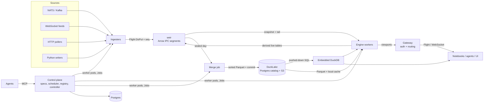

# Ursid architecture

Status: draft. This document is the design contract; nothing here is implemented yet.

Ursid is a cloud-native data platform where live and historical data share one table model.
A real-time incremental engine, a columnar ingest log, a Parquet lake, a job scheduler, a model
registry, a feature store, and an agent surface all sit on that model.

The name: the Ursids are a meteor shower radiating from Ursa Minor — a stream of events coming
from a bear.

## 1. Thesis

**A table is a timeline.** Every `namespace.table` has one schema and is reachable as:

- `db.live_table(ns, t)` — intraday, append-only, ticking.
- `db.historical_table(ns, t)` — merged days in the lake, static.
- `db.table(ns, t)` — both, routed by `Date`.

Everything else is a declarative object built on tables: feature views, models, jobs,
ingesters, deployments. The same expression that builds a training set from history runs
incrementally on live data; replaying history through the engine is a backtest.

## 2. Goals and non-goals

Goals

- Deephaven-style incremental engine with ticking tables and viewport subscriptions.
- kdb+/Deephaven-Enterprise-style data lifecycle: ingest → intraday store → daily merge → lake.
- Scheduled jobs and DAGs with retries, whose state is itself a live table.
- Model registry with models that plug directly into live graphs.
- Feature store with one definition for offline training and online serving.
- Agent-first: every resource is a typed spec with validate → plan → apply.
- Python SDK and Jupyter as the primary human surface.
- Multi-user from the start: OIDC login, namespace RBAC, per-user isolated worker pods.
- Schema changes as first-class, planned operations across live data, history, and dependents.
- Kubernetes-native: Helm install; the controller runs every worker as its own pod.
- Clean local start: `pip install ursid` or one static binary. No JVM, Docker, or Kubernetes
  required.

Non-goals (for now)

- Distributing one update graph across nodes. One deployment = one engine process; scale by
  sharding deployments.
- General incremental SQL (DBSP/differential dataflow). The engine supports a fixed operator set.
- A custom historical file format. History is Parquet.
- Web UI beyond catalog, table viewer, console, jobs, and models until notebooks and agents work
  end to end.

## 3. Prior art mapping

| kdb+ tick | Deephaven Enterprise | Ursid |
|---|---|---|
| Feedhandler | Logger / Kafka ingester | Ingester (connector) |
| Tickerplant + tplog | Data Import Server (DIS) | **weir** |
| RDB | Worker reading intraday | Engine worker, `db.live_table` |
| RTE / CEP, chained TP | Persistent query | Engine deployment publishing derived live tables back to weir |
| `.u.end` end-of-day writedown | Merge + validate | Daily merge job |
| HDB (splayed, date-partitioned, mmap) | Historical (DH format / Parquet) | Parquet in DuckLake, `db.historical_table` |
| Gateway | Query routing | `db.table` + query router |

Lessons taken from kdb+: keep the ingest hop dumb (append, log, publish — no queries); historical
speed comes from layout (sort by key within date, enumerated keys, parted attribute) more than
from file format.

## 4. Components

| Component | Name | Language | Role |
|---|---|---|---|
| Ingest server | weir | Rust | Accepts ingest protocol, writes Arrow IPC segments, serves snapshot + tail |
| Engine | falls | Rust (library + server) | Incremental update graph, expressions, inference, Flight server |
| Merge | — | Rust job | Daily intraday → sorted Parquet → DuckLake commit |
| Control plane | — | Rust | Spec API, scheduler, Kubernetes controller, registry, audit |
| Scheduler | run | Rust (in control plane) | Cron, DAGs, retries, leases |
| Model registry | den | Rust (in control plane) | Model versions, aliases, signatures |
| Feature store | forage | Rust + Python SDK | Feature views, point-in-time training sets, online state |
| Agent surface | ranger | Rust | MCP server over the spec API and query surface |
| Gateway | — | Rust | Single authenticated entry point; proxies Flight/WebSocket to worker pods |
| SDK | `ursid` | Python (+ PyO3 engine wheel) | Client, local engine, notebook widgets |



## 5. Data model

### 5.1 Tables and schemas

- A table is identified by `namespace.table`.
- Schemas are Arrow schemas with stable column IDs, versioned in the catalog. Live and historical
  share the schema history. Changes are planned operations (§5.4).
- Column partition: `Date` (UTC, string `YYYY-MM-DD`), assigned from **ingest time**, not event
  time. This makes a day's partition closable at a fixed wall-clock moment. Late events land in the
  partition of the day they arrived.
- Internal partition: one per ingest source (`source_id`). Each internal partition has exactly one
  writer.
- Event time is an optional designated column per table (`ts_column`), used by as-of joins,
  windows, and replay.

### 5.2 Table kinds

| Kind | Stored | Semantics |
|---|---|---|
| append | weir → lake | Default. Rows are never modified or removed. |
| blink | no | Only the current cycle's rows are visible; for high-rate transient signals. |
| derived | optional | Engine output. May be published back to weir as an append table. |

Mutable data (upserts, CDC, order books) is stored as an append log of changes. Current state is a
view: `live_table(...).last_by("key")`. Storage never mutates rows.

### 5.3 Access API

```python
db = us.connect().db

odds = db.live_table("sports", "odds")                    # unmerged intraday partitions, ticking
hist = db.historical_table("sports", "odds")              # merged dates, static
full = db.table("sports", "odds")                         # historical ∪ live, disjoint by Date
```

`db.live_table` contains every intraday partition not yet merged; callers usually filter
`.where("Date = today()")`. `db.table` partitions dates by catalog state: dates committed to the
lake come from history, the rest from weir. When a merge commits, the date moves from live to
historical at a cycle boundary; the rows are identical, so downstream sees no change.

### 5.4 Schema evolution

Schema changes are ordinary resource changes: validate → plan → apply (§10.2), from the SDK, CLI,
or an agent.

```python
plan = (us.schema.alter("sports.odds")
          .add("venue", us.string(), default=None)
          .rename("px", "price")
          .widen("size", us.int64()))
plan.show()     # change classes, affected dependents, rewrite cost
plan.apply()
```

Column identity

- Every column has a stable ID, carried as Arrow field metadata and Parquet `field_id`, and mapped
  to DuckLake column IDs. Names are labels; data is matched by ID everywhere.
- Renames are metadata-only. Old data never needs rewriting to change a name.

Change classes, determined by `plan`

| Change | Class | Effect |
|---|---|---|
| Add column (nullable or with default) | compatible | Applies mid-day. Older segments and files read as null/default. |
| Widen type (int32→int64, float32→float64, new enum value) | compatible | Cast on read. |
| Rename column | compatible | Metadata only. Dependents referencing the old name are rewritten in the same apply. |
| Drop column | contract | Hidden from reads immediately; stored data kept until an explicit purge job. |
| Incompatible type change, recomputed values | rewrite | Backfill DAG with one task per date: rewrite Parquet with a transform expression, commit each date atomically. Resumable. |
| Sort keys / layout | rewrite (optional) | Applies to future merges; backfill optional. |

Dependents

- `plan` walks lineage and lists every affected ingester, deployment, feature view, and model
  signature as unaffected, auto-migrated, or must-change.
- Apply is atomic across the table and its dependent specs. A change that would break a feature
  view or model signature is rejected unless the same plan updates it.

Live data

- A new schema version on a live table takes effect at a cycle boundary and opens new weir
  segments.
- weir accepts writes at any version compatible with the current one and projects them up by
  column ID (defaults, casts, dropped columns discarded). Producers and tables upgrade
  independently: expand → migrate producers → contract.
- Initial implementation restarts dependent deployments, which rebuild state from weir and
  history. Hot re-planning for compatible changes comes later.

History

- The schema change commits to DuckLake in the same transaction as the catalog version bump.
  Existing Parquet files are not touched; reads map them by column ID.
- Time travel to an older snapshot sees the older schema.
- Merge projects every version present in a date onto the table's current version (§8.2).

## 6. Ingestion

### 6.1 Ingest protocol

Arrow Flight `DoPut`.

- Flight descriptor: `{namespace, table, date, source_id, schema_version}`.
- Every record batch carries `app_metadata = {seq: u64}`. `seq` is strictly increasing per
  `(table, date, source_id)`.
- weir acknowledges on the `PutResult` stream with the highest `seq` that is durable (fsynced).
- weir drops batches with `seq <= last_acked`. Resent batches are harmless.
- On (re)connect the writer calls `GetFlightInfo` / an action `last_seq` and resumes the source from
  there. For log-structured sources (NATS JetStream, Kafka) the source offset is the `seq`, so
  connectors keep no state of their own.
- The descriptor's `schema_version` may be any version compatible with the table's current one;
  weir projects batches up by column ID (§5.4). Incompatible versions are rejected. A new version
  opens a new segment.

Fallback for lightweight producers: WebSocket (and HTTP POST) carrying Arrow IPC or JSON rows,
coerced to the table schema by weir, same `seq` semantics.

### 6.2 Ingesters

An ingester is a managed deployment that reads a source and speaks the ingest protocol.

```yaml
kind: Ingester
name: odds-nats
source: {type: nats, subject: "odds.>", durable: ursid-odds}
target: {namespace: sports, table: odds}
transform: python:juicebear.ingest:parse_odds   # optional; or a declarative column map
```

- Built-in Rust connectors: NATS JetStream, Kafka, WebSocket, HTTP poll, file drop.
- Python connectors use `us.ingest.writer(ns, table, source=...)`, the SDK equivalent of a
  Deephaven logger.
- Batch imports (CSV, API backfills) are ordinary jobs that write either through weir (live) or
  directly into the lake (historical, via the merge writer).

## 7. weir

### 7.1 Storage

```
/data/weir/{namespace}/{table}/{date}/{source_id}/
  seg-000042.arrow      sealed: Arrow IPC file (footer present), immutable
  seg-000042.idx        batch offsets, seq range, ingest-time range, row range
  seg-000043.arrows     open: Arrow IPC stream, append + fsync
  state.json            last_seq, schema_version, sealed flag for the day
```

- Open segments are Arrow IPC streams. Appends are fsynced before ack.
- A segment seals after N rows or N seconds: the file is rewritten/finalized with its footer and
  index so it can be memory-mapped.
- Crash recovery: read the open stream to the last complete batch, truncate the rest, restore
  `last_seq`.
- Row positions within an internal partition are stable (append-only), which maps onto add-only
  tables in the engine.
- Per-batch metadata (`seq`, ingest time) lives in the index, not in user columns. An
  `IngestTime` column can be materialized per table if requested.

### 7.2 Serving

- Subscribers are engine workers, not end users.
- Subscribe = snapshot (all sealed segments + open segment up to now) then tail (new batches as
  they are acked).
- Transport: Flight `DoGet` for sealed segments (engine caches them locally), Flight
  `DoExchange` for the tail.
- Co-located workers may memory-map sealed segments directly; this is an optimization only.

### 7.3 Day roll

At UTC midnight + a short grace window weir seals all open segments for `D` and rejects new
writes to `D`. Writers have already rolled to `D+1` because `date` comes from ingest time.

### 7.4 Durability

- Initial: single writer per internal partition on a Longhorn PVC (replicated block storage).
  weir is a StatefulSet.
- Later: copy sealed segments to S3 (rustfs) so node loss costs at most the open segment (§16).
- Retention: intraday partitions are deleted N days after their merge validates.

## 8. Historical store

### 8.1 Layout

Parquet files written by Ursid, cataloged in DuckLake (Postgres catalog on CNPG, data on rustfs).

```
s3://lake/{namespace}/{table}/Date={date}/part-0000.parquet
```

Per-table layout config, applied by the merge writer:

- Sort by `(key columns..., ts_column)` within the date — the analogue of kdb+'s `p#`.
- Dictionary-encode key columns — the analogue of kdb+'s `sym` enumeration.
- Row groups sized to align with key ranges; write the page index so readers skip by key and time.
- Compression: ZSTD.

### 8.2 Merge job

Daily, scheduled through the Ursid scheduler.

1. Wait until all internal partitions for `D` are sealed.
2. Read sealed segments, project every schema version present in `D` onto the table's current
   version by column ID (§5.4), sort per layout config, write Parquet.
3. Commit to DuckLake in one transaction, **replacing** partition `D` (idempotent re-runs).
   Registering pre-written files uses DuckLake's add-data-files path; confirm semantics against the
   deployed DuckLake version.
4. Validate: row counts per source match weir indexes.
5. Mark `D` merged in the catalog (flips `db.table` routing) and schedule intraday deletion.

### 8.3 Reading history

- Static queries (no live input) on `db.historical_table` compile to SQL and run in embedded
  DuckDB attached to DuckLake; results return as Arrow. Agent and human SQL over history goes
  straight to DuckDB.
- The engine reads Parquet itself (file list from the catalog, arrow-rs reader, local NVMe cache)
  only when it must: as-of joins between live and historical, replay, and warming state at
  startup.

## 9. Engine

### 9.1 Model

- Deephaven-style update graph. Execution proceeds in cycles; each cycle propagates deltas
  (added / removed / modified row sets, plus shifts) through operators in topological order.
- Data is held as Arrow chunks. Append-only sources produce only `added` deltas.
- One worker pod per deployment, ingester, or session (§15.3). No worker process is shared
  between users.
- The engine is a library first (Rust crate, PyO3 wheel for `us.local()`) and a server second
  (same crate plus Flight).

### 9.2 Operators (initial set)

`where`, `select` / `update` (expressions), `last_by`, `agg_by` (sum, count, mean, min, max,
first, last, std), `natural_join`, `as_of_join`, `rolling` (row- and time-based), `sort`
(snapshot-oriented), `merge` (union), `predict` (model inference).

Anything outside this set runs as static queries or as Python jobs.

### 9.3 Expressions

The Ursid expression language is the contract. It compiles to:

- DataFusion physical expressions for in-engine evaluation per chunk;
- DuckDB SQL for pushed-down historical queries.

A shared conformance corpus runs every expression through both and compares results. Raw SQL is a
separate surface that only targets DuckDB.

### 9.4 Clocks and replay

The engine is driven by an injectable clock.

- Real-time clock: cycles on a fixed period (default 100 ms) or on input, whichever comes first.
- Replay clock: feeds historical rows in `ts_column` order at a chosen speed (or as fast as
  possible). The same graph run under replay is a backtest.

Late data policy is per operator: windows declare allowed lateness; as-of joins use the current
state at cycle time.

### 9.5 Inference in the graph

`predict(model_ref)` evaluates once per cycle on the batch of changed rows.

- ONNX models run in-process via ONNX Runtime (`ort`). sklearn → ONNX via skl2onnx; torch via
  `torch.onnx.export`.
- Other flavors (arbitrary Python) run in a Python sidecar process fed Arrow IPC over a Unix socket,
  one round-trip per cycle. CPython is not embedded in the engine process.
- Aliases (`model@champion`) are watched; swaps happen atomically at a cycle boundary. Shadow mode
  evaluates two versions and emits both outputs.

### 9.6 Client subscriptions

- Flight `DoExchange` with a delta protocol modeled on Deephaven Barrage: Arrow record batches
  plus flatbuffer metadata describing row-set changes and viewport.
- Clients subscribe to a viewport (row range + columns); the server sends only that window.
- Browser transport: WebSocket carrying the same frames. WebTransport (HTTP/3) can replace it later
  behind the same frame format once browser and proxy support allow.

## 10. Control plane

### 10.1 Resources

Every resource is a typed spec (Rust types, JSON Schema generated from them):
`Table`, `Ingester`, `Deployment` (long-running engine graph), `Job`, `Dag`, `FeatureView`,
`Model`, `ModelVersion`, `Alias`, `WorkerClass`, `Environment`, `Repository`, `Secret` reference.

Specs are stored in Postgres. GitOps export (into the Argo CD repo) is a later addition; Postgres is
the source of truth.

### 10.2 validate → plan → apply

- `validate`: type-check the spec; infer output schemas using the engine's planner.
- `plan`: diff against current state; inferred schemas, sample rows (bounded), cost and
  cardinality estimates, affected downstream resources.
- `apply`: execute the plan; optional approval gate per caller role.

Humans (CLI, SDK) and agents use the same three calls.

### 10.3 Scheduler

- Triggers: cron, upstream completion (DAG edges), table events (e.g. "date `D` merged"), manual.
- Retries with backoff, timeouts, concurrency limits, catch-up policy.
- State in Postgres; workers claim tasks with leases (`SELECT ... FOR UPDATE SKIP LOCKED`).
- Executors: Kubernetes Job per task (arbitrary image) or a warm Python worker pool (low latency).
- Run state is published to weir as live tables: `sys.job_runs`, `sys.task_runs`, `sys.task_logs`.
  Observability is `db.live_table("sys", "job_runs")`.

```python
@us.job(schedule="0 6 * * *", retries=3, backoff="exp", timeout="30m")
def retrain(ctx): ...
```

### 10.4 System tables

`sys.job_runs`, `sys.task_runs`, `sys.task_logs`, `sys.deployments`, `sys.ingest_stats`,
`sys.audit`, `sys.lineage`, `sys.model_events`. All are ordinary live tables and merge to the lake
daily.

### 10.5 Worker configuration

Every deployment, ingester, job, and session declares the worker it runs on: code, Python
environment, and resources.

```yaml
kind: Deployment
name: odds-model
namespace: sports
code:
  repo: rcolclough/juicebear
  ref: main                 # resolved to a commit SHA at apply
  path: apps/sportsflow
  entrypoint: sportsflow.ursid:graph
  track: true               # a push to main produces a new plan
environment:
  from: code                # apps/sportsflow/uv.lock at that commit
  python: "3.13"
worker:
  class: medium             # admin-defined preset
  memory: 16Gi              # pod total
  engine_memory: 12Gi       # engine's own budget, kept below the container limit
  python_memory: 4Gi        # python sidecar container
  cpu: 4
  gpu: 0
  cache_disk: 50Gi
```

```python
s = us.connect().session(env="sportsflow@main", worker="medium", memory="8Gi")
```

- **Worker classes** are admin-defined presets (memory, CPU, GPU, node selector, priority, maximum
  overrides). Users pick a class and override within its limits and their quota.
- The engine enforces `engine_memory` itself (Arrow memory pool budget) and reports usage to
  `sys.deployments`, so it fails a query with an error instead of being OOM-killed.
- `plan` shows the resolved commit, the environment status (cached or build required), and the
  resources requested against quota.

### 10.6 Environments

An environment is an immutable, prebuilt Python environment. Nothing is installed when a worker
starts.

- Sources: `from: code` (the `pyproject.toml` + `uv.lock` in the code path at the resolved
  commit), or an inline dependency list, which the control plane resolves with uv into a lock
  stored with the `Environment` version.
- Identity: hash of `uv.lock`, `pyproject.toml`, Python version, Ursid version, and platform.
  Code changes that don't touch the lock reuse the existing environment.
- Build, at apply time and only on a cache miss: an unprivileged Kubernetes Job starts from the
  `ursid-python` base image, runs `uv sync --frozen --no-dev --no-install-project` into
  `/opt/ursid/env`, and pushes that directory as one OCI layer on top of the base (no Docker daemon,
  no privileged builder) to the Gitea OCI registry as `ursid-env:<hash>`.
- Workers reference the image by digest. The kubelet's image cache makes later starts on a node
  instant; an optional pre-pull DaemonSet warms environments marked hot.
- A failed build fails `apply`; it never fails a running worker.
- Sessions may `%pip install` into a scratch overlay for exploration. The session is then marked
  dirty and cannot be promoted to a deployment until the dependency is in a lock.
- Unreferenced environment images are garbage-collected, keeping the last N per environment.

### 10.7 Code from git

- A `Repository` registers a git remote (Gitea first), its credentials (secret reference), and a
  webhook secret. Credentials stay in the control plane; worker pods never hold them.
- `code.ref` (branch, tag, or SHA) resolves to a commit SHA at apply time. The control plane
  snapshots `code.path` at that SHA into object storage, content-addressed by SHA and path; the
  worker fetches it at start with a short-lived token and mounts it read-only.
- Every deployment, job run, and session records the SHA it ran (`sys.deployments`,
  `sys.task_runs`, `sys.audit`). Rollback = apply a previous SHA.
- `track: true`: a Gitea push webhook produces a new plan for the tracked ref, applied
  automatically or after approval per the resource's policy.
- Scheduled jobs resolve a tracked ref at trigger time and record the SHA per run.
- The project's own package is placed on `PYTHONPATH` from the snapshot, so a code-only change is
  a snapshot download, not an environment build.
- Agents change code through pull requests; deployments follow merged commits.

## 11. ML

### 11.1 Model registry (den)

A model version is:

- artifact URI (S3/rustfs);
- flavor: `onnx`, `sklearn`, `torch`, `python`;
- input/output Arrow schemas (signature);
- feature-view references and versions;
- link to an MLflow run (MLflow stays as experiment tracking).

Aliases (`champion`, `challenger`) are pointers to versions. Alias changes are events in
`sys.model_events`.

### 11.2 Feature store (forage)

A feature view is a keyed, timestamped table expression.

```python
@us.feature_view(entity="player_id", ts="ts")
def form(games):
    return (games.rolling(by="player_id", rows=10)
                 .agg(pts_avg=us.mean("pts"), mins_avg=us.mean("mins")))
```

- Offline: `us.training_set(labels, features=[...], ts=...)` evaluates the view over
  `db.historical_table` and performs a point-in-time-correct as-of join. Large training sets push
  down to DuckDB.
- Online: the same view runs incrementally on `db.live_table`; online state is
  `last_by(entity)` in engine memory. No separate online store.
- Served-feature logging: deployments publish the exact features and predictions they served back
  to weir as live tables. These merge into history and become training data that matches serving.

## 12. Agent surface (ranger)

MCP server over the control plane and query surface.

- Catalog: search namespaces/tables, describe schema, sample rows, lineage.
- Query: bounded static queries (DuckDB) and bounded live snapshots.
- Resources: validate / plan / apply for every resource kind; job logs; retry; model comparison.
- Sandboxes: agent sessions run in their own engine processes with memory, CPU, and time quotas;
  writes go to scratch namespaces unless the role allows otherwise.
- Agents act with a delegated, optionally narrowed token from their user (§13); they never exceed
  the user's grants.
- Every agent action is recorded in `sys.audit`.
- Errors are structured (code, location, fix hint) so agents can repair specs without guessing.

## 13. Identity and access

Multi-user within one organization first; separate tenants later.

Identity

- Any OIDC provider; Dex in the reference deployment.
- Browser and hosted notebooks: authorization code + PKCE. CLI and SDK: device authorization flow
  (`us.login()`), token cached in the OS keychain.
- The control plane exchanges the OIDC ID token for a short-lived Ursid access token (JWT,
  refreshable) carrying subject, groups, and scopes. weir, the gateway, and workers verify it
  against the control plane's JWKS; nothing calls the OIDC provider on the request path.

Workload identity

- Every worker and job pod runs under its own Kubernetes ServiceAccount. The pod's projected
  ServiceAccount token (audience `ursid`) is exchanged at the control plane for an Ursid token
  scoped to the resource's owner and grants. No long-lived credentials in pods.

Authorization

- RBAC per namespace. Roles: `viewer` (read tables), `writer` (ingest, publish derived tables),
  `editor` (create and modify resources), `admin` (schema changes, grants, purges).
- Bindings map users or OIDC groups to roles.
- Resources have owners and run with the owner's grants, re-checked at every (re)start.
- `sys.*` rows are filtered to namespaces the caller can view.

Enforcement points: control plane (spec operations), gateway (which workers a caller may reach),
weir (per-table writes; reads by workers only), workers (table opens checked against the worker's
token).

Isolation and quotas

- Each session is its own pod; per-user quotas on memory, CPU, concurrent sessions, and idle time.
- `sys.audit` records subject and actor separately (user vs agent acting for the user).

Later: row filters, column masking, multiple tenants (tenant-scoped namespaces and Kubernetes
namespaces).

## 14. Clients

### 14.1 Python SDK and notebooks

- `us.connect()` — remote cluster; `us.local()` — in-process engine from the same Rust crate.
- Tables convert to pyarrow, pandas, and polars without copying where possible.
- Ticking tables render in Jupyter via an anywidget-based widget subscribed to a viewport.
- Decorators: `@us.job`, `@us.feature_view`; registry: `us.models.register(...)`; ingest:
  `us.ingest.writer(...)`.

### 14.2 Web UI

- React + TypeScript, Vite, Bun (package manager, scripts, tests), shadcn/ui on Tailwind CSS,
  lucide icons, React Router — juicebear's web baseline plus shadcn.
- `@ursid/client`: TypeScript package speaking the delta protocol over WebSocket and decoding Arrow
  IPC with `apache-arrow`. Used by the UI and any other TypeScript consumer.
- Ticking tables: viewport subscription rendered with TanStack Virtual; updates applied once per
  animation frame; only visible rows are in the DOM. A canvas grid is an optimization to adopt only
  if profiling demands it. Static lists (catalog, jobs, models) use TanStack Table with shadcn
  table components.
- Auth: OIDC authorization code + PKCE (`oidc-client-ts`). Local mode skips login.
- The production build is embedded in the `ursid` binary and served by the gateway, so local mode
  and the cluster serve the same UI with no separate web server.
- v1 surfaces: catalog (schemas, versions, lineage), live and historical table viewer, console
  (expression editor on CodeMirror 6), job runs and logs (live from `sys.*`), models and aliases,
  agent chat backed by ranger.

## 15. Runtime and deployment

Every server role (control plane, gateway, weir, worker) is a subcommand of one Rust binary,
`ursid`. Two runtimes host it: Kubernetes (§15.1–15.5) and local (§15.6).

### 15.1 Packaging

- Helm chart `ursid` in this repo (`deploy/helm/ursid`), published to the Gitea OCI registry,
  as one `ursid` image (all server roles) plus `ursid-python` for Python sidecars and jobs.
- The Argo CD repo consumes it like other upstream charts (values in
  `components/ursid/helm/values.yaml`); Kargo promotes chart versions.
- The chart installs: CRDs, `ursid-control`, `ursid-gateway`, weir, ServiceAccounts and RBAC,
  config. It does not contain workers, ingesters, or jobs; the controller creates those at runtime.
- External dependencies are values: Postgres (existing CNPG cluster or connection secret; the
  chart can optionally render a CNPG `Cluster`), S3 endpoint and bucket (rustfs), DuckLake catalog,
  OIDC issuer.

### 15.2 Controller

- `ursid control` runs API, scheduler, reconciler, and ranger. It runs with several
  replicas; scheduler and reconciler loops use leader election via a Kubernetes `Lease`, and every
  replica serves the API.
- Two layers of state:
  - **Intent** in Postgres: specs, versions, owners, run history, audit. Written by
    validate → plan → apply.
  - **Runtime** in Kubernetes: custom resources the controller writes from intent and reconciles
    into native objects. `kubectl get ursidworkers` shows what is running.
- Status flows back: the controller watches Pods and Jobs and writes status to the custom
  resource and to `sys.deployments` / `sys.task_runs`.
- Owner references garbage-collect everything a worker created.

| Runtime object | Created for | Reconciled into |
|---|---|---|
| `UrsidWorker` (CRD) | deployment, ingester, session | StatefulSet (1 replica) or Pod, Service, ServiceAccount |
| `batch/v1` Job | scheduled task attempt | created directly by the scheduler; history in Postgres |

### 15.3 Worker pods

- One worker = one pod. Containers: `engine` (image `ursid:<version>`, Flight server) and an
  optional `python` sidecar (image `ursid-env:<hash>`, §10.6) for Python model flavors, UDFs, and
  user code, connected by a Unix socket on a shared `emptyDir`. Each container gets its own memory
  limit from the worker spec (§10.5).
- An init container fetches the code snapshot (§10.7) into a read-only volume.
- Deployments and ingesters: StatefulSet with one replica. This guarantees at most one pod per
  identity (no rollout overlap double-publishing derived tables), stable DNS, and a PVC for the
  segment/Parquet cache. Restarts rebuild state from weir and history.
- Sessions: bare Pod, `restartPolicy: Never`, reaped after the idle timeout; resources from the
  session request within the user's quota.
- Jobs: one `batch/v1` Job per task attempt with `backoffLimit: 0`; the Ursid scheduler owns
  retries so every attempt is a row in `sys.task_runs`.
- User Python always comes from a prebuilt environment image (§10.6); nothing is installed at pod
  start.
- Scheduling: requests/limits from the spec; node selectors and tolerations pass through. Priority
  classes: deployments > ingesters > jobs > sessions.

### 15.4 Gateway

- Clients never address worker pods directly. `ursid-gateway` terminates TLS, verifies tokens,
  checks the caller may reach the target worker, and proxies Flight (gRPC) and WebSocket to it,
  routed by `x-ursid-worker` metadata or URL path.
- One Gateway API `HTTPRoute` exposes the whole platform.

### 15.5 Reference deployment

| Workload | Kind | Storage / dependency |
|---|---|---|
| weir | StatefulSet (chart) | Longhorn PVC |
| ursid-control | Deployment, 2+ replicas (chart) | Postgres (CNPG) |
| ursid-gateway | Deployment (chart) | — |
| Workers | `UrsidWorker` → StatefulSet / Pod (controller) | PVC cache for deployments |
| Merge, jobs | `batch/v1` Job (scheduler) | rustfs, DuckLake catalog |
| Lake | existing DuckLake component | CNPG catalog + rustfs |

Telemetry: OpenTelemetry traces to Tempo, logs to Loki, metrics to Prometheus; platform state stays
in `sys.*` tables.

### 15.6 Local mode

No JVM, Docker, or Kubernetes.

| Entry point | What runs | Use |
|---|---|---|
| `us.local()` | Engine inside the Python process (PyO3) | Notebooks, tests, experiments |
| `ursid dev` | One supervisor process: control plane, gateway + UI, weir, workers as child processes | Full platform on a laptop |
| Kubernetes | Same binary, one role per pod | Cluster |

- Install: `pip install ursid` installs the SDK and in-process engine, and pulls the `ursid-cli`
  wheel that carries the native `ursid` binary (§18.1). A standalone binary is also published.
- `ursid dev` keeps state in `./.ursid/` (or `--data-dir`): weir segments on local disk; the lake
  is DuckLake with a SQLite catalog file (multi-process safe, unlike a DuckDB catalog file) and
  local Parquet; control-plane state in SQLite; a single implicit user, OIDC optional.
- Workers are `ursid worker` child processes; Python sidecars are child processes using the
  environment built by uv into `.ursid/envs/<hash>` (same hash as §10.6, built once, then reused).
  Code comes from the local working tree or a git ref. Same protocols as pods, so behaviour
  matches the cluster.
- The controller has a runtime trait (`Local`: child processes; `Kubernetes`: `UrsidWorker`) and a
  storage trait (SQLite, Postgres) with one conformance suite run against both.
- `us.connect()` with no arguments targets a running `ursid dev`, otherwise `URSID_URL`.
- Startup targets: `us.local()` under 100 ms; `ursid dev` ready under 1 s.

## 16. Scaling and high availability

Not built initially: one weir, restart-based recovery. These invariants are built from M1 so that
sharding and HA are additive later instead of a redesign.

| Invariant | Enables |
|---|---|
| Clients resolve endpoints per internal partition via Flight `GetFlightInfo`; no client hardcodes a weir address | Moving partitions between weir shards without client changes |
| Placement unit is the internal partition `(table, date, source_id)`; weir never coordinates across partitions | Spreading partitions over any number of shards |
| Each partition's owner holds an epoch (fencing token) from the control plane; segments and acks record it; stale-epoch writes are rejected | Failover without split-brain |
| Sealed segments are immutable and self-describing (schema version, seq range, row range, epoch) | Serving them from any node or from S3 |
| Subscriptions resume by `(partition, row position)` | Readers reconnecting to a different weir mid-stream |
| Derived publications record the input positions they cover | Restarted workers resuming output without duplicates |
| Control plane and gateway hold no local state | Horizontal replicas behind leader election |

Ingesters declare whether their source is replayable (NATS JetStream, Kafka, files) or not (raw
WebSocket feeds). Replayable sources recover losslessly from weir's `last_seq` after any weir
failure; `plan` warns when a non-replayable source has no replicated ack.

| Component | Initial behaviour on failure | Later |
|---|---|---|
| weir | Single StatefulSet on a Longhorn-replicated volume; pod reschedules and volume reattaches (minutes); writers buffer and resume from `last_seq` | Shards via a placement map in Postgres; sealed segments copied to S3; `ack: replicated` (primary + follower for open segments) |
| Ingesters | Restart; replayable sources lose nothing; non-replayable sources lose the outage window | Replicated ack; standby ingester |
| Engine deployments | Restart and rebuild from weir and history; recovery time = rebuild time | State checkpoints; hot standby with input-driven (deterministic) cycles |
| Sessions | Lost with the pod | — |
| Control plane, gateway | 2+ replicas | — |
| Postgres, lake | CNPG replicas; rustfs | — |

## 17. Technology choices

| Concern | Choice |
|---|---|
| Engine, weir, control plane | Rust |
| Columnar memory | arrow-rs; one major version across the workspace, pinned to DataFusion's. Crates on another major (e.g. `duckdb`) exchange data through the Arrow C Data Interface |
| Expressions / planning | DataFusion |
| RPC | arrow-flight (tonic, HTTP/2) |
| Lake catalog and batch SQL | DuckDB + DuckLake |
| Parquet | `parquet` crate (writer and engine reads) |
| Inference | ONNX Runtime via `ort`; Python sidecar for other flavors |
| Kubernetes | kube-rs |
| Control-plane DB | Postgres via sqlx |
| Python bindings | PyO3 (abi3), `pyo3-arrow` (Arrow PyCapsule interface), maturin, uv workspace |
| Notebook widget | anywidget |
| Auth | OIDC (`openidconnect`), JWT (`jsonwebtoken`) |
| Packaging | Helm chart, OCI registry on Gitea |
| Web UI | React, TypeScript, Vite, Bun, shadcn/ui, Tailwind CSS, React Router |
| Browser data | `apache-arrow` (JS), TanStack Virtual, TanStack Table, CodeMirror 6 |
| Local-mode storage | SQLite (control plane, DuckLake catalog) |

## 18. Planned repository layout

```
Cargo.toml        Cargo workspace; shared versions in [workspace.dependencies]
pyproject.toml    `ursid` Python package (maturin, builds crates/ursid-py) and uv workspace root
uv.lock
crates/
  ursid-core      Arrow tables, row sets, update graph, clocks
  ursid-ops       operators
  ursid-expr      expression language → DataFusion / DuckDB SQL
  ursid-flight    Flight server, delta protocol
  ursid-weir      ingest server and segment store
  ursid-lake      DuckLake catalog, Parquet writer, merge
  ursid-control   spec API, scheduler, registry, MCP
  ursid-gateway   authenticated Flight/WebSocket proxy
  ursid-cli       the `ursid` binary (dev, control, gateway, weir, worker); its pyproject.toml
                  builds the `ursid-cli` wheel
  ursid-py        PyO3 extension module `ursid._native`
python/ursid      SDK, widgets, decorators (pure Python over `ursid._native`)
web/app           React UI (Bun workspace)
web/client        @ursid/client TypeScript package
deploy/helm/ursid Helm chart: CRDs, control plane, gateway, weir
docs/
```

### 18.1 Python packaging

Verified against maturin 1.16, PyO3 0.30, and uv workspaces.

- Two wheels from one repository: `ursid` (SDK + `ursid._native`) depends on `ursid-cli`
  (`bindings = "bin"`). maturin does not package a `[[bin]]` target into a PyO3 wheel; the split
  keeps the CLI a native process with no interpreter in worker processes, identical to the binary
  in the container image.
- Root `pyproject.toml`: `[tool.maturin]` with `manifest-path = "crates/ursid-py/Cargo.toml"`,
  `module-name = "ursid._native"`, `python-source = "python"`; `[tool.uv.workspace]` with
  `members = ["crates/ursid-cli"]`; `ursid-cli = { workspace = true }` in `[tool.uv.sources]`.
- Both pyproject files set `tool.uv.cache-keys` to cover the workspace `Cargo.toml`, `Cargo.lock`,
  and every crate's `*.rs` and `Cargo.toml` (parent-relative globs from `crates/ursid-cli`), so
  `uv sync` / `uv run` rebuild after any Rust change. Without this, uv only rebuilds when a
  package's own `pyproject.toml` changes.
- PyO3 without the `extension-module` feature (maturin sets `PYO3_BUILD_EXTENSION_MODULE`), so
  `cargo test` links normally; `crate-type = ["cdylib", "rlib"]`; declarative
  `#[pymodule] mod _native`.
- ABI: `abi3-py312`, one wheel per platform for GIL-enabled CPython. Free-threaded 3.14t needs a
  version-specific wheel; `abi3t` (PEP 803) covers both builds from CPython 3.15.
- Arrow crosses the boundary through `pyo3-arrow` (Arrow PyCapsule interface): zero-copy to
  pyarrow, polars, arro3, nanoarrow, with no hard pyarrow dependency.
- Editable builds use a `dev-py` Cargo profile (release optimisation, no LTO, incremental) through
  maturin's `editable-profile`; published wheels use `release`.
- Type stubs for `_native` are hand-written until maturin's `--generate-stubs` (PyO3
  `experimental-inspect`) is stable.

## 19. Roadmap

| Milestone | Deliverable | Toy example |
|---|---|---|
| M0 | Engine crate: chunks, update graph, initial operators, expressions; PyO3 wheel; notebook widget | Random-walk ticker → rolling mean/vol, live in Jupyter |
| M1 | weir (DoPut, segments, seq dedup, epochs, snapshot + tail); `db.live_table`; WebSocket connector; `ursid dev`; Helm chart (weir + engine) | Synthetic ticker over WebSocket → weir → engine, on a laptop and in the cluster |
| M2 | Merge job, DuckLake commit, `db.historical_table`, `db.table`, DuckDB pushdown, replay clock; column IDs and compatible schema changes | Ticker merged nightly, replayed as a backtest; add a column mid-day |
| M3 | Control plane: specs, validate/plan/apply, scheduler, `sys.*` tables, ranger MCP; OIDC, RBAC, `UrsidWorker` controller, gateway; worker classes, prebuilt environments, git code sources; schema plans with dependents and rewrites; web UI v1 | Two users, each with their own sessions; a DAG deployed from a git ref with its own environment; retries visible live in the UI |
| M4 | den: register sklearn LinearRegression → ONNX → `predict`; torch MLP; aliases, shadow mode | Live prediction; swap champion without restart |
| M5 | forage: feature views, training sets, online `last_by`, served-feature logging | Toy sportsbook: simulated games + odds → form features → live win probability vs implied odds |
| M6 | Port juicebear sportsflow features and models | Real data |

## 20. Open questions

1. Latency target per event (assumed 100 ms–1 s cycles).
2. Peak rows/sec and live state size for juicebear — validates single-process deployments.
3. Derived-state checkpointing: replay from start of day vs periodic engine snapshots.
4. weir placement policy once sharded: hashing vs explicit assignment (deferred; §16 keeps it
   additive).

## 21. Risks

- **Engine scope.** A general Deephaven-class engine is years of work; hold the operator set fixed
  until M5.
- **Event vs processing time.** Replay correctness depends on the injectable clock and explicit
  lateness rules from M0.
- **Python in the hot path.** Batch-per-cycle is mandatory for Python inference and UDFs.
- **Two SQL dialects.** Mitigated by the expression language and conformance corpus (§9.3).
- **Arrow version skew.** DataFusion, `duckdb`, `arrow-flight`, and `pyo3-arrow` each pin an
  arrow-rs major and release on different cadences. One workspace major (DataFusion's), a
  duplicate-version ban in `cargo deny`, and C Data Interface bridging for any outlier.
- **Single weir.** Node loss stalls ingest until the volume reattaches; non-replayable sources lose
  that window. Accepted initially; §16 invariants keep sharding and replication additive.
- **Two control-plane stores.** SQLite (local) and Postgres (cluster) can diverge; one conformance
  suite runs against both, and the storage trait stays narrow.
- **Rewrite cost.** Incompatible schema changes on long histories are expensive; `plan` must show
  partitions and bytes to rewrite, and the backfill must be resumable per date.
- **Two state layers.** Postgres intent and Kubernetes runtime objects can drift; the reconciler
  treats Postgres as truth and recreates or deletes runtime objects to match.
